# PRD: Glideslope — pencatat keuangan pribadi: runway dana sampai lulus, tangkapan email otomatis, aset, scan nota, dan bagi tagihan

> **Catatan untuk AI agent.** Dokumen ini adalah sumber kebenaran untuk apa yang harus dibangun.
> 1. Sebelum menulis kode: tulis ringkasan singkat PRD ini dan daftar asumsi `(asumsi)` yang kamu pakai, lalu langsung mulai membangun seluruh aplikasi dalam satu sesi. Jangan menunggu konfirmasi.
> 2. Jika ada yang ambigu atau bertentangan, pakai default yang tertulis di Pertanyaan Terbuka (OQ-n). Jangan menebak sendiri dan jangan menambah fitur di luar daftar.
> 3. Kerjakan seluruh fase pada bagian Rencana fase build secara berurutan. Di akhir tiap fase: jalankan tes, centang kriteria penerimaan yang sudah terverifikasi di dokumen ini, pastikan aplikasi bisa dijalankan, lalu langsung lanjut ke fase berikutnya.
> 4. Berhenti hanya bila tes gagal dan tidak teratasi setelah dua kali perbaikan, atau bila butuh rahasia atau akun yang tidak kamu punya. Selesaikan sisanya dulu, lalu laporkan.
> 5. Patuhi `[FIXED]`, bagian Non-goals, dan bagian Batasan untuk agent. Jika keputusan berubah, perbarui dokumen ini lebih dulu sebelum kode.
> 6. Diagram hanyalah ringkasan visual. Jika diagram berbeda dengan tabel (kamus entitas, tabel transisi, tabel endpoint), tabel yang berlaku.
> 7. Di akhir, laporkan: apa yang selesai, kriteria yang belum terpenuhi beserta sebabnya, asumsi yang dipakai, dan cara menjalankan aplikasi.
> 8. Folder `design/` di samping dokumen ini berisi tangkapan layar referensi (`m-beranda.png`, `m-inbox.png`, `m-tambah.png`, `m-aset.png`, `d-beranda.png`, `d-inbox.png`, `d-aset.png`). Gunakan sebagai acuan tata letak untuk layar S-04, S-05, S-06, dan S-11. Bila tangkapan layar berbeda dari token atau aturan di bagian 4, bagian 4 yang berlaku. Angka pada tangkapan layar adalah data contoh.

| Field | Isi |
|---|---|
| Versi | 0.1 |
| Status | Draft |
| Pemilik | Pemilik produk (pengguna tunggal) |
| Mode | App |
| Terakhir diperbarui | 2026-11-02 |
| Bahasa dokumen | Indonesia |

## 1. Perencanaan

### 1.1 Ringkasan
Aplikasi web (PWA) pribadi untuk satu orang: menjawab "apakah dana saya cukup sampai lulus?" lewat proyeksi runway, sambil mencatat pengeluaran secara otomatis dari email bank dan merchant (Gmail), dari input manual, dan dari scan nota. Aplikasi juga memantau saldo rekening, e-wallet, dan aset (deposito, reksa dana, emas), serta membantu membagi tagihan dan melacak piutang ke teman. Tampilannya mengikuti gaya Copilot Money dalam versi mobile dan desktop.

### 1.2 Masalah dan konteks
Pemilik membiayai seluruh biaya hidup dari satu dana terbatas yang harus bertahan sampai lulus kuliah, tanpa pemasukan tetap. Uang itu tersebar di beberapa rekening, e-wallet, dan aset berjangka. Pencatatan manual tidak bertahan lama karena melelahkan, sedangkan aplikasi keuangan umum mengasumsikan gaji bulanan sehingga angka anggarannya tidak menjawab pertanyaan utama: sampai kapan dana ini cukup.

Notifikasi transaksi sudah ada di email (struk bank dan merchant) tetapi tersebar dan tidak pernah dirangkum. Pengeluaran bersama teman (makan bersama, patungan) menimbulkan piutang yang mudah terlupa. Akibatnya pemilik tidak punya satu angka yang dipercaya tentang sisa dana, laju pemakaian, dan tanggal habis.

### 1.3 Pengguna dan skenario
| Persona | Situasi | Tujuan (job to be done) |
|---|---|---|
| Pemilik (satu-satunya pengguna sistem) | Mahasiswa, memakai HP Android atau iPhone (OQ-4) dan laptop, membuka aplikasi beberapa kali sehari | Tahu dalam 5 detik apakah dana cukup sampai lulus; tidak mencatat manual untuk transaksi yang sudah ada di email; meninjau sisa transaksi ambigu dalam 2 menit per hari |
| Teman penerima tagihan (bukan pengguna sistem) | Ikut makan bersama pemilik, menerima pesan WhatsApp berisi bagiannya | Melihat jumlah dan rincian bagiannya dengan jelas lalu mentransfer |

### 1.4 Tujuan dan metrik keberhasilan
| ID | Tujuan | Metrik | Baseline | Target | Diukur dengan | Jangka waktu |
|---|---|---|---|---|---|---|
| G-1 | Transaksi dari pengirim email yang diizinkan tercatat tanpa input manual | Persentase transaksi email yang masuk ke daftar transaksi atau Inbox dalam 10 menit setelah email tiba | 0% (belum ada sistem) | ≥ 90% | Perbandingan dengan statement bulanan dan log INGEST_EVENT | 30 hari setelah email terhubung |
| G-2 | Beban peninjauan harian kecil | Jumlah item Inbox baru per hari; waktu menyelesaikan Inbox | Belum ada (produk baru) | ≤ 5 item per hari dan ≤ 2 menit per hari setelah 30 hari | Hitungan item dan stempel waktu aksi di Inbox | 30 hari |
| G-3 | Saldo di aplikasi dapat dipercaya | Selisih saldo terhitung terhadap saldo akhir bulan di statement atau aplikasi bank | Belum ada (produk baru) | ≤ Rp 10.000 per akun per bulan pada ≥ 90% akun-bulan | Titik cek saldo (F-11.1) | 3 bulan |
| G-4 | Status runway terbaca seketika | Hero runway terlihat tanpa menggulir pada layar 360 × 780 px dan LCP Beranda | Belum ada (produk baru) | Terlihat tanpa gulir; LCP ≤ 2,5 detik pada 4G terlambat dan CPU diperlambat 4× | Lighthouse dan uji Playwright | Setiap rilis |
| G-5 | Biaya infrastruktur nol | Biaya bulanan layanan; panggilan LLM per hari | Belum ada (produk baru) | Rp 0 pada paket gratis; ≤ 200 panggilan LLM per hari | Dasbor penyedia dan tabel LLM_JOB | Berkelanjutan |

Counter-metrik (hal yang tidak boleh memburuk): persentase transaksi berstatus auto_confirmed yang kategorinya diubah pemilik setelahnya harus tetap ≤ 5%; bila lebih, ambang auto-konfirmasi diperketat.

### 1.5 Non-goals
Hal yang sengaja **tidak** dikerjakan di versi ini.
- Versi ini tidak menyediakan banyak pengguna, berbagi akun, peran keluarga, atau pendaftaran publik; hanya satu akun pemilik.
- Versi ini tidak terhubung langsung ke bank atau e-wallet lewat agregator atau open banking, dan tidak menyimpan kredensial bank atau e-wallet.
- Versi ini tidak memindahkan uang: tidak ada pembayaran, transfer nyata, QRIS dinamis, atau pengiriman WhatsApp otomatis; pesan penagihan hanya dibuka lewat tautan `wa.me` untuk dikirim manual.
- Versi ini tidak memberi saran investasi, rekomendasi beli atau jual, atau proyeksi imbal hasil aset; aplikasi hanya menampilkan fakta dan proyeksi dari angka yang diisi pemilik.
- Versi ini tidak mengambil harga pasar otomatis (saham, NAV reksa dana, emas); semua harga aset diisi manual.
- Versi ini tidak menyertakan aplikasi native Android atau iOS pendamping; jalur notifikasi HP hanya lewat endpoint webhook (F-12.1).
- Versi ini hanya mendukung mata uang rupiah (IDR) dan zona waktu Asia/Jakarta.
- Versi ini tidak membaca email di luar daftar pengirim yang diizinkan, dan tidak menyimpan isi email mentah yang belum diredaksi.
- Versi ini tidak memuat chatbot atau penasihat keuangan berbasis AI; LLM hanya dipakai untuk tugas ekstraksi dan klasifikasi di bagian 8.
- Versi ini tidak menghasilkan laporan pajak atau pembukuan akuntansi.

### 1.6 Batasan, asumsi, dan dependensi
**Keputusan yang diambil saat menyusun dokumen** (pemilik tidak bisa ditanya saat penyusunan)
- Pohon fitur di 1.7 disusun dari hasil diskusi perencanaan; pemilik diminta mengoreksinya setelah menerima dokumen ini. Selama belum dikoreksi, pohon ini berlaku.
- Data pribadi pemilik (nama, nominal dana asli, alamat pengirim email asli) tidak ditulis di dokumen ini; semua angka di dokumen adalah data contoh untuk seed dan pengujian.

**Keputusan tetap** (sebutkan sumbernya)
- `[FIXED]` Aplikasi dipakai satu orang saja — pernyataan pemilik.
- `[FIXED]` Tangkapan transaksi dari email harus otomatis penuh tanpa langkah manual harian — pernyataan pemilik ("sangat butuh").
- `[FIXED]` Arsitektur serverless: frontend di Vercel (paket Hobby, khusus non-komersial pribadi) dan tanpa VPS; backend dikembangkan lokal lebih dulu — pernyataan pemilik; batas Hobby dari dokumentasi Vercel.
- `[FIXED]` Tampilan mengikuti Copilot Money, dengan versi mobile dan desktop yang masing-masing disesuaikan — pernyataan pemilik; hasil rancangan ada di `design/`.
- `[FIXED]` Pemasukan dicatat lewat menu Tambah dan tidak punya bagian di Beranda — pernyataan pemilik (pemasukan tidak tetap).
- `[FIXED]` Anggaran berbasis periode sampai tanggal lulus, bukan siklus bulanan — pernyataan pemilik (tidak ada pemasukan tetap).
- `[FIXED]` Fitur LLM memakai endpoint kompatibel OpenAI milik pemilik (9router, bawaan `http://localhost:20128/v1`) — pernyataan pemilik; 9router adalah proxy sumber terbuka yang berjalan lokal.
- `[FIXED]` Semua uang disimpan sebagai bilangan bulat rupiah (tanpa desimal) dan semua waktu disimpan dalam UTC — standar kebenaran data; tampilan memakai Asia/Jakarta.

**Asumsi** (tebakan yang belum dikonfirmasi)
- (asumsi) Gmail dibaca lewat Gmail API dengan scope `gmail.readonly`, dengan aplikasi OAuth berstatus "In production" tanpa verifikasi Google (pemakaian pribadi; layar peringatan diklik sekali). Alasan: status Testing membuat refresh token kedaluwarsa tiap 7 hari. Belum diuji oleh penyusun; PH-4 memuat langkah uji oleh pemilik dan jalur cadangan di R-2.
- (asumsi) Next.js 16 dengan App Router (stabil sejak 2026; Node.js ≥ 20.9), React 19, TypeScript ketat, Tailwind CSS. Alasan: pilihan arus utama dengan dukungan agent terbaik.
- (asumsi) Supabase (Postgres, Auth, Storage, Vault, Edge Functions, pg_cron, pg_net) sebagai backend; pengembangan lokal memakai Supabase CLI dan Docker. Alasan: satu platform untuk semua kebutuhan backend pada paket gratis.
- (asumsi) Ponsel pemilik berupa Android dengan Chrome; fitur yang butuh Chrome Android (share target) masuk Could. Lihat OQ-4.
- (asumsi) Pengeluaran rutin setelah lulus diproyeksikan sama dengan rata-rata saat ini.
- (asumsi) Ambang nominal besar untuk peninjauan wajib adalah Rp 500.000 (OQ-6).
- [FIXED] Nama aplikasi: **Glideslope** (diputuskan pemilik produk, 2026-11-02). Logo belum ada; dipakai wordmark teks dari konstanta `APP_NAME` (OQ-1).

**Dependensi** (layanan, tim, atau keputusan luar yang dibutuhkan)
- Akun Google dengan Gmail milik pemilik, dan proyek Google Cloud untuk kredensial OAuth (disiapkan pemilik; langkahnya ada di README yang ditulis agent).
- Docker Desktop atau runtime kompatibel, Supabase CLI, dan Node.js LTS di komputer pemilik.
- 9router yang berjalan di komputer pemilik, dengan setidaknya satu model teks dan satu model vision.
- Contoh email asli per pengirim untuk memverifikasi parser (OQ-2); sebelum tersedia, parser diuji dengan fixture sintetis.
- Akun Supabase dan Vercel milik pemilik untuk tahap penerapan produksi (di luar sesi build lokal).

### 1.7 Peta fitur
Pohon fitur dan sub fitur. Setiap ID di sini punya bagian detail di bagian 2, dan sebaliknya.
- F-01 Akses, keamanan, dan pengaturan awal [Must]
  - F-01.1 Masuk satu pengguna dengan MFA
  - F-01.2 Kunci aplikasi dengan PIN
  - F-01.3 Pengaturan inti dan onboarding
- F-02 Akun dan saldo [Must]
  - F-02.1 Kelola akun (bank, e-wallet, tunai)
  - F-02.2 Saldo terhitung dan sumber saldo
  - F-02.3 Kartu akun
- F-03 Pencatatan manual [Must]
  - F-03.1 Catat pengeluaran dengan numpad
  - F-03.2 Catat pemasukan lewat menu Tambah
  - F-03.3 Transfer antar akun dan biaya admin
  - F-03.4 Daftar, detail, ubah, dan hapus transaksi
  - F-03.5 Kategori dan memori merchant
- F-04 Tangkapan email otomatis [Must]
  - F-04.1 Hubungkan Gmail
  - F-04.2 Polling, dedupe, dan pencocokan lintas sumber
  - F-04.3 Parser deterministik per pengirim
  - F-04.4 Pembacaan cadangan dengan LLM
  - F-04.5 Halaman Sumber email
  - F-04.6 Impor riwayat awal 90 hari
- F-05 Inbox peninjauan [Must]
  - F-05.1 Penilaian kepercayaan dan antrean
  - F-05.2 Aksi peninjauan
  - F-05.3 Deteksi transfer internal
  - F-05.4 Aturan peninjauan dan ambang nominal besar
- F-06 Runway dan Beranda [Must]
  - F-06.1 Mesin runway dan angka aman per hari
  - F-06.2 Pengeluaran terjadwal
  - F-06.3 Hero Beranda dan pilihan tampilan per bulan
  - F-06.4 Ringkasan Beranda
- F-07 Aset dan portofolio [Must]
  - F-07.1 Kelola aset dan harga manual
  - F-07.2 Tangga likuiditas
  - F-07.3 Jatuh tempo deposito dan pencairan
  - F-07.4 Perubahan dana bulan ini
- F-08 Analitik [Should]
  - F-08.1 Batang pengeluaran per bulan
  - F-08.2 Rincian kategori dan perbandingan bulan
  - F-08.3 Pengeluaran besar
  - F-08.4 Label (acara dan proyek)
- F-09 Scan nota [Should]
  - F-09.1 Unggah dan ekstraksi nota
  - F-09.2 Validasi hitungan dan koreksi
  - F-09.3 Pencocokan nota dengan transaksi
- F-10 Bagi tagihan dan piutang [Should]
  - F-10.1 Editor bagi tagihan
  - F-10.2 Pesan penagihan WhatsApp
  - F-10.3 Piutang dan pelunasan
- F-11 Rekonsiliasi dan langganan [Should]
  - F-11.1 Titik cek saldo dan rekonsiliasi
  - F-11.2 Deteksi langganan
- F-12 Jalur masuk tambahan dan notifikasi [Could]
  - F-12.1 Webhook notifikasi HP
  - F-12.2 Terima gambar dari menu Bagikan
  - F-12.3 Notifikasi push
  - F-12.4 Catat dengan kalimat biasa
- F-13 Data milik pemilik [Should]
  - F-13.1 Ekspor data
  - F-13.2 Pengingat cadangan

### 1.8 Arsitektur dan stack

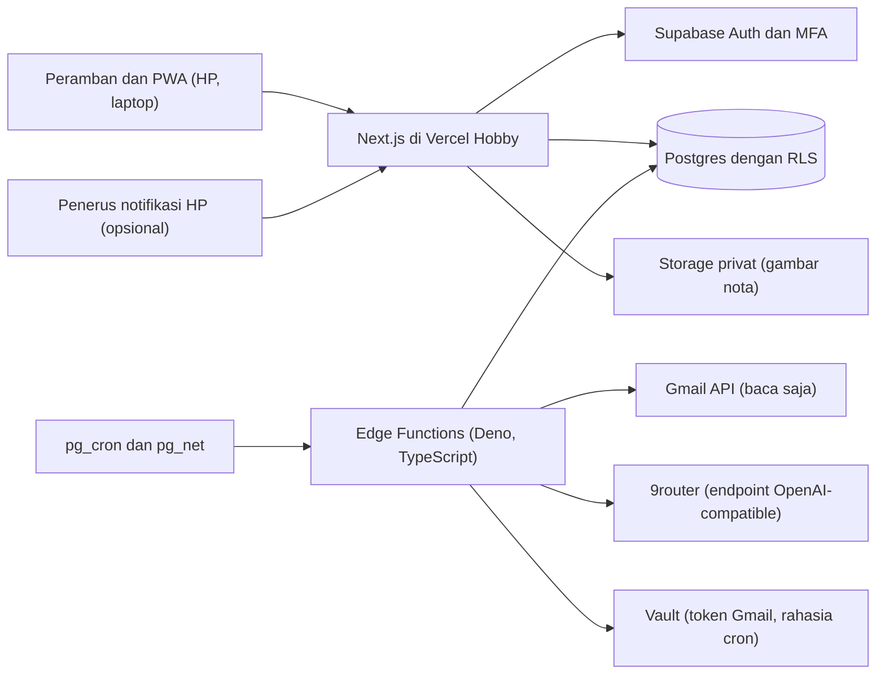

| Lapisan | Pilihan | Status | Alasan |
|---|---|---|---|
| Frontend | Next.js 16 App Router, React 19, TypeScript ketat, Tailwind CSS dengan token di bagian 4.2, PWA | (asumsi) | Arus utama; satu codebase untuk mobile dan desktop |
| Hosting | VPS pemilik (Ubuntu 24.04), semuanya Docker: Next.js standalone, worker LLM, layanan OCR, Caddy (HTTPS); Supabase self-hosted (compose resmi) | `[FIXED]` 2026-11-04 | Keputusan pemilik (menggantikan Vercel Hobby). Hanya Caddy membuka 80/443; Supabase, OCR, dan worker terikat ke loopback karena Docker melewati UFW. Worker LLM memproses antrean karena 9router hanya mendengar di loopback host |
| CI/CD | GitHub Actions: lint, typecheck, tes di setiap push; di cabang default membangun image ke GHCR lalu `deploy/deploy.sh` lewat SSH (migrasi bertahap, sinkron Edge Function) | `[FIXED]` 2026-11-04 | Keputusan pemilik |
| Backend | Supabase: Postgres + RLS, Auth, Storage, Vault, Edge Functions | (asumsi) | Satu platform; Edge Functions menjalankan parser dan pekerjaan terjadwal |
| Penjadwal | pg_cron dipasangkan dengan pg_net untuk memanggil Edge Function, rahasia di Vault | (asumsi) | Pola resmi Supabase; menghindari batas cron Vercel Hobby |
| Email | Gmail API `gmail.readonly`, polling tiap 5 menit | (asumsi) | Tanpa domain dan tanpa Pub/Sub; tanpa pembaruan watch tiap 7 hari |
| LLM | Klien OpenAI-compatible ke 9router lewat env `LLM_BASE_URL` | `[FIXED]` | Permintaan pemilik |
| Uji | Vitest (logika murni), Deno test (parser dan Edge Function), Playwright dengan axe (e2e dan aksesibilitas) | (asumsi) | Satu alat per lapisan |
| Pengembangan lokal | `supabase start`, `supabase functions serve`, `next dev`; dari Edge Function lokal, layanan di komputer host dijangkau lewat `host.docker.internal` | `[FIXED]` | Dokumentasi Supabase CLI; permintaan pemilik (backend lokal dulu) |

## 2. Fitur dan sub fitur

Konvensi: semua uang adalah bilangan bulat rupiah; semua waktu disimpan UTC dan ditampilkan Asia/Jakarta (WIB). Nama tabel dan kolom ada di bagian 5. Tabel keputusan dan rumus ada di 5.4 dan dirujuk dengan nomor tabel.

### F-01 Akses, keamanan, dan pengaturan awal [Must]
**Cerita pengguna:** Sebagai pemilik, saya ingin hanya saya yang bisa membuka data keuangan ini agar tetap aman walau HP atau laptop dipinjam orang lain.
**Dependensi:** tidak ada

#### F-01.1 Masuk satu pengguna dengan MFA
**Requirement**
- Ketika pemilik mengirim email dan kata sandi yang valid, sistem harus meminta kode TOTP, lalu membuat sesi hanya setelah kode valid.
- Ketika pemilik masuk pertama kali tanpa faktor TOTP, sistem harus memaksa pendaftaran TOTP (kode QR dan kode manual) sebelum mengizinkan akses ke layar lain.
- Setelah akun pemilik pertama dibuat, sistem harus menolak setiap pendaftaran akun baru.
- Selama sesi belum berada pada level autentikasi aal2, sistem harus menolak pembacaan dan penulisan semua tabel data keuangan di tingkat basis data (RLS).
- Jika ada 5 percobaan masuk gagal dalam 15 menit, maka sistem harus memblokir percobaan berikutnya selama 15 menit dan menampilkan sisa waktu blokir.
- Sistem harus mengakhiri sesi setelah 30 hari tanpa aktivitas.

**Kriteria penerimaan**
- [x] Diberikan email dan kata sandi valid dan TOTP terdaftar, ketika kode benar dimasukkan, maka pemilik masuk ke S-04; ketika kode salah, tidak ada sesi terbentuk dan teks "Kode salah. Periksa jam di ponselmu lalu coba lagi." tampil di bawah kolom kode.
- [x] Diberikan sudah ada satu akun, ketika permintaan pendaftaran dikirim ke endpoint Auth, maka permintaan ditolak dan tidak ada baris baru di `auth.users`.
- [x] Diberikan sesi aal1, ketika klien meminta `select * from transactions`, maka hasilnya 0 baris atau galat izin, bukan data.
- [x] Diberikan 5 percobaan gagal, ketika percobaan ke-6 dikirim dalam 15 menit, maka ditolak dengan pesan berisi sisa waktu.

**Kasus tepi dan galat**
- Perangkat TOTP hilang: README harus mendokumentasikan langkah menghapus faktor MFA lewat dasbor atau CLI Supabase; tidak ada pemulihan otomatis lewat email.
- Jam perangkat melenceng: kode ditolak; pesan galat menyebut jam.
- Kolom kata sandi kosong: tombol Masuk nonaktif; galat sebaris "Kata sandi wajib diisi."

#### F-01.2 Kunci aplikasi dengan PIN
**Requirement**
- Ketika pemilik mengaktifkan kunci aplikasi, sistem harus meminta PIN 6 digit dan menyimpan hanya hash PBKDF2 dengan minimal 210.000 iterasi dan garam acak.
- Selama aplikasi tidak disentuh melebihi batas idle (default 5 menit; pilihan 1, 5, 15, 30 menit), sistem harus menutup konten dengan layar S-02 dan meminta PIN.
- Ketika tab kembali terlihat setelah tersembunyi lebih lama dari batas idle, sistem harus menampilkan S-02 sebelum merender konten keuangan.
- Sistem harus memverifikasi PIN di server; konten keuangan tidak boleh dirender sebelum verifikasi lolos.
- Jika PIN salah 5 kali berturut-turut, maka sistem harus mengakhiri sesi dan meminta masuk ulang penuh dengan TOTP.

**Kriteria penerimaan**
- [x] Diberikan PIN aktif dan idle 1 menit, ketika 61 detik tanpa interaksi berlalu, maka S-02 menutup konten dan jumlah uang tidak ada di DOM.
- [x] Diberikan PIN benar, ketika dimasukkan di S-02, maka konten sebelumnya muncul dalam ≤ 1 detik pada koneksi lokal.
- [x] Diberikan 5 PIN salah, ketika percobaan kelima dikirim, maka sesi berakhir dan S-01 tampil.
- [x] Diperiksa tabel `app_settings`, maka tidak ada PIN polos; hanya hash dan garam.

**Kasus tepi dan galat**
- PIN lupa: pemilik masuk ulang penuh dengan TOTP lalu mengatur PIN baru di S-20.
- PIN bukan 6 digit angka: ditolak sebaris "PIN harus 6 angka."
- Layanan verifikasi tidak terjangkau: konten tetap terkunci dan pesan "Tidak bisa memeriksa PIN. Periksa koneksi lalu coba lagi." tampil.

#### F-01.3 Pengaturan inti dan onboarding
**Requirement**
- Ketika pemilik pertama kali masuk setelah MFA, sistem harus menjalankan onboarding 4 langkah di S-03: (1) tanggal perkiraan lulus, (2) cadangan darurat dan estimasi pengeluaran bulanan, (3) minimal satu akun dengan saldo awal, (4) hubungkan Gmail (boleh dilewati).
- Sistem harus menyimpan pengaturan: tanggal lulus, cadangan darurat, estimasi pengeluaran bulanan, ambang nominal besar, batas idle, kata redaksi pribadi, teks instruksi pembayaran, sakelar LLM, sakelar tautkan transfer otomatis, dan jadwal pengingat.
- Jika pemilik melewati langkah 4, maka sistem harus tetap membuka S-04 dan menampilkan ajakan "Hubungkan Gmail" yang bisa ditutup dan muncul lagi setelah 7 hari.
- Sistem harus menolak tanggal lulus yang tidak lebih besar dari hari ini dan cadangan darurat negatif.

**Kriteria penerimaan**
- [x] Diberikan akun baru, ketika MFA selesai, maka S-03 langkah 1 tampil dan S-04 tidak bisa dibuka lewat URL sebelum langkah 1–3 selesai.
- [x] Diberikan tanggal lulus kemarin, ketika Lanjut ditekan, maka galat sebaris "Tanggal lulus harus setelah hari ini." tampil dan langkah tidak maju.
- [x] Diberikan langkah 4 dilewati, ketika S-04 terbuka, maka ajakan Hubungkan Gmail tampil dengan tombol Tutup.
- [x] Diberikan pengaturan disimpan, ketika halaman dimuat ulang, maka nilai yang sama tampil di S-20.

**Kasus tepi dan galat**
- Estimasi pengeluaran bulanan kosong: diizinkan; runway memakai data transaksi atau status "data belum cukup" (F-06.1).
- Pemilik menutup tab di tengah onboarding: kemajuan langkah tersimpan dan dilanjutkan.
- Penyimpanan gagal: pesan "Pengaturan belum tersimpan. Coba lagi." dan nilai di formulir tetap ada.

### F-02 Akun dan saldo [Must]
**Cerita pengguna:** Sebagai pemilik, saya ingin melihat semua tempat uang saya beserta saldonya agar tahu uang yang siap dipakai.
**Dependensi:** F-01

#### F-02.1 Kelola akun (bank, e-wallet, tunai)
**Requirement**
- (2026-11-04) Sistem harus menyediakan tombol mata (privasi) di Beranda, Rekening & wallet, detail akun, dan Aset yang menyembunyikan semua saldo dan nilai dana menjadi "Rp ••••••" dan nomor rekening/HP menjadi "•••• {4 digit}", termasuk label nominal pada grafik runway; nominal transaksi tetap tampil. Pilihan disimpan di cookie perangkat `privasi` sehingga halaman langsung dirender tersembunyi tanpa kilasan angka. Akun dapat menyimpan nomor lengkap (opsional) yang hanya tampil saat privasi dibuka.
- Ketika pemilik menambah akun, sistem harus meminta nama (1–40 karakter), jenis (bank, ewallet, tunai), saldo awal (bilangan bulat ≥ 0), tanggal saldo awal, dan secara opsional 4 digit terakhir serta kata kunci pencocokan.
- Sistem harus membuat satu akun sistem bernama "Belum ditentukan" saat onboarding, yang tidak tampil di kartu dan tidak dihitung di dana tersisa.
- Ketika pemilik mengarsipkan akun yang punya transaksi, sistem harus menyembunyikannya dari kartu dan pilihan akun, tetapi mempertahankan transaksi dan perhitungan historis.
- Jika nama akun sama (tanpa membedakan huruf besar atau kecil) dengan akun aktif lain, maka sistem harus menolaknya.
- Sistem harus mengizinkan pemilik mengubah urutan akun dan menyimpannya.

**Kriteria penerimaan**
- [x] Diberikan nama "Mandiri", jenis bank, saldo awal 2.350.000, ketika Simpan ditekan, maka akun muncul di S-13 dan di kartu S-04 dengan "Rp 2.350.000".
- [x] Diberikan akun "Mandiri" sudah ada, ketika "mandiri" ditambahkan, maka galat "Nama akun sudah dipakai." tampil.
- [x] Diberikan akun dengan 10 transaksi, ketika diarsipkan, maka kartu hilang dan 10 transaksi tetap muncul di S-08 dengan label akun.
- [x] Diberikan saldo awal desimal "1.5", ketika Simpan ditekan, maka ditolak sebaris "Saldo harus bilangan bulat rupiah."

**Kasus tepi dan galat**
- Akun terakhir yang aktif tidak boleh diarsipkan; pesan "Sisakan minimal satu akun aktif."
- Saldo awal sangat besar (> 10.000.000.000): ditolak sebagai di luar batas.
- Kata kunci pencocokan kosong: diizinkan; pencocokan hanya memakai nama dan 4 digit terakhir.

#### F-02.2 Saldo terhitung dan sumber saldo
**Requirement**
- Sistem harus menghitung saldo akun = saldo awal + jumlah semua transaksi masuk − jumlah semua transaksi keluar, untuk transaksi pada atau setelah tanggal saldo awal yang berstatus selain ignored dan tidak terhapus.
- Sistem harus menetapkan satu label sumber saldo per akun sesuai Tabel 5.4-H: "Cocok statement {bulan}", "Dari email", "Diisi manual", atau "Selisih Rp {jumlah}".
- Jika saldo terhitung negatif, maka sistem harus menampilkannya dengan tanda "−" dan teks bantuan "Periksa saldo awal atau transaksi yang terlewat."
- Ketika transaksi berubah (dibuat, diubah, dihapus), sistem harus menampilkan saldo baru di semua layar dalam ≤ 2 detik setelah penyimpanan berhasil.

**Kriteria penerimaan**
- [x] Diberikan saldo awal 1.000.000, satu transaksi keluar 28.000 dan satu masuk 105.000, ketika halaman dimuat, maka saldo "Rp 1.077.000".
- [x] Diberikan titik cek terakhir yang sama persis dengan saldo terhitung pada tanggalnya, ketika kartu dirender, maka label "Cocok statement {bulan}" dengan ikon centang.
- [x] Diberikan titik cek yang berbeda Rp 12.000 dari saldo terhitung, ketika kartu dirender, maka label "Selisih Rp 12.000".
- [x] Diberikan transaksi berstatus ignored, ketika saldo dihitung, maka transaksi itu tidak ikut.

**Kasus tepi dan galat**
- Transaksi bertanggal sebelum tanggal saldo awal: tersimpan tetapi tidak mengubah saldo.
- Dua titik cek pada tanggal sama: yang dibuat terakhir yang dipakai.
- Akun tanpa transaksi: saldo sama dengan saldo awal dan label "Diisi manual".

#### F-02.3 Kartu akun
**Requirement**
- Pada layar sempit (< 768 px), sistem harus menampilkan baris kartu akun yang dapat digeser horizontal dengan snap; kartu pertama (warna aksen) berisi total "Rekening & wallet" dan pengeluaran bulan ini, diikuti satu kartu per akun aktif sesuai urutan; setiap kartu berukuran 224 × 141 px.
- Pada layar ≥ 1280 px, sistem harus menampilkan tumpukan kartu di rail kanan: kartu total di atas dan hingga 3 akun mengintip di bawahnya, diikuti baris tautan "Aset lain {nilai}" yang membuka S-11.
- Sistem harus menampilkan label sumber saldo pada setiap kartu dengan ikon dan teks.
- Ketika sebuah kartu ditekan, sistem harus membuka detail akun di S-13.

**Kriteria penerimaan**
- [x] Diberikan 5 akun, ketika S-04 dirender pada 390 px, maka 6 kartu (1 total, 5 akun) dapat digeser dan kartu kedua terlihat sebagian di tepi kanan.
- [x] Diberikan total akun Rp 5.210.000 dan nilai seluruh dana Rp 287.000.000, ketika S-04 dirender pada 1440 px, maka baris "Aset lain Rp 281.790.000" tampil.
- [x] Diberikan label sumber saldo "Dari email", ketika kartu dirender, maka ikon amplop dan teks tampil bersama.
- [x] Diberikan nol akun aktif, ketika S-04 dirender, maka kartu diganti ajakan "Tambah akun pertama".

**Kasus tepi dan galat**
- Lebih dari 8 akun: kartu tetap dapat digeser; tumpukan desktop tetap menampilkan 3 teratas.
- Total akun sangat besar: angka dipotong dengan elipsis hanya setelah ukuran font mencapai batas bawah 16 px; tidak pernah memotong digit tanpa tanda.
- Gagal memuat saldo: kartu menampilkan keadaan galat dengan tombol "Coba lagi".

### F-03 Pencatatan manual [Must]
**Cerita pengguna:** Sebagai pemilik, saya ingin mencatat transaksi apa pun dalam waktu ≤ 10 detik agar catatan tetap lengkap saat email tidak tersedia.
**Dependensi:** F-02

#### F-03.1 Catat pengeluaran dengan numpad
**Requirement**
- Ketika pemilik membuka S-07 dalam mode Pengeluaran, sistem harus menampilkan jumlah besar di bagian atas, chip kategori, akun, dan tanggal, numpad (tombol 0–9, "000", hapus), dan tombol Simpan selebar layar.
- Sistem harus memformat jumlah dengan pemisah ribuan titik saat mengetik (misalnya "Rp 1.250.000") dan harus menolak jumlah 0 atau di atas 999.999.999.
- Ketika Simpan ditekan dengan jumlah, kategori, dan akun yang valid, sistem harus membuat transaksi kind expense, arah keluar, status confirmed, sumber manual, lalu kembali ke layar asal dengan toast.
- Sistem harus mengisi awal akun dengan akun yang terakhir dipakai, tanggal dengan hari ini (WIB), dan kategori dengan saran dari memori merchant bila merchant diisi.
- Ketika sakelar "Sekali-jalan" dinyalakan, sistem harus menyimpan transaksi dengan penanda sekali-jalan.
- Sistem harus mencegah kirim ganda: tombol Simpan nonaktif sampai respons diterima.

**Kriteria penerimaan**
- [x] Diberikan jumlah "28000", kategori Makan & minum, akun Mandiri, ketika Simpan ditekan, maka satu transaksi keluar Rp 28.000 tersimpan dan saldo Mandiri berkurang 28.000.
- [x] Diberikan jumlah 0, ketika dilihat, maka tombol Simpan nonaktif.
- [x] Diberikan tombol "000" ditekan setelah "28", maka jumlah menjadi "28.000".
- [x] Diberikan Simpan ditekan dua kali dalam 300 ms, ketika diperiksa, maka hanya satu transaksi yang ada.

**Kasus tepi dan galat**
- Tanpa koneksi: pesan "Tidak ada koneksi. Transaksi belum tersimpan." dan jumlah yang diketik tetap ada; tidak ada antrean offline.
- Jumlah lebih dari 999.999.999: karakter tambahan diabaikan dan hint "Maksimal Rp 999.999.999." tampil.
- Tanggal di masa depan lebih dari 1 hari: ditolak sebaris.

#### F-03.2 Catat pemasukan lewat menu Tambah
**Requirement**
- Ketika tombol "+" ditekan, sistem harus membuka S-06 berisi lima pilihan: Pengeluaran, Pemasukan, Transfer antar akun, Scan nota, Bagi tagihan.
- Ketika Pemasukan dipilih, sistem harus membuka S-07 dalam mode Pemasukan dengan kategori Uang saku, Honor, Hadiah, Lainnya, dan menyimpan transaksi kind income, arah masuk.
- Sistem tidak boleh menampilkan total pemasukan sebagai bagian di S-04; pemasukan hanya tampil di daftar transaksi, perubahan dana bulan ini (hanya bila lebih dari 0), dan rincian S-10.

**Kriteria penerimaan**
- [x] Diberikan menu Tambah dibuka, ketika dirender, maka tepat 5 baris dengan teks bantuan sesuai desain `design/m-tambah.png`.
- [x] Diberikan pemasukan Rp 1.500.000 kategori Uang saku ke akun BNI, ketika Simpan ditekan, maka saldo BNI naik 1.500.000 dan total pengeluaran tidak berubah.
- [x] Diberikan S-04 dirender, maka tidak ada elemen berlabel "Pemasukan" di Beranda.

**Kasus tepi dan galat**
- Transfer masuk dari teman yang cocok dengan piutang: diarahkan ke F-10.3 sebagai pelunasan, bukan pemasukan.
- Jumlah 0 atau kategori kosong: tombol Simpan nonaktif.
- Penyimpanan gagal: toast galat dengan tombol "Coba lagi" dan nilai formulir tetap.

#### F-03.3 Transfer antar akun dan biaya admin
**Requirement**
- Ketika pemilik memilih Transfer, sistem harus meminta akun asal, akun tujuan (berbeda), jumlah yang diterima, biaya admin (default 0), dan tanggal.
- Ketika Simpan ditekan, sistem harus membuat dua transaksi kind transfer (keluar di akun asal, masuk di akun tujuan, keduanya berjumlah sama), satu TRANSFER_LINK, dan bila biaya admin lebih dari 0, satu transaksi kind fee pada akun asal dengan kategori "Biaya admin".
- Sistem harus mengecualikan transaksi kind transfer dari total pengeluaran dan pemasukan, tetapi menghitungnya pada saldo akun.
- Jika akun asal sama dengan akun tujuan, maka sistem harus menolak dengan galat sebaris.
- (2026-11-04) Pengeluaran satu sisi yang sebenarnya isi saldo ke e-wallet milik pemilik (email Livin' "Top-up Berhasil", penerima "OVO ****1234") harus dapat dijadikan transfer: sisi keluar menjadi kind transfer dan sisi masuk dibuat di akun e-wallet, ditautkan dengan TRANSFER_LINK (`rpc_convert_to_transfer`). Pencocokan memakai nama atau kata kunci akun e-wallet; bila penerima dan akun sama-sama memuat nomor, 4 digit terakhir harus sama sehingga isi saldo ke dompet orang lain tidak ikut. Hanya dijalankan atas tindakan pemilik: tombol "Jadikan transfer ke {akun}" di Inbox (juga lewat Enter) dan detail transaksi, serta "Isi saldo e-wallet (N)" untuk semua sekaligus dengan konfirmasi.

**Kriteria penerimaan**
- [x] Diberikan isi saldo Mandiri → OVO ****1234 Rp 50.000 dan akun OVO bernomor 1234, ketika "Jadikan transfer" ditekan, maka Mandiri −50.000, OVO +50.000, keduanya kind transfer, dan tidak dihitung pengeluaran; isi saldo ke OVO ****5678 tetap "Belum terkait".
- [x] Diberikan transfer Mandiri → OVO Rp 100.000 dengan biaya Rp 1.000, ketika Simpan ditekan, maka Mandiri berkurang 101.000, OVO bertambah 100.000, dan pengeluaran bulan ini bertambah 1.000.
- [x] Diberikan transfer yang sama, ketika daftar S-08 dilihat, maka dua baris transfer tampil berlabel "Transfer" dan satu baris biaya.
- [x] Diberikan akun asal = tujuan, ketika Simpan ditekan, maka galat "Akun asal dan tujuan harus berbeda." tampil.

**Kasus tepi dan galat**
- Biaya admin negatif atau desimal: ditolak.
- Menghapus salah satu sisi transfer: sistem harus menawarkan hapus kedua sisi dan biaya terkait; tidak boleh meninggalkan satu sisi yatim.
- Saldo asal tidak cukup: diizinkan dengan peringatan, karena saldo bisa belum akurat.

#### F-03.4 Daftar, detail, ubah, dan hapus transaksi
**Requirement**
- Sistem harus menampilkan S-08 sebagai daftar transaksi yang dikelompokkan per tanggal WIB dengan subtotal pengeluaran harian, dimuat 50 baris per halaman.
- Sistem harus menyediakan filter segmented (Semua, Pengeluaran, Pemasukan, Transfer), filter kategori, akun, rentang tanggal, dan status, serta pencarian teks atas merchant dan catatan mulai 2 karakter.
- Ketika sebuah baris ditekan, sistem harus membuka S-09 yang menampilkan jumlah, merchant, kategori, akun, waktu, sumber, bukti (email dan nota), dan aksi Ubah, Bagi tagihan, Tandai sekali-jalan, Hapus.
- Ketika Hapus dikonfirmasi, sistem harus menandai transaksi terhapus (soft delete), menghitung ulang saldo, dan menampilkan toast "Dihapus. Urungkan" selama 6 detik.
- Ketika jumlah transaksi dari email diubah, sistem harus menyimpan jumlah asli email di bukti dan menampilkan peringatan "Jumlah berbeda dari email."

**Kriteria penerimaan**
- [x] Diberikan 120 transaksi, ketika S-08 dibuka, maka 50 baris pertama tampil dan 50 berikutnya dimuat saat gulir mencapai dasar.
- [x] Diberikan pencarian "kopi", ketika diketik 4 karakter, maka hanya transaksi dengan "kopi" di merchant atau catatan yang tampil.
- [x] Diberikan Hapus lalu Urungkan dalam 6 detik, ketika diperiksa, maka transaksi kembali dan saldo kembali semula.
- [x] Diberikan transaksi email Rp 40.000 diubah menjadi Rp 45.000, ketika S-09 dibuka, maka peringatan tampil dan bukti email tetap menunjukkan Rp 40.000.

**Kasus tepi dan galat**
- Daftar kosong: keadaan kosong pertama kali menampilkan ajakan "Catat transaksi pertama"; hasil filter kosong menampilkan "Tidak ada transaksi yang cocok" dengan tombol "Hapus filter".
- Pencarian satu karakter: tidak dijalankan; hint "Ketik minimal 2 huruf."
- Transaksi sudah terhapus dibuka lewat URL: halaman "Transaksi tidak ditemukan."

#### F-03.5 Kategori dan memori merchant
**Requirement**
- Sistem harus menyediakan kategori pengeluaran awal: Makan & minum, Rumah tangga, Hiburan, Belanja, Pendidikan, Kesehatan, Transportasi, Tagihan & langganan, Biaya admin, Lainnya; dan kategori pemasukan awal: Uang saku, Honor, Hadiah, Lainnya.
- Ketika pemilik mengonfirmasi atau mengubah kategori transaksi dengan opsi "Ingat untuk merchant ini" menyala (default menyala), sistem harus menyimpan kategori itu sebagai kategori bawaan merchant, dan transaksi berikutnya dari merchant yang sama harus memakainya.
- Sistem harus menormalkan nama merchant (huruf kecil, tanpa badan usaha PT, CV, Tbk, tanpa tanda baca, spasi tunggal) sebagai kunci pencocokan.
- Pemilik harus dapat menambah, mengganti nama, dan mengarsipkan kategori di S-20; kategori yang dipakai tidak boleh dihapus permanen.
- Pemilik harus dapat menggabungkan dua merchant sehingga nama yang satu menjadi alias yang lain.

**Kriteria penerimaan**
- [x] Diberikan "Warung Mie Pak Dani" dikonfirmasi dengan kategori Makan & minum dan opsi ingat menyala, ketika email berikutnya dari merchant itu tiba, maka kategori Makan & minum terisi otomatis.
- [x] Diberikan "PT Solusi Kasir Digital" dan "Solusi Kasir Digital", ketika dinormalkan, maka kunci pencocokan identik.
- [x] Diberikan kategori yang dipakai 3 transaksi, ketika Hapus dicoba, maka ditolak dan hanya Arsipkan yang tersedia.

**Kasus tepi dan galat**
- Nama kategori kosong atau lebih dari 30 karakter: ditolak sebaris.
- Merchant tanpa nama (hanya angka): kunci pencocokan memakai teks asli apa adanya.
- Penggabungan merchant menimbulkan dua kategori bawaan berbeda: kategori merchant tujuan yang dipertahankan.

### F-04 Tangkapan email otomatis [Must]
**Cerita pengguna:** Sebagai pemilik, saya ingin transaksi dari email bank dan merchant masuk sendiri agar saya tidak mencatat ulang apa yang sudah dikirim ke inbox.
**Dependensi:** F-02, F-03.5

#### F-04.1 Hubungkan Gmail
**Requirement**
- Ketika pemilik menekan "Hubungkan Gmail", sistem harus mengalihkan ke persetujuan Google dengan satu scope `https://www.googleapis.com/auth/gmail.readonly`, `access_type=offline`, `prompt=consent`, dan parameter `state` acak yang diverifikasi saat callback.
- Ketika callback valid, sistem harus menyimpan refresh token hanya di Vault, dan menyimpan di tabel INTEGRATION hanya id rahasia, alamat email, status, dan waktu polling terakhir.
- Sistem tidak boleh mengirim token ke klien, menulisnya ke log, atau mengembalikannya dari endpoint mana pun.
- Ketika pemilik menekan "Putuskan", sistem harus mencabut token di Google, menghapus rahasia dari Vault, dan menghentikan polling, sementara data transaksi yang sudah ada tetap tersimpan.
- Jika Google menolak refresh token (galat invalid_grant), maka sistem harus mengubah status integrasi menjadi `perlu_hubungkan_ulang` dan menampilkan banner di S-04 dan S-17.

**Kriteria penerimaan**
- [x] Diberikan tombol Hubungkan ditekan, ketika URL tujuan diperiksa, maka scope tepat satu dan memuat `state` acak.
- [x] Diberikan callback dengan `state` salah, ketika diproses, maka ditolak dengan status 400 dan tidak ada rahasia tersimpan.
- [x] Diberikan koneksi berhasil, ketika tabel INTEGRATION diperiksa, maka tidak ada kolom berisi token dan satu rahasia baru ada di Vault.
- [x] Diberikan Putuskan ditekan, ketika diperiksa, maka rahasia hilang dari Vault dan status `terputus`.

**Kasus tepi dan galat**
- Pemilik menolak persetujuan di Google: kembali ke S-17 dengan pesan "Gmail belum terhubung. Kamu bisa mencoba lagi kapan saja."
- Layar "aplikasi belum diverifikasi" dari Google: README harus menjelaskan klik "Lanjutan" lalu lanjutkan; ini bukan galat.
- Akun Google berbeda dari yang diharapkan: alamat email terhubung ditampilkan agar pemilik bisa memeriksa.

#### F-04.2 Polling, dedupe, dan pencocokan lintas sumber
**Requirement**
- Setiap 5 menit, pg_cron harus memanggil Edge Function `ingest-gmail`, yang mengambil pesan dengan query `from:(<pengirim aktif dipisah OR>) after:<detik epoch>` dengan tumpang tindih 10 menit dari waktu pesan terakhir yang diproses, maksimum 100 pesan per jalan dan 50 pesan per halaman.
- Sistem harus membuat tepat satu INGEST_EVENT per kombinasi (pengguna, kanal, id pesan) dan harus melewati pesan yang sudah ada.
- Sistem harus memakai `dedupe_key` dari parser untuk mencegah dua transaksi dari referensi yang sama.
- Ketika transaksi baru dari pengirim berbeda memiliki akun dan jumlah yang sama dan selisih waktu ≤ 10 menit dengan transaksi yang sudah ada, sistem harus menautkannya sebagai bukti tambahan alih-alih membuat transaksi kedua.
- Ketika jumlah dan waktu cocok tetapi akun berbeda, sistem harus membuat MATCH_PROPOSAL bertipe duplicate_suspect di Inbox.
- Jika Gmail API mengembalikan 429 atau 5xx, maka sistem harus mencatat galat di INTEGRATION dan mengulang pada jalan berikutnya tanpa menggandakan data.

**Kriteria penerimaan**
- [x] Diberikan dua kali pemanggilan `ingest-gmail` untuk kotak masuk yang sama, ketika diperiksa, maka jumlah INGEST_EVENT dan TRANSACTION tidak bertambah pada pemanggilan kedua.
- [x] Diberikan email Mandiri QRIS Rp 40.000 pukul 17:57:04 dan struk merchant Rp 40.000 pukul 17:57:14 pada akun yang sama, ketika keduanya diproses, maka ada 1 transaksi dengan 2 bukti.
- [x] Diberikan Gmail membalas 429, ketika jalan berikutnya berjalan, maka pesan yang tertunda diproses sekali.
- [x] Diberikan 130 pesan baru, ketika satu jalan selesai, maka 100 diproses dan sisanya diproses pada jalan berikutnya.

**Kasus tepi dan galat**
- Tidak ada pengirim aktif: fungsi keluar tanpa memanggil Gmail dan mencatat "tidak ada pengirim".
- Email tiba tidak berurutan: urutan diproses berdasarkan waktu pesan, bukan urutan tiba.
- Pesan dihapus pemilik di Gmail setelah diproses: tidak menghapus transaksi.

#### F-04.3 Parser deterministik per pengirim
**Requirement**
- Sistem harus menyediakan parser per layanan (Mandiri, Grab, Shopee, Google Play, ESB, Gojek) dengan antarmuka sama: masukan teks email dan header, keluaran status `parsed`, `ignored`, atau `failed` beserta daftar transaksi dengan field sesuai Tabel 5.4-B.
- Sistem harus mengurai angka uang sesuai Tabel 5.4-E, termasuk "Rp 17.201,00", "Rp 19800", "Rp 819,376", dan "Rp517,500".
- Ketika email menandakan status tidak sukses (gagal, dibatalkan, kedaluwarsa), parser harus menghasilkan `ignored`.
- Parser tidak boleh melempar pengecualian yang tidak tertangani; setiap kegagalan harus menjadi status `failed` dengan alasan.
- Setiap parser harus memiliki minimal 3 fixture email dan tes yang memeriksa semua field wajib.

**Kriteria penerimaan**
- [x] Diberikan fixture email QRIS Mandiri Rp 40.000, ketika diurai, maka keluaran amount 40000, arah keluar, `dedupe_key` berisi nomor referensi, dan merchant_raw terisi.
- [x] Diberikan keempat format uang pada Tabel 5.4-E, ketika diurai, maka hasilnya 17201, 19800, 819376, dan 517500.
- [x] Diberikan email "transaksi gagal", ketika diurai, maka status `ignored`.
- [x] Diberikan teks acak tanpa struktur, ketika diurai, maka status `failed` dan tidak ada pengecualian.

**Kasus tepi dan galat**
- Email HTML tanpa bagian teks polos: HTML diubah menjadi teks sebelum diurai.
- Zona waktu pada email tidak ditulis: dianggap WIB.
- Satu email berisi beberapa pesanan: parser mengembalikan beberapa transaksi dengan `dedupe_key` masing-masing.

#### F-04.4 Pembacaan cadangan dengan LLM
**Requirement**
- Ketika parser gagal atau tidak ada untuk sebuah pengirim dan sakelar LLM menyala, sistem harus membuat LLM_JOB `parse_email` berisi teks yang sudah diredaksi, mengirimnya ke `LLM_MODEL_TEXT` dengan skema JSON, dan memvalidasi hasilnya terhadap skema dan aturan (jumlah > 0, tanggal valid dan tidak lebih dari 1 hari di depan).
- Sistem harus selalu menyimpan transaksi hasil LLM dengan status needs_review, alasan `llm_parsed`, dan kepercayaan ≤ 0,6; hasil LLM tidak boleh auto_confirmed.
- Sistem harus meredaksi teks sebelum dikirim sesuai bagian 8.3, dan harus membatasi panggilan LLM sampai 200 per hari.
- Jika `LLM_BASE_URL` tidak terjangkau atau melewati batas waktu 30 detik, maka sistem harus membiarkan pekerjaan pending (maksimum 5 percobaan, jeda 10 menit) dan menampilkan item "Menunggu dibaca" di S-17.
- Pada penerapan yang router LLM-nya hanya berjalan di komputer pemilik, sistem harus menyediakan skrip pekerja lokal yang memproses antrean LLM_JOB dengan kredensial layanan milik pemilik.

**Kriteria penerimaan**
- [x] Diberikan email dari pengirim tanpa parser, ketika LLM mengembalikan JSON valid, maka transaksi needs_review berkepercayaan ≤ 0,6 dengan alasan `llm_parsed` muncul di Inbox.
- [x] Diberikan LLM mengembalikan JSON tidak valid dua kali, ketika diproses, maka INGEST_EVENT berstatus `failed` dan muncul di daftar "Tidak terbaca".
- [x] Diberikan `LLM_BASE_URL` mati, ketika `process-llm-jobs` berjalan, maka pekerjaan tetap pending dengan jumlah percobaan bertambah satu.
- [x] Diberikan teks email berisi nomor rekening 1234567890123, ketika payload dikirim, maka nomor tampil sebagai "••••0123".

**Kasus tepi dan galat**
- Sakelar LLM mati: kegagalan parser langsung menjadi "Tidak terbaca" tanpa pekerjaan.
- Batas harian 200 tercapai: pekerjaan baru menunggu sampai hari berikutnya (UTC+7) dan S-17 menampilkan sebabnya.
- Model mengarang jumlah yang tidak ada di teks: aturan validasi memeriksa bahwa angka jumlah muncul sebagai substring teks sumber; jika tidak, hasil ditolak.

#### F-04.5 Halaman Sumber email
**Requirement**
- Sistem harus menampilkan di S-17 status Gmail (terhubung, perlu hubungkan ulang, terputus), alamat email, dan waktu polling terakhir.
- Sistem harus menampilkan daftar pengirim (EMAIL_SOURCE) dengan alamat, label, parser, sakelar aktif, jumlah email berhasil dan gagal 30 hari terakhir, tanggal email terakhir, dan penanda "Parser belum diverifikasi dengan email asli" bila hanya diuji dengan fixture sintetis.
- Sistem harus menampilkan daftar "Tidak terbaca" berisi INGEST_EVENT berstatus failed atau unreadable dengan pengirim, subjek, dan tanggal, beserta aksi Coba baca dengan LLM, Abaikan, dan Jadikan transaksi manual (mengisi awal formulir S-07).
- Ketika pemilik menambah pengirim tanpa parser khusus, sistem harus memakai pembacaan LLM (F-04.4) untuk pengirim itu.
- Sistem harus menandai pengirim "sunyi" bila tidak ada email dari pengirim itu selama 60 hari.

**Kriteria penerimaan**
- [x] Diberikan 6 pengirim awal, ketika S-17 dibuka, maka 6 baris tampil dengan hitungan 30 hari.
- [x] Diberikan 2 email gagal diurai, ketika S-17 dibuka, maka 2 baris "Tidak terbaca" tampil dengan tiga aksi.
- [x] Diberikan "Jadikan transaksi manual" ditekan, ketika S-07 terbuka, maka tanggal dan subjek email mengisi awal formulir.
- [x] Diberikan pengirim tanpa email 61 hari, ketika S-17 dibuka, maka baris itu berlabel "Sunyi".

**Kasus tepi dan galat**
- Alamat pengirim tidak valid (tanpa tanda @): ditolak sebaris.
- Pengirim yang sama ditambah dua kali: ditolak sebaris "Pengirim sudah ada."
- Daftar "Tidak terbaca" kosong: teks "Semua email terbaca" tampil.

#### F-04.6 Impor riwayat awal 90 hari
**Requirement**
- Ketika pemilik menekan "Impor 90 hari terakhir", sistem harus memproses pesan dari 90 hari ke belakang dalam potongan 100 pesan per jalan dan menampilkan progres (diproses dari total) di S-17.
- Sistem harus menyimpan transaksi impor dengan aturan penilaian kepercayaan yang sama seperti email baru (Tabel 5.4-A).
- Sistem harus mengelompokkan item Inbox hasil impor per merchant baru sehingga satu kartu mewakili semua transaksi merchant itu.
- Sistem tidak boleh mengubah saldo akun dengan transaksi bertanggal sebelum tanggal saldo awal akun.

**Kriteria penerimaan**
- [x] Diberikan 250 pesan dalam 90 hari, ketika impor dijalankan, maka selesai dalam 3 jalan dan progres menunjukkan 250 dari 250.
- [x] Diberikan 12 transaksi dari merchant baru yang sama, ketika Inbox dibuka, maka 1 kartu "12 transaksi" tampil, bukan 12 kartu.
- [x] Diberikan transaksi impor bertanggal sebelum tanggal saldo awal, ketika saldo dihitung, maka saldo tidak berubah.
- [x] Diberikan impor dijalankan dua kali, ketika diperiksa, maka tidak ada transaksi ganda.

**Kasus tepi dan galat**
- Impor terhenti di tengah: jalan berikutnya melanjutkan dari kursor yang tersimpan.
- Gmail belum terhubung: tombol nonaktif dengan teks bantuan.
- Pemilik membatalkan impor: sisa pesan tidak diproses; yang sudah masuk tetap.

### F-05 Inbox peninjauan [Must]
**Cerita pengguna:** Sebagai pemilik, saya ingin hanya meninjau transaksi yang ambigu, dalam hitungan menit per hari, agar catatan akurat tanpa kerja berulang.
**Dependensi:** F-03, F-04

#### F-05.1 Penilaian kepercayaan dan antrean
**Requirement**
- Sistem harus memberi status awal setiap transaksi otomatis sesuai Tabel 5.4-A: auto_confirmed hanya bila semua syarat terpenuhi, selain itu needs_review dengan satu alasan.
- Sistem harus menampilkan S-05 berisi transaksi needs_review dan MATCH_PROPOSAL terbuka, dengan filter segmented: Semua, Cocok (bukti ≥ 2 sumber), Merchant baru, Belum terkait (transfer masuk tanpa piutang, hanya nota, akun tidak dikenal).
- Sistem harus menampilkan lencana jumlah item terbuka pada navigasi (Inbox) dan menghilangkannya saat 0.
- Ketika Inbox kosong, sistem harus menampilkan "Semua sudah ditinjau" dan jumlah transaksi masuk otomatis sejak kemarin.

**Kriteria penerimaan**
- [x] Diberikan transaksi parser deterministik, merchant dikenal dengan kategori bawaan, jumlah Rp 28.000, ketika disimpan, maka status auto_confirmed dan tidak muncul di Inbox.
- [x] Diberikan merchant baru, ketika disimpan, maka needs_review dengan alasan `merchant_baru`.
- [x] Diberikan 7 item terbuka, ketika navigasi dirender, maka lencana "7" tampil.
- [x] Diberikan filter "Merchant baru", ketika dipilih, maka hanya item beralasan `merchant_baru` yang tampil.

**Kasus tepi dan galat**
- Dua alasan berlaku sekaligus: alasan dipilih berdasarkan urutan prioritas di Tabel 5.4-A.
- Item diubah di layar lain saat Inbox terbuka: daftar disegarkan saat fokus kembali; aksi pada item yang sudah berubah ditolak dengan "Item ini sudah berubah."
- Gagal memuat: keadaan galat dengan tombol "Coba lagi".

#### F-05.2 Aksi peninjauan
**Requirement**
- Sistem harus menyediakan aksi Konfirmasi (status confirmed), Ubah (kategori, akun, jumlah, merchant, catatan), Bagi tagihan (membuka S-15), Abaikan (status ignored, tidak dihitung), dan Lewati (item tetap terbuka dan berpindah ke akhir antrean sesi).
- Pada layar sempit, sistem harus menampilkan satu kartu per item dengan penunjuk progres bersegmen, geser kanan untuk Konfirmasi dan geser kiri untuk Lewati, ditambah tombol sebagai alternatif satu pointer.
- Pada layar ≥ 1024 px, sistem harus menampilkan daftar di kiri dan detail di kanan, dengan pintasan keyboard: Enter = Konfirmasi, panah bawah dan atas = pindah item, E = Ubah, S = Lewati, X = Abaikan.
- Ketika Konfirmasi diterapkan pada merchant baru, sistem harus menerapkan kategori yang sama pada semua transaksi needs_review beralasan `merchant_baru` dari merchant itu.
- Sistem harus menolak Konfirmasi bila akun transaksi masih "Belum ditentukan".

**Kriteria penerimaan**
- [x] Diberikan item "Warung Mie Pak Dani" Rp 40.000 dengan 2 bukti, ketika Enter ditekan di desktop, maka item berstatus confirmed dan item berikutnya terpilih.
- [x] Diberikan 3 transaksi merchant baru yang sama, ketika salah satu dikonfirmasi dengan kategori Makan & minum, maka ketiganya confirmed.
- [x] Diberikan geser kanan 80 px pada mobile, ketika dilepas, maka Konfirmasi terjadi; geser kiri 80 px menjalankan Lewati.
- [x] Diberikan akun "Belum ditentukan", ketika Konfirmasi ditekan, maka galat "Pilih akun dulu." tampil dan status tidak berubah.

**Kasus tepi dan galat**
- Item terakhir selesai: "Semua sudah ditinjau".
- Aksi gagal di jaringan: item kembali ke posisi semula dengan toast galat.
- Abaikan tidak sengaja: toast "Diabaikan. Urungkan" 6 detik.

#### F-05.3 Deteksi transfer internal
**Requirement**
- Setelah setiap transaksi baru yang tidak diabaikan tersimpan, sistem harus mencari pasangan dengan arah berlawanan, akun berbeda, selisih waktu ≤ 5 hari, dan selisih jumlah termasuk {0, 500, 999, 1.000, 1.500, 2.500, 6.500}, memberi skor sesuai Tabel 5.4-F, dan membuat MATCH_PROPOSAL bertipe transfer bila skor ≥ 0,6.
- Ketika proposal dikonfirmasi, sistem harus mengubah kedua transaksi menjadi kind transfer, membuat TRANSFER_LINK, dan bila ada selisih membuat transaksi kind fee kategori "Biaya admin" pada akun asal.
- Ketika proposal ditolak, sistem harus mencatat penolakan sehingga pasangan itu tidak diusulkan lagi.
- Sistem tidak boleh menautkan transfer secara otomatis kecuali sakelar "Tautkan transfer otomatis" menyala (default mati) dan skor ≥ 0,9.
- Satu transaksi tidak boleh berada di lebih dari satu proposal terbuka atau satu TRANSFER_LINK.

**Kriteria penerimaan**
- [x] Diberikan Mandiri keluar Rp 101.000 dan OVO masuk Rp 100.000 dalam 5 menit, ketika diproses, maka satu proposal transfer dengan biaya Rp 1.000 muncul di Inbox.
- [x] Diberikan proposal dikonfirmasi, ketika total pengeluaran bulan ini dihitung, maka hanya Rp 1.000 yang bertambah.
- [x] Diberikan proposal ditolak lalu transaksi baru diproses, ketika diperiksa, maka pasangan yang sama tidak diusulkan lagi.
- [x] Diberikan sakelar otomatis mati dan skor 0,95, ketika diproses, maka tetap hanya proposal, tidak ada tautan otomatis.

**Kasus tepi dan galat**
- Dua kandidat dengan skor sama: yang selisih waktunya lebih kecil dipilih; yang lain dilepas.
- Selisih jumlah di luar daftar biaya admin: tidak diusulkan.
- Transaksi pasangan dihapus setelah proposal dibuat: proposal ditutup otomatis.

#### F-05.4 Aturan peninjauan dan ambang nominal besar
**Requirement**
- Sistem harus mengizinkan pemilik mengatur ambang nominal besar (default Rp 500.000; rentang Rp 10.000 sampai Rp 50.000.000) dan transaksi dengan jumlah ≥ ambang harus selalu needs_review beralasan `nominal_besar`.
- Sistem harus mengizinkan pemilik mengatur per merchant: kategori bawaan, penanda sekali-jalan bawaan, dan sakelar "lewati peninjauan" (auto-konfirmasi).
- Sakelar "lewati peninjauan" tidak boleh berlaku untuk transaksi beralasan `nominal_besar` atau `llm_parsed`.

**Kriteria penerimaan**
- [x] Diberikan ambang Rp 500.000 dan transaksi Rp 500.000 dari merchant dengan "lewati peninjauan" menyala, ketika disimpan, maka needs_review `nominal_besar`.
- [x] Diberikan merchant "Laundry Mawar" dengan "lewati peninjauan" menyala dan transaksi Rp 35.000, ketika disimpan, maka auto_confirmed.
- [x] Diberikan ambang diisi Rp 5.000, ketika disimpan, maka ditolak dengan "Ambang minimal Rp 10.000."

**Kasus tepi dan galat**
- Ambang diubah: hanya berlaku untuk transaksi baru; item yang sudah confirmed tidak berubah.
- Merchant digabung: pengaturan merchant tujuan yang berlaku.
- Sakelar menyala untuk merchant berbahaya (jumlah bervariasi): hanya peringatan teks, bukan blokir.

### F-06 Runway dan Beranda [Must]
**Cerita pengguna:** Sebagai pemilik, saya ingin melihat apakah dana saya cukup sampai lulus dan berapa yang aman saya pakai per hari agar bisa mengatur pengeluaran.
**Dependensi:** F-02, F-03, F-07

#### F-06.1 Mesin runway dan angka aman per hari
**Requirement**
- Sistem harus menghitung dana tersisa, pengeluaran rutin rata-rata, tanggal habis, sisa saat lulus, angka aman per hari, dan status sesuai Tabel 5.4-C.
- Dana tersisa harus berupa jumlah saldo semua akun aktif (kecuali akun sistem) ditambah nilai semua aset aktif; piutang tidak boleh dihitung.
- Sistem harus memproyeksikan dengan langkah bulanan dari hari ini, mengurangkan pengeluaran terjadwal pada tanggal jatuh temponya, dan tetap memakai pengeluaran rutin yang sama setelah tanggal lulus.
- Jika data pengeluaran rutin kurang dari 30 hari dan estimasi manual kosong, maka sistem harus menetapkan status `data_belum_cukup` dan tidak menampilkan tanggal habis.
- Sistem harus memberi label status yang netral: "Sesuai rencana", "Perlu diperhatikan", "Belum cukup sampai lulus", atau "Isi estimasi pengeluaran"; tidak boleh memakai kata "boros" atau "bahaya".

**Kriteria penerimaan**
- [x] Diberikan data contoh di 5.5 (dana 287.000.000, pengeluaran rutin 8.400.000 per bulan, 3 pengeluaran terjadwal @ 9.000.000, lulus 14 Juli 2028, cadangan 30.000.000, hari ini 14 November 2026), ketika dihitung, maka sisa saat lulus Rp 92.000.000, tanggal habis jatuh di Juni 2029, aman per hari Rp 378.000, dan status "Sesuai rencana".
- [x] Diberikan dana 100.000.000 dan pengeluaran rutin 8.400.000 per bulan tanpa pengeluaran terjadwal dan lulus 20 bulan lagi, ketika dihitung, maka status "Belum cukup sampai lulus".
- [x] Diberikan data 12 hari dan estimasi manual kosong, ketika dihitung, maka status `data_belum_cukup`.
- [x] Diberikan piutang Rp 1.640.000 terbuka, ketika dana tersisa dihitung, maka angka tidak berubah.

**Kasus tepi dan galat**
- Tanggal lulus sudah lewat: tampil ajakan memperbarui tanggal di S-20 dan proyeksi tidak dihitung.
- Pengeluaran rutin 0: tanggal habis ditampilkan "Tidak habis dalam proyeksi" dan aman per hari memakai rumus yang sama.
- Dana tersisa negatif atau 0: status "Belum cukup sampai lulus" dan tanggal habis hari ini.

#### F-06.2 Pengeluaran terjadwal
**Requirement**
- Sistem harus mengizinkan pemilik menambah, mengubah, dan menghapus pengeluaran terjadwal dengan label (1–40 karakter), jumlah (bilangan bulat > 0), tanggal jatuh tempo, ulangi tiap N bulan (opsional, 1–12) sampai tanggal tertentu, dan kategori.
- Sistem harus menyertakan pengeluaran terjadwal berulang pada proyeksi untuk setiap kemunculan sampai tanggal berhenti atau tanggal lulus plus 24 bulan, mana yang lebih awal.
- Ketika tanggal jatuh tempo sudah lewat dan item belum ditandai dibayar, sistem harus mengeluarkannya dari proyeksi dan menampilkan tombol "Tandai sudah dibayar" di S-19.
- Sistem harus menampilkan di S-19 total pengeluaran terjadwal sampai tanggal lulus.

**Kriteria penerimaan**
- [x] Diberikan "Biaya semester" Rp 9.000.000 pada 14 Februari 2027 berulang tiap 6 bulan sampai 14 Februari 2028, ketika S-19 dibuka, maka 3 kemunculan dan total Rp 27.000.000 tampil.
- [x] Diberikan item ditambah, ketika S-04 dimuat ulang, maka grafik runway menampilkan langkah turun tambahan pada tanggalnya.
- [x] Diberikan jumlah 0, ketika Simpan ditekan, maka galat sebaris "Jumlah harus lebih dari 0."

**Kasus tepi dan galat**
- Tanggal sebelum hari ini: diterima sebagai catatan yang sudah lewat dan langsung berstatus "lewat".
- Ulang tanpa tanggal berhenti: berhenti pada tanggal lulus plus 24 bulan.
- Penghapusan item berulang: dialog menawarkan "Hapus kemunculan ini" atau "Hapus semua".

#### F-06.3 Hero Beranda dan pilihan tampilan per bulan
**Requirement**
- Sistem harus menampilkan hero S-04 berisi label "Dana tersisa", jumlah, penanda status dengan ikon dan teks, kalimat "Cukup sampai ±{bulan tahun}", grafik runway SVG, dan statistik (mobile: Rata-rata 3 bulan dan Aman dipakai per hari; desktop menambah Biaya semester terjadwal).
- Sistem harus menyediakan pilihan dua tampilan pada hero, "Dana" (default) dan "Per bulan"; tampilan "Per bulan" menampilkan batang 6 bulan terakhir dengan garis rata-rata pengeluaran rutin.
- Grafik runway harus memuat titik "Sekarang", langkah turun pada tiap pengeluaran terjadwal, penanda "Lulus {bulan tahun} · sisa Rp {jumlah}", garis putus-putus setelah lulus sampai tanggal habis, dan label sumbu; seluruh grafik harus punya ringkasan teks alternatif.
- Jika tanggal habis lebih dari 24 bulan setelah tanggal lulus, maka sistem harus memotong sumbu di tanggal lulus plus 24 bulan dan menulis "Cukup lebih dari {N} bulan setelah lulus".

**Kriteria penerimaan**
- [x] Diberikan data contoh 5.5, ketika S-04 dirender pada 390 × 844 px, maka label "Dana tersisa", "Rp 287.000.000", penanda "Sesuai rencana" terlihat tanpa menggulir.
- [ ] Diberikan pilihan "Per bulan" ditekan, ketika grafik dirender, maka 6 batang dan garis rata-rata tampil dan pilihan "Dana" bisa dipulihkan.
- [x] Diberikan pembaca layar, ketika grafik dibaca, maka teks alternatif menyebut dana sekarang, sisa saat lulus, dan bulan habis.
- [ ] Diberikan LCP diukur dengan Lighthouse pada profil 4G terlambat dan CPU 4×, ketika S-04 dimuat, maka LCP ≤ 2,5 detik.

**Kasus tepi dan galat**
- Status `data_belum_cukup`: hero menampilkan jumlah dana dan ajakan "Isi estimasi pengeluaran bulanan"; grafik tidak dirender.
- Data bulan kurang dari 6: batang hanya untuk bulan yang ada.
- Gagal memuat hero: kartu galat dengan tombol "Coba lagi"; bagian lain halaman tetap tampil.

#### F-06.4 Ringkasan Beranda
**Requirement**
- Setelah hero, sistem harus menampilkan baris kartu akun (F-02.3), kartu "Perlu dicek" (satu item terbuka dengan tombol Lewati dan Konfirmasi serta tautan "Buka Inbox") bila ada item terbuka, dan daftar "Terbaru" berisi 4 transaksi pada layar sempit dan 5 pada desktop.
- Sistem harus menampilkan banner yang dapat ditutup untuk keadaan: Gmail perlu hubungkan ulang, harga aset berfluktuasi lebih dari 14 hari belum diperbarui, ekspor data terakhir lebih dari 7 hari, dan deposito jatuh tempo dalam 7 hari.
- Sistem harus menampilkan penanda verifikasi (ikon centang) hanya pada transaksi dengan bukti dari ≥ 2 sumber.

**Kriteria penerimaan**
- [x] Diberikan 7 item Inbox terbuka, ketika S-04 dirender, maka kartu "Perlu dicek" tampil dengan lencana 7 dan satu item.
- [x] Diberikan deposito jatuh tempo 5 hari lagi, ketika S-04 dirender, maka banner "Deposito A jatuh tempo 14 Feb 2027" tampil.
- [x] Diberikan nol item Inbox, ketika S-04 dirender, maka kartu "Perlu dicek" tidak tampil.
- [x] Diberikan transaksi dengan 2 bukti, ketika daftar "Terbaru" dirender, maka ikon centang tampil dengan label aksesibel "Terverifikasi dari email dan nota".

**Kasus tepi dan galat**
- Beberapa banner aktif: maksimal 2 tampil, urut prioritas Gmail, deposito, harga, ekspor; sisanya di S-20.
- Banner ditutup: muncul lagi setelah 7 hari bila kondisi masih berlaku.
- Gagal memuat daftar: keadaan galat dengan tombol "Coba lagi".

### F-07 Aset dan portofolio [Must]
**Cerita pengguna:** Sebagai pemilik, saya ingin melihat di mana dana saya disimpan dan berapa lama tiap bagian bisa dicairkan agar tahu apa yang bisa dicairkan.
**Dependensi:** F-02

#### F-07.1 Kelola aset dan harga manual
**Requirement**
- Sistem harus mengizinkan pemilik menambah aset dengan nama (1–60 karakter), jenis (deposit, bond, money_market_fund, fixed_income_fund, equity_fund, stock, gold, crypto, other), jumlah unit, lembar, gram, atau koin (desimal hingga 4 digit), dan secara opsional modal awal. (Jenis bond, fixed_income_fund, stock, crypto ditambahkan 2026-11-04.)
- Untuk obligasi dan SBN (ORI, SR, SBR, ST, FR, obligasi korporasi), sistem harus menyimpan nominal pokok (jumlah = 1, harga = pokok), tanggal jatuh tempo (wajib), kupon per tahun, tanggal pembayaran kupon (1–31), dan akun tujuan kupon dan pelunasan, serta menampilkan perkiraan kupon bulanan bersih = pokok × kupon ÷ 12 × (1 − 10% pajak final).
- Sistem harus menyimpan riwayat harga per unit atau per gram yang diisi manual dengan tanggal (ASSET_PRICE) dan memakai harga dengan tanggal terbaru yang tidak melewati hari ini; nilai aset = pembulatan (jumlah × harga).
- Untuk deposito, sistem harus menyimpan pokok, suku bunga tahunan (opsional), tanggal jatuh tempo, dan akun tujuan pencairan, dengan jumlah = 1 dan harga = pokok.
- Sistem harus menandai aset berfluktuasi (emas, reksa dana) yang harganya lebih dari 14 hari tidak diperbarui dengan penanda "Harga lama" berikon dan teks.
- Ketika pemilik membeli aset dari sebuah akun, sistem harus membuat ASSET_EVENT `purchase` dan transaksi kind investment (keluar) pada akun itu, bukan pengeluaran.

**Kriteria penerimaan**
- [x] Diberikan emas 16,5 gram dan harga Rp 2.526.000 per gram, ketika nilai dihitung, maka Rp 41.679.000.
- [x] Diberikan obligasi ORI025-T3 pokok Rp 50.000.000, kupon 6,9%, dibayar tanggal 15, ketika S-11 dirender, maka baris Obligasi & SBN menampilkan "Kupon tiap tanggal 15 · ±Rp 258.750/bulan bersih" dan nilai Rp 50.000.000.
- [x] Diberikan harga baru diisi untuk tanggal hari ini, ketika S-11 dimuat ulang, maka nilai memakai harga baru dan riwayat menampilkan dua entri.
- [x] Diberikan harga emas terakhir 15 hari lalu, ketika baris emas dirender, maka penanda "Harga lama" tampil.
- [x] Diberikan pembelian reksa dana Rp 5.000.000 dari Mandiri, ketika disimpan, maka saldo Mandiri turun 5.000.000, total pengeluaran tidak berubah, dan dana tersisa tidak berubah.

**Kasus tepi dan galat**
- Harga 0 atau negatif: ditolak.
- Jumlah unit 0 setelah pencairan penuh: aset diarsipkan otomatis dengan nilai 0.
- Dua harga untuk tanggal yang sama: yang terakhir diisi menggantikan.

#### F-07.2 Tangga likuiditas
**Requirement**
- Sistem harus menampilkan di S-11 total dana, bar komposisi bersegmen, dan daftar baris yang selalu berurutan: Rekening & wallet (Langsung), Reksa dana pasar uang (1–3 hari kerja), Reksa dana pendapatan tetap (2–7 hari kerja), Deposito (Jatuh tempo bertahap), Obligasi & SBN (Jual ±2 hari kerja atau tunggu jatuh tempo), Emas (Harga berfluktuasi), Reksa dana saham & campuran (Harga berfluktuasi), Saham (Harga berfluktuasi · cair T+2), Kripto (Harga sangat berfluktuasi), Lainnya.
- Setiap baris harus menampilkan ikon, nama, keterangan kecepatan cair dengan ikon, nilai rupiah, dan persentase dengan 1 angka desimal; jumlah persentase harus 100,0% setelah pembulatan terbesar-sisa.
- Setiap segmen bar harus dapat dibedakan tanpa warna (urutan tetap, label di daftar, dan teks alternatif bar yang menyebut persentase tiap bagian).

**Kriteria penerimaan**
- [x] Diberikan data contoh 5.5, ketika S-11 dirender, maka lima baris dengan nilai 5.210.000; 60.000.000; 140.000.000; 41.679.000; 40.111.000 dan total Rp 287.000.000 tampil.
- [x] Diberikan persentase dihitung, ketika dijumlahkan, maka tepat 100,0.
- [x] Diberikan jenis aset tanpa data (misalnya emas kosong), ketika dirender, maka baris itu disembunyikan.

**Kasus tepi dan galat**
- Tidak ada aset sama sekali: keadaan kosong dengan ajakan "Tambah aset pertama" dan hanya baris Rekening & wallet.
- Aset berjenis other: baris tambahan "Lainnya" di akhir daftar.
- Total dana 0: persentase tidak ditampilkan.

#### F-07.3 Jatuh tempo deposito dan pencairan
**Requirement**
- Sistem harus menampilkan di S-11 bagian "Jatuh tempo berikutnya" berisi hingga 3 deposito terdekat dengan tanggal, rekening tujuan, dan nilai.
- Ketika pemilik menekan "Cairkan" pada aset, sistem harus meminta jumlah (≤ nilai aset), akun tujuan, biaya (default 0), dan tanggal.
- Ketika pencairan disimpan, sistem harus membuat ASSET_EVENT `redemption`, mengurangi jumlah unit, dan membuat transaksi kind redemption (masuk) pada akun tujuan; transaksi itu tidak boleh dihitung sebagai pemasukan atau pengeluaran.
- Sistem harus menampilkan catatan "Pencairan tercatat sebagai transfer ke rekening, bukan pemasukan, dan nilai asetnya ikut berkurang."
- Jika jumlah pencairan melebihi nilai aset, maka sistem harus menolak.

**Kriteria penerimaan**
- [x] Diberikan Deposito A Rp 50.000.000 dicairkan ke Mandiri tanggal jatuh tempo, ketika disimpan, maka saldo Mandiri naik 50.000.000, nilai deposito 0, dan dana tersisa tidak berubah.
- [x] Diberikan pencairan yang sama, ketika total pemasukan dihitung, maka tidak ada tambahan.
- [x] Diberikan jumlah pencairan 60.000.000 untuk aset Rp 50.000.000, ketika Simpan ditekan, maka galat "Jumlah melebihi nilai aset."
- [x] Diberikan 4 deposito, ketika S-11 dirender, maka hanya 3 terdekat tampil.

**Kasus tepi dan galat**
- Biaya pencairan lebih dari 0: dicatat sebagai transaksi fee pada akun tujuan.
- Pencairan sebagian untuk deposito: jumlah unit berkurang proporsional dan pokok disesuaikan.
- Tanggal jatuh tempo sudah lewat tanpa pencairan: baris berlabel "Lewat jatuh tempo" dan banner tampil.

#### F-07.4 Perubahan dana bulan ini
**Requirement**
- Sistem harus menampilkan bagian "Perubahan bulan ini" di S-11 dengan baris Dipakai (jumlah pengeluaran bulan ini), Pemasukan (hanya bila lebih dari 0), Perubahan pasar, dan Total berubah, sesuai rumus Tabel 5.4-G.
- Sistem harus menampilkan Perubahan pasar per aset berfluktuasi pada kolom "Pasar bulan ini" di tabel desktop.
- Sistem harus menampilkan tanda "+" atau "−" pada setiap angka, tidak hanya warna.

**Kriteria penerimaan**
- [x] Diberikan data contoh 5.5, ketika bagian dirender, maka Dipakai −Rp 4.280.000, Perubahan pasar −Rp 212.000, dan Total berubah −Rp 4.492.000.
- [x] Diberikan pembelian aset Rp 5.000.000 bulan ini, ketika Perubahan pasar dihitung, maka pembelian tidak ikut dihitung sebagai perubahan pasar.
- [x] Diberikan pemasukan Rp 1.500.000 bulan ini, ketika dirender, maka baris Pemasukan "+Rp 1.500.000" tampil.

**Kasus tepi dan galat**
- Tidak ada harga awal bulan untuk sebuah aset: perubahan pasar aset itu dianggap 0 dan diberi catatan.
- Bulan baru berganti pukul 00:00 WIB: bulan berjalan memakai batas WIB, bukan UTC.
- Total berubah positif: tampil dengan "+" tanpa warna khusus selain teks.

### F-08 Analitik [Should]
**Cerita pengguna:** Sebagai pemilik, saya ingin melihat pola pengeluaran per bulan dan per kategori agar tahu uang saya habis untuk apa.
**Dependensi:** F-03, F-06.1

#### F-08.1 Batang pengeluaran per bulan
**Requirement**
- Sistem harus menampilkan di S-10 batang pengeluaran per bulan untuk 3, 6 (default), atau 12 bulan terakhir, setiap batang bertumpuk menjadi bagian rutin dan bagian sekali-jalan, dengan garis rata-rata pengeluaran rutin.
- Sistem harus menandai bulan berjalan dengan label "belum selesai" dan pola garis diagonal, bukan hanya perbedaan warna.
- Ketika sebuah batang ditekan, sistem harus menampilkan daftar transaksi bulan itu di S-08 dengan filter bulan terisi.
- Sistem harus menyediakan tabel data tersembunyi secara visual untuk pembaca layar berisi nilai tiap bulan.

**Kriteria penerimaan**
- [x] Diberikan 6 bulan data contoh, ketika S-10 dirender, maka 6 batang dengan garis rata-rata Rp 8.400.000 tampil.
- [x] Diberikan bulan berjalan, ketika dirender, maka batangnya berpola diagonal dan berlabel "belum selesai".
- [x] Diberikan batang bulan Februari ditekan, ketika S-08 terbuka, maka hanya transaksi Februari yang tampil.
- [x] Diberikan pembaca layar, ketika grafik dibaca, maka 6 nilai bulan terbaca dari tabel data.

**Kasus tepi dan galat**
- Bulan tanpa transaksi: batang tinggi 0 dengan label "Rp 0".
- Satu bulan ekstrem (misalnya biaya semester): sumbu menyesuaikan; bagian sekali-jalan menjelaskan lonjakan.
- Transaksi bersplit: yang dihitung adalah bagian pemilik (5.4-D).

#### F-08.2 Rincian kategori dan perbandingan bulan
**Requirement**
- Sistem harus menampilkan untuk bulan terpilih daftar kategori berurut dari terbesar, masing-masing dengan bar horizontal, jumlah, dan persentase dari total bulan itu.
- Sistem harus menampilkan perbandingan total dengan bulan sebelumnya dalam rupiah dan persen dengan tanda "+" atau "−".
- Sistem harus mengizinkan memilih bulan dengan kontrol sebelumnya dan berikutnya, tidak melewati bulan berjalan.

**Kriteria penerimaan**
- [x] Diberikan bulan dengan 4 kategori, ketika dirender, maka daftar urut menurun dan persentasenya berjumlah 100,0%.
- [x] Diberikan total bulan ini Rp 8.100.000 dan bulan lalu Rp 8.400.000, ketika dirender, maka "−Rp 300.000 (−3,6%)".
- [x] Diberikan bulan sebelum transaksi pertama, ketika dipilih, maka keadaan kosong "Belum ada data bulan ini."

**Kasus tepi dan galat**
- Total bulan lalu 0: persen perbandingan ditampilkan "—".
- Kategori diarsipkan: tetap tampil untuk bulan yang memuat transaksinya.
- Bar sangat kecil (< 1%): lebar minimum 4 px agar tetap terlihat.

#### F-08.3 Pengeluaran besar
Ditambahkan atas permintaan pemilik (2026-11-03) agar lonjakan rata-rata pengeluaran rutin mudah ditelusuri.

**Requirement**
- Sistem harus menampilkan di S-10 daftar pengeluaran (kind `expense` dan `fee`, tidak diabaikan atau terhapus) dengan jumlah ≥ ambang nominal besar dari pengaturan (default Rp 500.000) dalam rentang yang dipilih, urut dari terbaru.
- Daftar dikelompokkan per bulan dengan subtotal. Setiap baris harus menampilkan tanggal, merchant atau penerima, jumlah, status tinjauan, dan sakelar "Sekali-jalan" (`role="switch"`, nama aksesibel "Sekali-jalan: <merchant>"; keadaan dari posisi sakelar dan `aria-checked`, bukan hanya warna).
- Pemilik harus dapat menyalakan atau mematikan sekali-jalan langsung dari daftar; rata-rata rutin (5.4-C) dihitung ulang setelahnya.
- Sistem harus menampilkan ringkasan jumlah transaksi, total, dan bilah proporsi "ikut rata-rata bulanan" vs "sekali-jalan" beserta nominalnya.

**Kriteria penerimaan**
- [ ] Diberikan transaksi Rp 15.040.000 dalam rentang, ketika S-10 dirender, maka transaksi itu tampil di daftar dengan sakelar "Sekali-jalan" mati.
- [ ] Diberikan transaksi itu ditandai sekali-jalan dari daftar, ketika S-10 dimuat ulang, maka sakelarnya menyala dan garis rata-rata turun.
- [ ] Diberikan transaksi Rp 499.999, ketika daftar dirender, maka transaksi itu tidak tampil.

#### F-08.4 Label (acara dan proyek)
Ditambahkan atas permintaan pemilik (2026-11-04) untuk transaksi khusus seperti pembayaran umroh yang terdiri dari beberapa pembayaran lintas kategori. Kategori menjawab "jenis pengeluaran apa", label menjawab "bagian dari acara apa", catatan menjawab "detailnya apa", sekali-jalan menjawab "apakah berulang".

**Requirement**
- Sistem harus mengizinkan pemilik membuat label (nama 1–40 karakter, unik tanpa beda huruf besar/kecil di antara label aktif) dengan target biaya opsional dan sakelar "Acara khusus: otomatis sekali-jalan".
- Pemilik harus dapat memasang dan melepas beberapa label pada satu transaksi dari Inbox (S-05) dan detail transaksi (S-09), termasuk membuat label baru dengan mengetik namanya.
- Ketika label beropsi acara khusus dipasang, atau opsi itu dinyalakan pada label yang sudah terpasang, sistem harus menandai transaksinya sekali-jalan; melepas label tidak mengubah tanda itu.
- Sistem harus menampilkan halaman Label (`/label`) berisi total pengeluaran per label (expense dan fee, tidak diabaikan atau terhapus), dan bila ada target: sudah dibayar, sisa, dan persentase; halaman per label (`/label/[id]`) berisi daftar transaksinya dan pengaturan label.
- Sistem harus menyediakan filter label di S-08 (dan parameter `label` di API-10), kartu "Per label" di S-10, label di baris daftar transaksi, serta kolom catatan di Inbox dan catatan di baris daftar.
- Label diarsipkan, tidak dihapus; transaksinya tetap berlabel. Label ikut ekspor data.

**Kriteria penerimaan**
- [x] Diberikan label "Umroh 2026" dengan target Rp 35.000.000 dan opsi acara khusus, ketika dipasang pada transaksi Rp 9.000.000, maka transaksi itu sekali-jalan dan halaman Label menampilkan Rp 9.000.000 dari Rp 35.000.000 · sisa Rp 26.000.000 (25,7%).
- [x] Diberikan label "Umroh 2026" sudah ada, ketika membuat label "umroh 2026", maka ditolak dengan "Nama label sudah dipakai."
- [x] Diberikan akun lain, ketika membaca label atau memasang label ke transaksi pemilik, maka 0 baris terlihat dan pemasangan ditolak RLS.
- [x] Diberikan filter label "Umroh 2026" di S-08, ketika diterapkan, maka hanya transaksi berlabel itu yang tampil.

### F-09 Scan nota [Should]
**Cerita pengguna:** Sebagai pemilik, saya ingin memotret nota dan mendapatkan rinciannya otomatis agar pengeluaran tunai atau tanpa email tetap tercatat dan bisa dicocokkan.
**Dependensi:** F-03, F-04.4

#### F-09.1 Unggah dan ekstraksi nota
**Requirement**
- Ketika pemilik membuka S-14, sistem harus menyediakan ambil foto (kamera) dan pilih berkas (JPEG, PNG, WebP).
- Sebelum diunggah, sistem harus mengecilkan gambar di sisi klien sehingga sisi terpanjang ≤ 1568 px, mengompres JPEG kualitas 0,85, dan memastikan ukuran < 5 MB.
- Sistem harus menyimpan gambar di bucket Storage privat lalu membacanya dengan layanan OCR milik sendiri (`ocr/`, kontainer Docker): RapidOCR menjalankan model deep learning PP-OCR (deteksi teks DBNet, klasifikasi arah, pengenalan teks SVTR/CRNN) di ONNX Runtime CPU, menghasilkan baris teks beserta kotaknya. Pembaca deterministik (`src/lib/core/receipt-ocr.ts`, berpengujian) mengelompokkan baris dan mengambil merchant, waktu, item (nama, jumlah, harga satuan, total baris), subtotal, biaya layanan, pajak (jumlah dan persen), diskon, pembulatan, total, dan metode bayar. (Keputusan pemilik 2026-11-04: OCR sungguhan, bukan LLM vision.)
- Sistem harus menyelesaikan atau berakhir dengan galat dalam 30 detik.
- Jika sakelar LLM mati atau model tidak terjangkau, maka sistem harus membuka formulir nota manual dengan gambar sebagai acuan.

**Kriteria penerimaan**
- [x] Diberikan foto 4032 × 3024 px 6 MB, ketika diunggah, maka berkas yang dikirim berukuran sisi terpanjang 1568 px dan < 5 MB.
- [x] Diberikan nota contoh "Warung Mie Pak Dani", ketika diekstraksi, maka 4 item, subtotal 36.364, pajak 3.636 (10%), dan total 40.000 tersimpan.
- [x] Diberikan unggahan berkas PDF, ketika dipilih, maka ditolak sebaris "Pilih foto JPEG, PNG, atau WebP."
- [x] Diberikan model tidak terjangkau, ketika diunggah, maka formulir manual terbuka dengan gambar di sampingnya.

**Kasus tepi dan galat**
- Foto buram atau terpotong: bidang yang tidak terbaca dikembalikan sebagai kosong dan ditandai "perlu dicek".
- Berkas lebih dari 15 MB sebelum pengecilan: ditolak.
- Gambar tersimpan tetapi ekstraksi gagal: nota berstatus `gagal` dengan tombol "Coba lagi" dan "Isi manual".

#### F-09.2 Validasi hitungan dan koreksi
**Requirement**
- Sistem harus memvalidasi hasil ekstraksi dengan aturan di Tabel 5.4-I: jumlah total baris = subtotal (toleransi Rp 100), dan subtotal + biaya layanan + pajak − diskon + pembulatan = total (toleransi Rp 100).
- Jika validasi gagal dan sakelar LLM menyala, sistem boleh meminta `LLM_MODEL_TEXT` merapikan **teks OCR** (teredaksi, bukan foto) ke skema yang sama; hasilnya hanya diterima bila setiap angka (total, subtotal, pajak, layanan, diskon, pembulatan, total baris) tertulis di teks OCR dan lolos Tabel 5.4-I. Selain itu status `perlu_koreksi` dengan hasil OCR. Foto nota tidak pernah dikirim ke LLM, sehingga OCR tetap berjalan saat sakelar LLM mati.
- Sistem harus selalu meminta pemilik meninjau hasil sebelum nota dikonfirmasi; tidak ada nota yang dikonfirmasi otomatis.
- Pemilik harus dapat mengedit setiap item, biaya, pajak, diskon, dan total, dan sistem harus menghitung ulang validasi saat berubah.

**Kriteria penerimaan**
- [x] Diberikan hasil dengan total tidak sama (selisih Rp 5.000), ketika divalidasi, maka status `perlu_koreksi` dan bidang total ditandai.
- [x] Diberikan pemilik memperbaiki satu harga hingga hitungan cocok, ketika disimpan, maka penanda hilang dan Konfirmasi aktif.
- [x] Diberikan model utama gagal validasi dan model cadangan berhasil, ketika diproses, maka hasil model cadangan dipakai dan `model_used` mencatatnya.
- [x] Diberikan nota baru, ketika diekstraksi, maka status awal tidak pernah `confirmed`.

**Kasus tepi dan galat**
- Nota dengan baris pembulatan: bidang pembulatan diizinkan negatif dan dihitung.
- Item berjumlah desimal (0,5 porsi): diizinkan hingga 2 angka desimal.
- Nominal selain rupiah pada nota: ditandai "perlu dicek" karena versi ini hanya IDR.

#### F-09.3 Pencocokan nota dengan transaksi
**Requirement**
- Setelah nota dikonfirmasi, sistem harus mencari transaksi keluar kind expense dalam ±2 hari dari waktu nota (atau hari upload bila waktu kosong) dengan jumlah sama persis dengan total nota, lalu memberi skor sesuai Tabel 5.4-F.
- Sistem harus mengusulkan tautan bila skor ≥ 0,75, memilih pasangan satu-ke-satu dengan skor tertinggi, dan menampilkannya di Inbox sebagai item "Email + nota cocok".
- Ketika tautan dikonfirmasi, sistem harus menambahkan nota sebagai bukti pada transaksi tanpa menimpa nama merchant dari email, dan menampilkan kedua nama.
- Jika tidak ada kandidat, maka sistem harus membuat transaksi baru berstatus needs_review dengan alasan `hanya_nota`, akun yang dipilih pemilik, dan kategori dari memori merchant.

**Kriteria penerimaan**
- [x] Diberikan transaksi QRIS Rp 40.000 pukul 17:57:04 dan nota Rp 40.000 pukul 17:57, ketika dicocokkan, maka skor ≥ 0,85 dan usulan tampil.
- [x] Diberikan nama merchant berbeda (penerima "PT Solusi Kasir Digital" vs nota "Warung Mie Pak Dani") tetapi jumlah dan waktu sama, ketika dicocokkan, maka usulan tetap dibuat.
- [x] Diberikan nota tanpa kandidat, ketika dikonfirmasi, maka item "Nota tanpa email" muncul di Inbox.
- [x] Diberikan dua nota berjumlah sama dan satu transaksi, ketika dicocokkan, maka hanya nota dengan skor tertinggi yang ditautkan.

**Kasus tepi dan galat**
- Transaksi sudah punya nota: tautan kedua ditolak.
- Waktu nota kosong: skor waktu 0 dan batas usulan tetap 0,75.
- Pemilik menolak usulan: pasangan itu tidak diusulkan lagi.

### F-10 Bagi tagihan dan piutang [Should]
**Cerita pengguna:** Sebagai pemilik, saya ingin membagi tagihan makan bersama sesuai pesanan dan mengingat siapa yang belum membayar agar uang saya tidak tertahan.
**Dependensi:** F-03, F-09

#### F-10.1 Editor bagi tagihan
**Requirement**
- Ketika pemilik membuka S-15 dari nota, transaksi, atau menu Tambah, sistem harus menampilkan item (dari nota atau diisi manual), peserta (1–12 orang termasuk pemilik, nama 1–40 karakter), dan penugasan item ke peserta.
- Sistem harus mengizinkan satu item dibagi ke beberapa peserta dengan bobot (default sama rata di antara yang ditandai), dan menyediakan tombol "Bagi rata semua".
- Sistem harus menghitung bagian tiap orang sesuai Tabel 5.4-D: biaya layanan dan diskon dibagi proporsional terhadap subtotal item, pajak proporsional terhadap subtotal ditambah layanan dikurangi diskon, pembulatan metode sisa terbesar sehingga jumlah semua bagian sama dengan total nota.
- Sistem harus membaca tarif pajak dan biaya layanan dari nota; tarif tidak boleh ditetapkan tetap di kode.
- Sistem harus menampilkan baris pemeriksaan "Jumlah semua bagian = Rp {total}" dan menonaktifkan tombol Bagikan bila tidak sama.

**Kriteria penerimaan**
- [x] Diberikan nota Rp 40.000 (subtotal 36.364, pajak 3.636), dua peserta, 2 item masing-masing, ketika dihitung, maka jumlah kedua bagian tepat Rp 40.000.
- [x] Diberikan nota Rp 100.000 dibagi 3 rata, ketika dihitung, maka bagian 33.334, 33.333, 33.333 dan jumlahnya 100.000.
- [x] Diberikan biaya layanan 5% pada nota, ketika dihitung, maka bagian layanan tiap orang proporsional terhadap subtotalnya, bukan dikali penuh per orang.
- [x] Diberikan peserta ke-13 ditambahkan, ketika Simpan ditekan, maka ditolak "Maksimal 12 peserta."

**Kasus tepi dan galat**
- Item tanpa peserta ditugaskan: tombol Bagikan nonaktif dengan daftar item yang belum ditugaskan.
- Diskon lebih besar dari subtotal: ditolak.
- Peserta tanpa item: bagiannya Rp 0 dan tidak membuat piutang.

#### F-10.2 Pesan penagihan WhatsApp
**Requirement**
- Ketika pemilik menekan Bagikan, sistem harus mengubah status bagi tagihan menjadi shared dan menampilkan untuk tiap peserta selain pemilik pesan berisi sapaan, judul, tanggal, rincian item, bagian rupiah, dan teks instruksi pembayaran dari pengaturan bila ada.
- Sistem harus menyediakan tombol "Buka WhatsApp" yang membuka `https://wa.me/<nomor>?text=<pesan terkodekan URL>` (atau `https://wa.me/?text=...` bila nomor kosong) dan tombol "Salin pesan".
- Sistem tidak boleh mengirim pesan secara otomatis dan tidak boleh menyisipkan nomor rekening kecuali pemilik menuliskannya di teks instruksi pembayaran.

**Kriteria penerimaan**
- [x] Diberikan peserta "Budi" dengan nomor 6281234567890 dan bagian Rp 105.000, ketika "Buka WhatsApp" ditekan, maka URL diawali `https://wa.me/6281234567890?text=` dan pesan memuat "Rp 105.000".
- [x] Diberikan nomor kosong, ketika ditekan, maka URL `https://wa.me/?text=`.
- [x] Diberikan teks instruksi pembayaran kosong, ketika pesan dibuat, maka tidak ada nomor rekening di pesan.

**Kasus tepi dan galat**
- Nomor tidak valid (bukan 8–15 digit): ditolak sebaris saat disimpan.
- Pesan sangat panjang (> 1.500 karakter): rincian item dipotong dan diganti "…lihat rincian dari pemilik".
- Karakter khusus pada nama: dikodekan URL dengan benar.

#### F-10.3 Piutang dan pelunasan
**Requirement**
- Ketika bagi tagihan berstatus shared, sistem harus membuat satu RECEIVABLE per peserta selain pemilik dengan jumlah bagiannya.
- Sistem harus menghitung pengeluaran efektif transaksi asal = jumlah transaksi − total bagian peserta lain, dan memakainya di analitik, rata-rata runway, dan batang bulanan.
- Ketika ada transaksi masuk dengan jumlah sama dengan sisa piutang seseorang (atau lebih kecil dari sisa) dalam 30 hari sejak shared, sistem harus membuat MATCH_PROPOSAL bertipe repayment di Inbox.
- Ketika proposal dikonfirmasi, sistem harus mengubah transaksi menjadi kind repayment, mencatat RECEIVABLE_PAYMENT, mengurangi sisa, dan menetapkan status settled bila sisa 0; transaksi itu tidak boleh dihitung sebagai pemasukan.
- Sistem harus menyediakan S-16 berisi daftar piutang terbuka per orang dengan sisa, umur, dan aksi "Tandai lunas tunai" yang meminta akun tujuan dan membuat transaksi repayment.

**Kriteria penerimaan**
- [x] Diberikan transaksi Rp 40.000 dibagi 2 orang bagian Rp 20.000 dan Rp 20.000, ketika shared, maka 1 piutang Rp 20.000 dan pengeluaran efektif Rp 20.000.
- [x] Diberikan transfer masuk Rp 105.000 dan piutang Budi Rp 105.000, ketika diproses, maka usulan pelunasan tampil dan setelah dikonfirmasi piutang settled serta pemasukan bulan ini tidak bertambah.
- [x] Diberikan transfer masuk Rp 60.000 untuk piutang Rp 105.000, ketika dikonfirmasi, maka sisa Rp 45.000 dan status partially_paid.
- [x] Diberikan "Tandai lunas tunai" ke akun Tunai, ketika disimpan, maka saldo Tunai naik sebesar sisa.

**Kasus tepi dan galat**
- Dua piutang dengan sisa sama: proposal diberikan untuk keduanya; pemilik memilih satu.
- Transfer masuk tidak cocok dengan piutang mana pun: item "Belum terkait piutang" di Inbox, bisa dikonfirmasi sebagai pemasukan.
- Piutang lebih dari 90 hari: label "Lama" dan opsi "Hapuskan" (status written_off) dengan konfirmasi.

### F-11 Rekonsiliasi dan langganan [Should]
**Cerita pengguna:** Sebagai pemilik, saya ingin tahu bila ada transaksi yang terlewat dan langganan apa yang berjalan agar saldo dan pengeluaran rutin akurat.
**Dependensi:** F-02, F-03

#### F-11.1 Titik cek saldo dan rekonsiliasi
**Requirement**
- Sistem harus mengizinkan pemilik memasukkan saldo akhir sebuah akun pada tanggal tertentu (dari statement atau aplikasi bank) sebagai titik cek.
- Sistem harus membandingkan titik cek dengan saldo terhitung di akhir tanggal itu (WIB) dan menampilkan selisihnya; bila selisih 0, label akun menjadi "Cocok statement {bulan}".
- Bila selisih tidak 0, sistem harus menampilkan daftar transaksi akun itu sejak titik cek sebelumnya dan tombol "Tambah transaksi yang terlewat" yang membuka S-07 dengan akun terisi.
- Pada tanggal 1 setiap bulan, sistem harus menampilkan banner pengingat memasukkan titik cek untuk akun bersumber email.

**Kriteria penerimaan**
- [x] Diberikan saldo terhitung Rp 2.350.000 dan titik cek Rp 2.350.000, ketika disimpan, maka label "Cocok statement {bulan}" tampil pada kartu.
- [x] Diberikan titik cek Rp 2.362.000 dan saldo terhitung Rp 2.350.000, ketika disimpan, maka "Selisih Rp 12.000" dan tombol "Tambah transaksi yang terlewat" tampil.
- [x] Diberikan tanggal titik cek di masa depan, ketika Simpan ditekan, maka ditolak.

**Kasus tepi dan galat**
- Impor otomatis PDF statement tidak termasuk versi ini (OQ-8); input saldo selalu manual.
- Dua titik cek pada tanggal yang sama: yang terbaru dipakai.
- Akun tanpa transaksi: titik cek pertama menetapkan pembanding tanpa daftar transaksi.

#### F-11.2 Deteksi langganan
**Requirement**
- Sistem harus mengusulkan langganan bila sebuah merchant memiliki ≥ 3 transaksi pengeluaran dengan jarak antar transaksi 28–35 hari (bulanan) atau 360–370 hari (tahunan) dan jumlah dalam ±10% dari rata-ratanya.
- Ketika pemilik menyetujui usulan, sistem harus menyimpan langganan aktif dengan perkiraan tanggal berikutnya dan menampilkan total biaya langganan per bulan di S-18.
- Sistem harus menandai langganan yang tidak muncul > 7 hari setelah tanggal perkiraan sebagai "Tidak terdeteksi bulan ini".

**Kriteria penerimaan**
- [x] Diberikan 3 transaksi "Langganan musik" Rp 54.990 berjarak 30 hari, ketika deteksi berjalan, maka usulan langganan bulanan tampil di S-18.
- [x] Diberikan usulan disetujui, ketika S-18 dirender, maka tanggal berikutnya dan total per bulan tampil.
- [x] Diberikan dua transaksi saja, ketika deteksi berjalan, maka tidak ada usulan.

**Kasus tepi dan galat**
- Harga naik lebih dari 10%: bukan bagian deret; deteksi menunggu 3 transaksi baru.
- Usulan ditolak: merchant itu tidak diusulkan lagi.
- Langganan dihentikan pemilik: status stopped dan tidak muncul di total.

### F-12 Jalur masuk tambahan dan notifikasi [Could]
**Cerita pengguna:** Sebagai pemilik, saya ingin cara tambahan memasukkan data dan menerima pengingat agar tidak ada transaksi yang terlewat.
**Dependensi:** F-04, F-05

#### F-12.1 Webhook notifikasi HP
**Requirement**
- Sistem harus menyediakan endpoint `POST /api/ingest/webhook` yang menerima JSON `{source_app, text, posted_at}` dengan header `x-webhook-secret`.
- Sistem harus membandingkan rahasia dengan perbandingan waktu-konstan, menolak badan > 8 KB, dan membatasi 60 permintaan per menit.
- Sistem harus membuat INGEST_EVENT kanal `webhook` dan memprosesnya lewat jalur yang sama dengan email (parser, lalu LLM cadangan).
- Jika rahasia salah atau kosong, maka sistem harus menjawab 401 tanpa membuat data.

**Kriteria penerimaan**
- [x] Diberikan rahasia benar dan badan valid, ketika dikirim, maka respons 202 dan satu INGEST_EVENT baru.
- [x] Diberikan rahasia salah, ketika dikirim, maka respons 401 dan tidak ada INGEST_EVENT.
- [x] Diberikan badan 9 KB, ketika dikirim, maka respons 413.
- [x] Diberikan 61 permintaan dalam 1 menit, ketika permintaan ke-61 dikirim, maka respons 429.

**Kasus tepi dan galat**
- Teks yang sama dikirim dua kali: dedupe memakai hash teks dan waktu (1 menit).
- `posted_at` kosong: waktu terima dipakai.
- Sakelar LLM mati dan tidak ada parser: event berstatus `failed`.

#### F-12.2 Terima gambar dari menu Bagikan
**Requirement**
- Pada Chrome atau Edge ≥ 89 yang memasang PWA, sistem harus mendaftarkan `share_target` bermetode POST multipart yang menerima `image/*`.
- Ketika gambar dibagikan ke aplikasi, sistem harus membuka S-14 dengan gambar terpilih siap diproses.
- Pada Safari iOS yang tidak mendukung share target, sistem harus tetap menyediakan tombol pilih berkas di S-14.

**Kriteria penerimaan**
- [x] Diberikan manifest, ketika divalidasi, maka `share_target` memuat action, method POST, enctype multipart/form-data, dan accept `image/*`.
- [ ] Diberikan gambar dibagikan di Chrome Android terpasang, ketika diterima, maka S-14 membuka dengan gambar itu.
- [ ] Diberikan aplikasi dibuka di Safari iOS, ketika S-14 dibuka, maka tombol pilih berkas tersedia.

**Kasus tepi dan galat**
- Berkas bukan gambar: ditolak dengan pesan format.
- Pengguna belum masuk saat berbagi: diarahkan masuk lalu kembali ke S-14 dengan gambar tersimpan sementara selama 10 menit.
- Beberapa gambar sekaligus: hanya yang pertama diproses, sisanya diabaikan dengan pemberitahuan.

#### F-12.3 Notifikasi push
**Requirement**
- Ketika pemilik mengaktifkan notifikasi, sistem harus mendaftarkan langganan Web Push (VAPID) dan menyimpannya.
- Sistem harus mengirim notifikasi untuk: item Inbox baru (digabung maksimum 1 per 15 menit), Gmail perlu hubungkan ulang, dan deposito jatuh tempo dalam 7 hari.
- Isi notifikasi tidak boleh memuat nominal atau nama merchant; contoh: "3 transaksi perlu dicek."
- Pada iOS, sistem harus meminta pemasangan ke layar utama sebelum menawarkan notifikasi.
- Setiap jenis notifikasi harus bisa dimatikan terpisah di S-20.

**Kriteria penerimaan**
- [x] Diberikan 3 item baru dalam 5 menit, ketika notifikasi dikirim, maka 1 notifikasi "3 transaksi perlu dicek."
- [x] Diberikan payload notifikasi, ketika diperiksa, maka tidak ada karakter "Rp".
- [x] Diberikan sakelar jenis Inbox mati, ketika item baru masuk, maka tidak ada notifikasi Inbox.

**Kasus tepi dan galat**
- Izin ditolak peramban: S-20 menampilkan petunjuk mengaktifkan lewat pengaturan peramban.
- Langganan kedaluwarsa (410): dihapus otomatis.
- Pengiriman gagal: dicoba ulang 3 kali dengan jeda 1 menit lalu dilepas.

#### F-12.4 Catat dengan kalimat biasa
**Requirement**
- Ketika pemilik mengetik kalimat seperti "kopi 28rb ovo" di S-07, sistem harus mengisi awal formulir (jumlah 28.000, merchant "kopi", akun OVO) tanpa menyimpan.
- Sistem harus memakai pengurai lokal untuk angka dengan sufiks "rb", "ribu", "k", "jt", "juta" lebih dulu, dan LLM (`quick_add`) hanya bila pengurai lokal gagal dan sakelar LLM menyala.
- Hasil harus selalu ditampilkan di formulir untuk dikonfirmasi pemilik.

**Kriteria penerimaan**
- [x] Diberikan "kopi 28rb ovo", ketika diurai, maka jumlah 28000, akun OVO, dan merchant "kopi".
- [x] Diberikan "laptop 12,5jt", ketika diurai, maka jumlah 12500000.
- [x] Diberikan kalimat tanpa angka, ketika diurai, maka formulir kosong dengan pesan "Tidak ada jumlah terbaca."

**Kasus tepi dan galat**
- Dua angka dalam kalimat: angka dengan sufiks satuan dipakai; bila ambigu, formulir meminta pemilik memilih.
- LLM tidak terjangkau: hanya pengurai lokal yang jalan.
- Akun tidak dikenali: akun terakhir dipakai dan ditandai.

### F-13 Data milik pemilik [Should]
**Cerita pengguna:** Sebagai pemilik, saya ingin dapat membawa data saya keluar dan diingatkan mencadangkannya agar tidak hilang bila layanan gratis berhenti.
**Dependensi:** F-03

#### F-13.1 Ekspor data
**Requirement**
- Ketika pemilik menekan "Ekspor data" di S-20 dan memverifikasi ulang dengan PIN atau TOTP, sistem harus menghasilkan arsip berisi JSON lengkap semua tabel milik pemilik dan CSV transaksi.
- Sistem tidak boleh memasukkan isi Vault, token, hash PIN, atau gambar nota ke arsip.
- Sistem harus menamai berkas `{APP_NAME-slug}-export-YYYYMMDD` dan mencatat waktu ekspor.

**Kriteria penerimaan**
- [x] Diberikan ekspor dijalankan, ketika arsip dibuka, maka JSON memuat setiap tabel di bagian 5 dan CSV memuat semua transaksi tidak terhapus.
- [x] Diberikan arsip, ketika dicari teks "refresh_token" atau "pin_hash", maka tidak ditemukan.
- [x] Diberikan ekspor tanpa verifikasi ulang, ketika dipanggil, maka ditolak 403.

**Kasus tepi dan galat**
- Data besar (> 50.000 transaksi): ekspor tetap selesai dalam 60 detik atau dipecah per tahun.
- Verifikasi ulang gagal: tidak ada arsip dibuat.
- Penyimpanan perangkat penuh: galat peramban; sistem tidak mencatat waktu ekspor.

#### F-13.2 Pengingat cadangan
**Requirement**
- Sistem harus menampilkan banner "Data belum dicadangkan lebih dari 7 hari" di S-04 dan S-20 bila waktu ekspor terakhir lebih dari 7 hari yang lalu atau belum pernah.
- Ketika ekspor berhasil, sistem harus menyembunyikan banner selama 7 hari.
- Sistem harus menampilkan di S-20 pemakaian penyimpanan (basis data dan gambar nota) dan peringatan pada 80% dari batas paket gratis (500 MB basis data, 1 GB Storage).

**Kriteria penerimaan**
- [x] Diberikan ekspor terakhir 8 hari lalu, ketika S-04 dirender, maka banner tampil.
- [x] Diberikan ekspor baru saja berhasil, ketika S-04 dirender, maka banner tidak tampil.
- [ ] Diberikan pemakaian Storage 850 MB, ketika S-20 dirender, maka peringatan 80% tampil.

**Kasus tepi dan galat**
- Pemilik menutup banner: muncul lagi setelah 7 hari.
- Pemakaian tidak terbaca dari API: bagian pemakaian menampilkan "Tidak tersedia".
- Belum pernah ekspor: teks "Belum pernah dicadangkan".

## 3. Alur dan layar *(Mode App)*

Diagram adalah ringkasan visual; tabel yang berlaku bila berbeda.

### 3.1 Peta navigasi
Navigasi utama mobile (bar bawah): Beranda, Inbox, tombol "+", Transaksi, Aset. Desktop (sidebar): Beranda, Inbox, Transaksi, Analitik, Aset (dengan Rekening & wallet, Deposito & investasi, Piutang), Pengaturan. Layar S-17, S-18, S-19 dibuka dari S-20 pada mobile dan dari sidebar bagian "Lainnya" pada desktop. S-02 adalah lapisan penutup di atas layar mana pun.

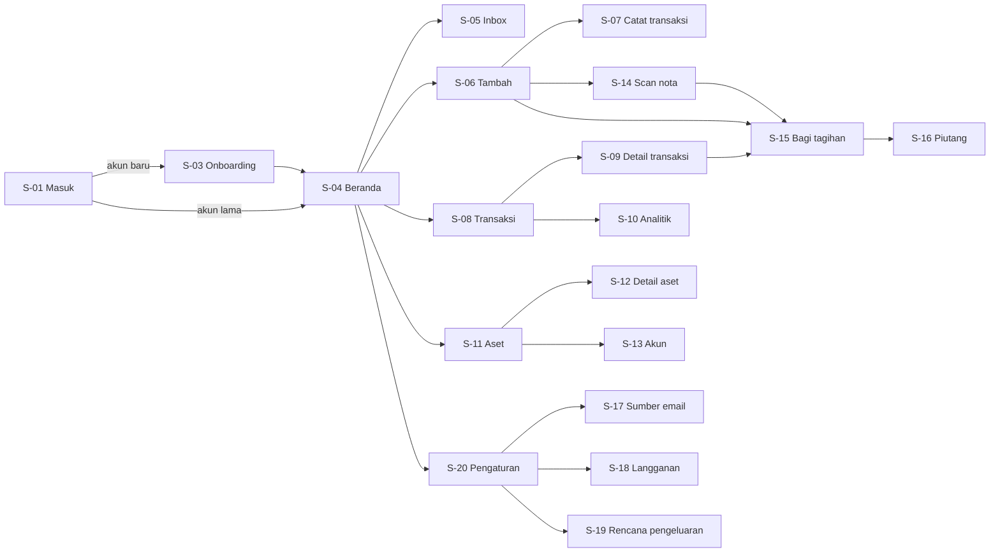

### 3.2 Alur pengguna utama

**UF-1 Email masuk sampai transaksi terkonfirmasi** (fitur: F-04.2, F-04.3, F-04.4, F-05.1, F-05.2)
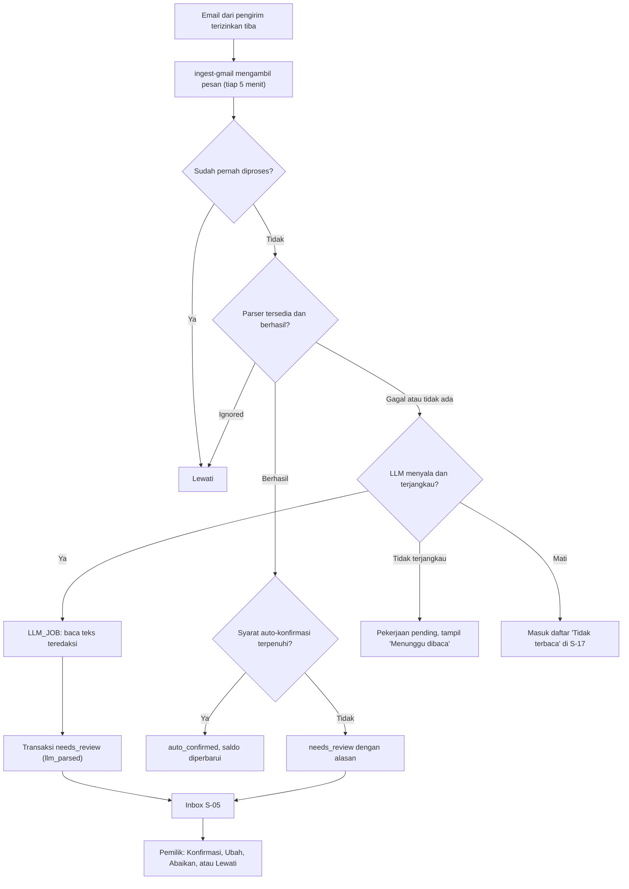

**UF-2 Catat transaksi manual** (fitur: F-03.1, F-03.2, F-03.3)
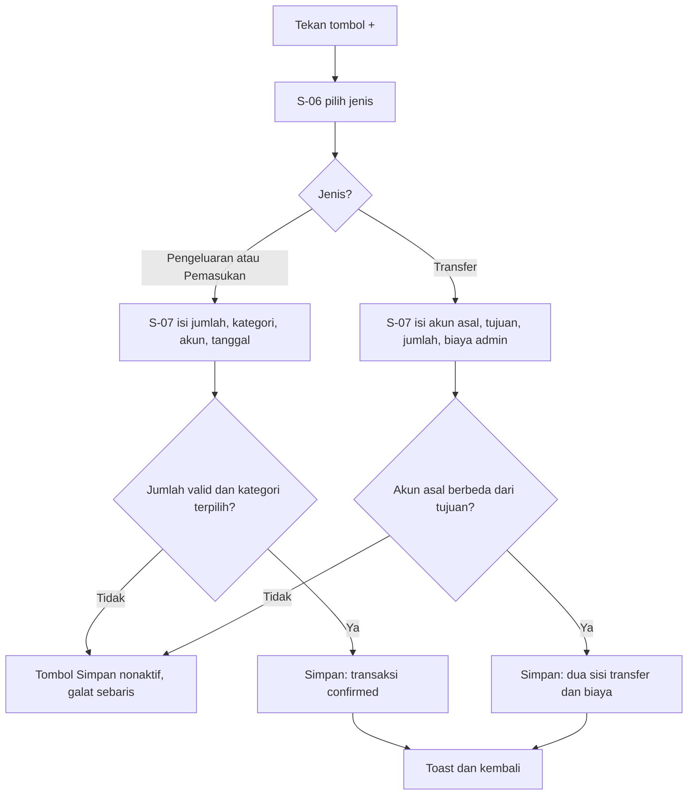

**UF-3 Scan nota dan pencocokan** (fitur: F-09.1, F-09.2, F-09.3)
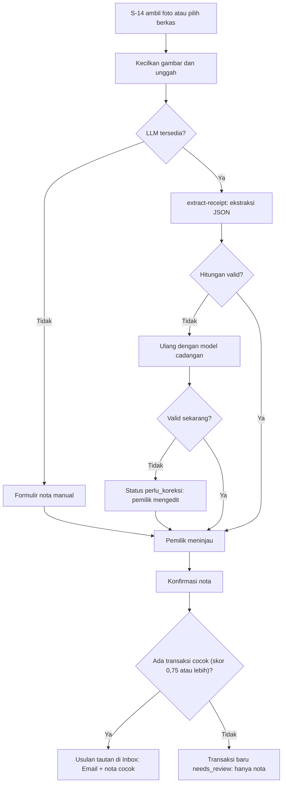

**UF-4 Bagi tagihan, piutang, dan pelunasan** (fitur: F-10.1, F-10.2, F-10.3)
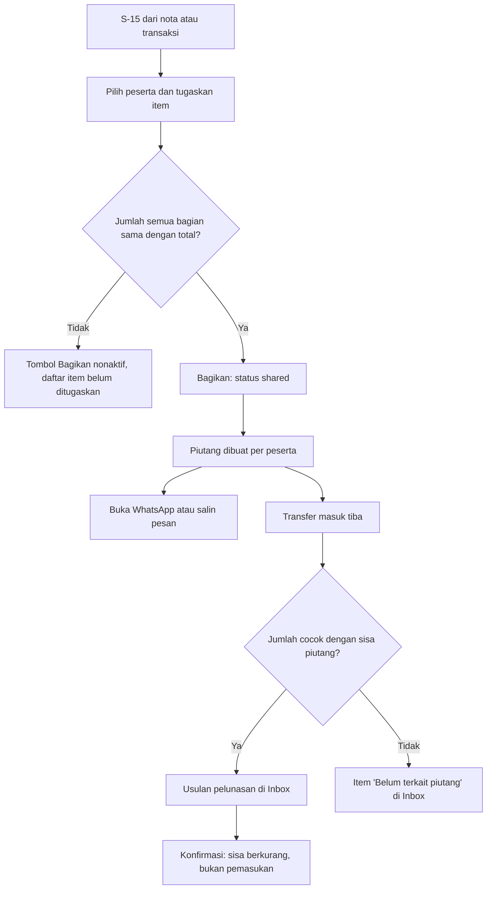

**UF-5 Pencairan aset** (fitur: F-07.3)
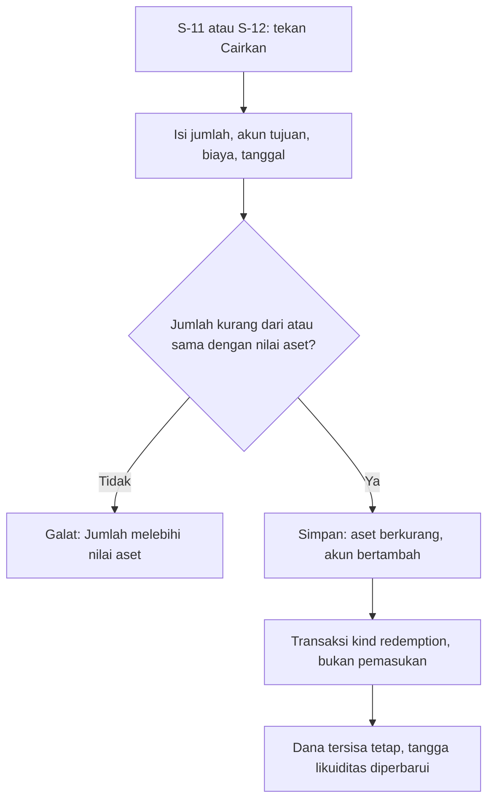

### 3.3 Inventaris layar
Keadaan umum (berlaku untuk semua layar): setiap daftar memiliki keadaan kosong, memuat (kerangka), dan galat dengan tombol "Coba lagi"; layar bertanda Pemilik mengalihkan ke S-01 bila belum masuk, dan ke S-02 bila terkunci; tiap layar dapat dibuka langsung lewat URL (deep link).

| ID | Nama | Rute | Peran yang boleh | Tujuan | Fitur | Komponen kunci | Keadaan khusus |
|---|---|---|---|---|---|---|---|
| S-01 | Masuk | `/masuk` | Tamu | Email, kata sandi, kode TOTP | F-01.1 | Formulir, input kode 6 digit | Terblokir 15 menit; daftar TOTP pertama kali |
| S-02 | Kunci aplikasi | lapisan di semua rute | Pemilik | Meminta PIN setelah idle | F-01.2 | Papan PIN 6 digit | Sesi berakhir setelah 5 salah |
| S-03 | Onboarding | `/mulai` | Pemilik | Tanggal lulus, cadangan, akun pertama, Gmail | F-01.3, F-02.1 | Stepper 4 langkah | Kemajuan tersimpan |
| S-04 | Beranda | `/` | Pemilik | Runway, akun, perlu dicek, terbaru | F-06.1, F-06.3, F-06.4, F-02.3, F-02.2 | Hero runway, kartu akun, kartu Perlu dicek, daftar transaksi | `data_belum_cukup`; banner (Gmail, deposito, harga, ekspor) |
| S-05 | Inbox | `/inbox` | Pemilik | Meninjau transaksi ambigu | F-05.1, F-05.2, F-05.3, F-05.4 | Kartu tumpuk (mobile), daftar dan detail (desktop), segmented | Kosong: "Semua sudah ditinjau" |
| S-06 | Tambah | `/tambah` | Pemilik | Memilih jenis input | F-03.2 | Lembar bawah dengan 5 baris | Tombol Tutup |
| S-07 | Catat transaksi | `/tambah/pengeluaran`, `/tambah/pemasukan`, `/tambah/transfer` | Pemilik | Numpad dan formulir | F-03.1, F-03.2, F-03.3, F-12.4 | Jumlah besar, numpad, chip, kolom kalimat biasa | Tidak ada koneksi |
| S-08 | Transaksi | `/transaksi` | Pemilik | Daftar, filter, cari | F-03.4 | Segmented, daftar bergrup, pencarian | Kosong pertama kali vs filter kosong |
| S-09 | Detail transaksi | `/transaksi/[id]` | Pemilik | Bukti, ubah, hapus | F-03.4, F-09.3 | Rincian, bukti dua kolom, aksi | Tidak ditemukan |
| S-10 | Analitik | `/analitik` | Pemilik | Batang bulanan dan kategori | F-08.1, F-08.2 | Batang bertumpuk, daftar bar | Bulan kosong |
| S-11 | Aset | `/aset` | Pemilik | Total dana, tangga likuiditas, jatuh tempo | F-07.2, F-07.3, F-07.4 | Bar komposisi, daftar/tabel, kartu perubahan | Tanpa aset |
| S-12 | Detail aset | `/aset/[id]` | Pemilik | Riwayat harga, ubah harga, cairkan | F-07.1, F-07.3 | Formulir harga, riwayat, dialog pencairan | Harga lama |
| S-13 | Akun | `/akun`, `/akun/[id]` | Pemilik | Kelola akun, titik cek | F-02.1, F-02.2, F-11.1 | Daftar akun, formulir, selisih | Akun diarsipkan |
| S-14 | Scan nota | `/nota/baru`, `/nota/[id]` | Pemilik | Unggah, tinjau, koreksi nota | F-09.1, F-09.2, F-09.3, F-12.2 | Pilih berkas, gambar dan formulir berdampingan | `perlu_koreksi`; LLM mati |
| S-15 | Bagi tagihan | `/bagi/[id]` | Pemilik | Editor pembagian dan pesan | F-10.1, F-10.2 | Peserta, penugasan item, ringkasan bagian | Total tidak sama |
| S-16 | Piutang | `/piutang` | Pemilik | Daftar dan pelunasan | F-10.3 | Daftar per orang | Tanpa piutang |
| S-17 | Sumber email | `/sumber` | Pemilik | Gmail, pengirim, tidak terbaca, impor | F-04.1, F-04.2, F-04.3, F-04.4, F-04.5, F-04.6 | Status integrasi, daftar pengirim, progres impor | Perlu hubungkan ulang |
| S-18 | Langganan | `/langganan` | Pemilik | Usulan dan daftar langganan | F-11.2 | Daftar, total per bulan | Tanpa usulan |
| S-19 | Rencana pengeluaran | `/rencana` | Pemilik | Biaya terjadwal | F-06.2, F-06.1 | Daftar, formulir | Item lewat |
| S-20 | Pengaturan | `/pengaturan` | Pemilik | Umum, keamanan, kategori dan aturan merchant, notifikasi, ekspor | F-01.2, F-01.3, F-03.5, F-05.4, F-12.1, F-12.3, F-13.1, F-13.2 | Bagian berjudul, sakelar, formulir | Banner cadangan |

## 4. Spesifikasi frontend *(Mode App)*
Sumber kebenaran visual: tangkapan layar di `design/` untuk S-04, S-05, S-06, S-11 (mobile dan desktop). Layar lain mengikuti token dan komponen di bawah. Semua nilai gaya berasal dari token di 4.2.

### 4.1 Arah visual
- **Kepribadian dan perasaan:** tenang, bersih, tepercaya. Pemilik membuka aplikasi dengan perasaan terkendali, bukan cemas.
- **Rujukan:** Copilot Money untuk tata letak kartu putih di atas latar abu kebiruan, hierarki angka besar, dan alur tinjau ala kotak masuk. Yang diambil: kartu bersudut besar dengan bayangan tipis berlapis, angka sebagai fokus. Tidak disalin: logo, ikon, atau ilustrasi.
- **Satu hal yang diingat:** satu angka "Dana tersisa" beserta garis proyeksi yang menunjukkan sampai kapan dana cukup.
- **Hindari:** emoji sebagai ikon; gradien ungu-biru; gradien pada teks; kaca buram (glassmorphism); kartu seragam berderet tanpa hierarki; kartu di dalam kartu; warna merah dan kata "boros" untuk status; status yang dibedakan hanya dengan warna; palet bawaan Tailwind tanpa dipilih; bayangan tebal atau cahaya (glow); easing memantul; sparkline dekoratif.
- **Kepadatan dan tema:** lega pada mobile, lebih padat pada tabel desktop; hanya tema terang di versi ini.

### 4.2 Design tokens
**Warna** (nilai nyata dan rasio kontras pasangan teks; rasio dihitung menurut WCAG)
| Token | Nilai | Dipakai untuk | Kontras |
|---|---|---|---|
| warna.latar | #F4F6F9 | latar halaman | - |
| warna.permukaan | #FFFFFF | kartu, lembar, bar | - |
| warna.teks | #0F1A2B | teks isi dan angka | 16,1:1 terhadap latar; 17,5:1 terhadap permukaan |
| warna.teks-redup | #4B586B | teks sekunder | 6,7:1 terhadap latar; 7,2:1 terhadap permukaan |
| warna.teks-pelan | #5F6B7C | keterangan, label | 5,0:1 terhadap latar; 5,4:1 terhadap permukaan; 4,8:1 terhadap isian |
| warna.isian | #EEF1F5 | tombol sekunder, petak ikon netral | - |
| warna.garis | #E3E8EF | pemisah dekoratif | tidak berlaku (dekoratif) |
| warna.garis-kontrol | #7F8CA0 | tepi input, chip tidak terpilih, kotak centang | 3,4:1 terhadap permukaan |
| warna.aksen | #2D5BD6 (pilihan lain: #0F766E, #B4532A) | aksi utama, tautan, penanda status | 5,9:1 terhadap permukaan; teks putih di atas aksen 5,9:1; #0F766E 5,5:1; #B4532A 5,0:1 |
| warna.aksen-lembut | campuran 12% aksen dengan putih (#E6EBFA untuk #2D5BD6) | latar chip status, tombol sekunder aksen, item terpilih | aksen di atasnya 4,9:1 |
| warna.aksen-sedang, warna.aksen-tinggi | campuran 40% dan 70% aksen dengan putih | segmen bar komposisi (dekoratif; arti ada di daftar) | tidak berlaku (dekoratif) |
| warna.masuk | #0E7A55 | angka "+" pada uang masuk | 5,3:1 terhadap permukaan |
| warna.peringatan | #7D5900 di atas #FBF0D2 | status perlu perhatian | 5,6:1 |
| warna.galat | #AE2D49 di atas #FBE5E9 | pesan galat, status "Belum cukup sampai lulus" | 5,4:1 |
| warna.info | sama dengan warna.aksen | informasi netral | 5,9:1 |
| Petak kategori (latar / ikon) | Makan #FDEBDD / #A24E17; Rumah #E1F2EA / #1B7556; Hiburan #F0E8FB / #6F3DB5; Belanja #E3EDFB / #2559B0; Pendidikan #FBF0D2 / #7D5900; Piutang #E6EBF2 / #3F4F66; Kesehatan #FBE5E9 / #AE2D49; Transportasi dan Tagihan memilih pasangan dengan rasio ≥ 4,5:1 | ikon kategori | 5,0:1; 4,9:1; 5,9:1; 5,7:1; 5,6:1; 7,0:1; 5,4:1 |

Aturan: kontras tepi kontrol minimal 3:1 (nilai #7F8CA0, lebih tinggi daripada tangkapan layar di `design/`); arti tidak boleh hanya warna, tiap status harus punya ikon dan teks.

**Tipografi, spasi, bentuk, kedalaman, gerak, tata letak**
| Kelompok | Nilai |
|---|---|
| Font | Plus Jakarta Sans (400, 500, 600, 700, subset Latin, lewat `next/font`); satu keluarga saja; semua angka memakai `font-variant-numeric: tabular-nums` (fitur ini ada di font ini); font sistem sebagai cadangan |
| Skala teks | Jumlah hero: mobile 38/46, desktop 52/64, bobot 700, jarak huruf −0,03em; awalan "Rp": mobile 20/30, desktop 26/40, bobot 600, warna teks-pelan; judul halaman: mobile 24/30, desktop 28/36, bobot 700; judul kartu: mobile 15/20, desktop 16/24, bobot 700; isi 14/20, bobot 400 sampai 600; keterangan 13/18; caption 12/16; angka baris 15/20 (mobile) dan 14/20 (desktop), bobot 600; jumlah numpad 44/52, bobot 700 |
| Spasi | Skala 4, 8, 12, 16, 20, 24, 28, 32 px; tepi halaman mobile 16 px, desktop 40 px; padding kartu 20 px (hero desktop 28 px); jarak antar kartu 16 px mobile, 24 sampai 28 px desktop |
| Radius dan garis batas | 10 (petak kecil), 12 (petak ikon), 14 (strip catatan), 20 (kartu), 28 (sudut atas lembar bawah), 999 (tombol dan chip pil); garis batas 1,5 px untuk chip terpilih, 1 px untuk chip tidak terpilih |
| Bayangan dan lapisan | E1: `0 0 0 1px rgba(15,26,43,0.04), 0 1px 2px rgba(15,26,43,0.06)`; E2 (kartu): `0 0 0 1px rgba(15,26,43,0.04), 0 1px 2px rgba(15,26,43,0.05), 0 6px 18px rgba(15,26,43,0.06)`; E3 (kartu fokus Inbox, lembar): `0 0 0 1px rgba(15,26,43,0.04), 0 2px 4px rgba(15,26,43,0.06), 0 14px 36px rgba(15,26,43,0.12)`; urutan lapisan: konten 0, navigasi 10, lembar bawah 20, lapisan kunci S-02 40, toast 50 |
| Gerak | Durasi 120 ms (cepat), 200 ms (sedang), 320 ms (lambat); easing `cubic-bezier(0.2, 0, 0, 1)`; hanya `transform` dan `opacity` yang dianimasikan; saat `prefers-reduced-motion`, semua perpindahan menjadi pemudaran 120 ms tanpa gerak spasial |
| Tata letak | Mobile satu kolom; sidebar 248 px tetap pada ≥ 1024 px; lebar konten maksimum 1240 px; rail kanan 340 sampai 400 px pada ≥ 1280 px |

### 4.3 Inventaris komponen
Basis: shadcn/ui di atas Tailwind (primitif Radix) yang digayakan ulang dengan token; ikon dari lucide-react dengan lebar garis 1,75 dan ukuran 18 sampai 24 px; komponen kustom hanya bila tidak ada padanannya. Setiap komponen interaktif memiliki keadaan default, hover, fokus (cincin 2 px berkontras ≥ 3:1), aktif, nonaktif, memuat, galat, dan sukses; hover tidak boleh menjadi satu-satunya cara menampilkan fungsi. Setiap daftar data memiliki keadaan kosong, memuat (kerangka), dan galat.

| Komponen | Tujuan | Varian | Keadaan dan perilaku khusus | Dipakai di |
|---|---|---|---|---|
| Tombol | Aksi | Utama (aksen penuh, teks putih), sekunder (isian), aksen-lembut, teks | Tinggi minimum 44 px, bentuk pil; memuat mempertahankan lebar dan menonaktifkan klik ganda | Semua layar |
| Kartu | Pembungkus bagian | Standar (E2), fokus (E3), datar | Tanpa kartu di dalam kartu; pemisah dengan garis 1 px dekoratif | S-04, S-05, S-10, S-11 |
| Petak kategori | Ikon kategori | 32, 36, 40, 44, 52 px | Selalu bersama teks kategori di sebelahnya | S-04, S-05, S-08, S-09 |
| Baris transaksi | Satu transaksi | Mobile, tabel desktop | Ikon centang verifikasi hanya untuk ≥ 2 bukti; jumlah rata kanan dengan angka tabular | S-04, S-08 |
| Kartu akun | Satu akun | Aksen (total), putih (akun), tumpukan desktop | 224 × 141 px di mobile; label sumber saldo berikon | S-04, S-13 |
| Hero runway | Dana, status, grafik | Mobile, desktop | Status berikon; grafik SVG dengan teks alternatif; keadaan `data_belum_cukup` | S-04 |
| Grafik runway | Proyeksi dana | Dengan atau tanpa gridline | Langkah turun pada pengeluaran terjadwal; garis putus-putus setelah lulus | S-04 |
| Grafik batang bulanan | Pengeluaran per bulan | 3, 6, 12 bulan | Bagian rutin dan sekali-jalan; bulan berjalan berpola diagonal dan berlabel; tabel data tersembunyi untuk pembaca layar | S-04, S-10 |
| Bar komposisi | Tangga likuiditas | 12 dan 14 px | Segmen dipisah 2 px; arti ada di daftar | S-11 |
| Segmented | Pilihan satu dari beberapa | 2–4 opsi | Tinggi 40 px; `aria-pressed`; tidak membungkus | S-05, S-08, S-04 |
| Numpad | Jumlah uang | Mobile | Tombol 0–9, 000, hapus; tombol ≥ 56 px; jumlah terformat saat mengetik | S-07 |
| Input uang | Jumlah di formulir | Dengan awalan "Rp" | Hanya angka; pemisah ribuan saat mengetik; galat sebaris | S-12, S-19, S-15 |
| Chip pilihan | Kategori, akun, tanggal | Terpilih (isi lembut + garis 1,5 px + ikon centang), tidak terpilih (garis kontrol) | Tinggi 44 px; `aria-pressed` | S-07, S-05 |
| Kartu tumpuk Inbox | Peninjauan satu per satu | Dengan dan tanpa pengintip | Geser kanan dan kiri disertai tombol; penunjuk progres bersegmen | S-05 (mobile) |
| Navigasi bawah | Navigasi mobile | 5 slot | Tinggi 80 px; tombol "+" 52 px; lencana Inbox; pil latar pada item aktif | Semua layar mobile |
| Sidebar | Navigasi desktop | Biasa, aktif | Lebar 248 px; item aktif berlatar aksen-lembut dan teks aksen | Semua layar desktop |
| Lembar bawah | Menu Tambah, dialog mobile | Standar | Sudut atas 28 px; pegangan; tombol Tutup ≥ 44 px; fokus terperangkap | S-06 |
| Dialog | Konfirmasi aksi merusak | Standar | Tombol berkata kerja spesifik; fokus awal pada pilihan aman | S-05, S-09, S-12, S-19 |
| Toast | Umpan balik ringan | Sukses, galat | Maks 1 tampil; tombol Urungkan 6 detik; tidak menutup aksi utama | Global |
| Tabel | Daftar rapat di desktop | Standar | Tajuk kolom `th scope`; baris 60 sampai 68 px; di mobile menjadi daftar | S-04, S-08, S-11 |
| Banner | Pemberitahuan keadaan | Info, perhatian | Berikon; bisa ditutup 7 hari; maks 2 tampil | S-04, S-17, S-20 |
| Kerangka (skeleton) | Keadaan memuat | Per komponen | Mempertahankan ukuran agar tata letak tidak bergeser | Semua daftar dan kartu |

### 4.4 Tata letak layar inti
**S-04 Beranda** (referensi `design/m-beranda.png`, `design/d-beranda.png`)
- Zona (sempit → lebar): mobile: judul + tombol profil, hero runway, baris Akun, kartu Perlu dicek, daftar Terbaru, navigasi bawah; desktop ≥ 1024 px: sidebar kiri, kolom utama (hero lebar, tabel "Transaksi terbaru"), dan pada ≥ 1280 px rail kanan (tumpukan akun, Perlu dicek, baris "Aset lain").
- Hierarki dan aksi utama: "Dana tersisa" paling menonjol; aksi utama mobile adalah tombol "+" di navigasi; aksi utama desktop adalah tombol "Catat transaksi" di sidebar; aksi kedua "Konfirmasi" pada kartu Perlu dicek.
- Perilaku: hero tampil tanpa menggulir pada 360 × 780 px; pilihan "Dana | Per bulan" mengganti grafik tanpa memuat ulang halaman; kartu akun dapat digeser; dasar daftar mobile memudar sebagai petunjuk gulir.

**S-05 Inbox** (referensi `design/m-inbox.png`, `design/d-inbox.png`)
- Zona: mobile: header (kembali, judul, "3 dari 7"), penunjuk progres bersegmen, kartu tumpuk (merchant, jumlah besar, baris Bukti, Rincian, Akun, Kategori), tombol Konfirmasi selebar layar, tombol teks Ubah, Bagi tagihan, Abaikan; desktop: segmented di atas, daftar 360 sampai 400 px di kiri, detail di kanan (bukti dua kolom, strip kecocokan, pilihan kategori, kotak "Ingat kategori ini", tombol), serta tautan "transaksi masuk otomatis".
- Hierarki dan aksi utama: Konfirmasi; satu aksi utama per layar.
- Perilaku: setelah aksi, item berikutnya terpilih; keyboard Enter, panah, E, S, X di desktop; kosong menampilkan "Semua sudah ditinjau".

**S-06 Tambah** (referensi `design/m-tambah.png`)
- Zona: lembar bawah di atas layar yang dibuka, dengan latar redup; lima baris (ikon, judul, keterangan, panah).
- Hierarki dan aksi utama: memilih satu baris; tidak ada tombol utama; Tutup di kanan atas.
- Perilaku: Escape dan ketuk di luar menutup; fokus kembali ke tombol "+".

**S-07 Catat transaksi**
- Zona (sempit → lebar): atas: segmented jenis (Pengeluaran, Pemasukan, Transfer) dan kolom kalimat biasa (F-12.4); tengah: jumlah besar dengan "Rp"; chip kategori, akun, tanggal; bawah: numpad dan tombol Simpan selebar layar. Pada ≥ 1024 px tampil sebagai dialog 480 px dengan kolom jumlah dan formulir di atas dan keyboard fisik sebagai masukan utama.
- Hierarki dan aksi utama: jumlah, lalu Simpan.
- Perilaku: Simpan nonaktif sampai jumlah > 0 dan kategori terpilih; toast dan kembali setelah tersimpan.

**S-11 Aset** (referensi `design/m-aset.png`, `design/d-aset.png`)
- Zona: mobile: judul + tombol tambah, kartu Total dana + Perubahan bulan ini, kartu Tangga likuiditas (bar + 5 baris), kartu Jatuh tempo berikutnya; desktop: kartu besar (total, bar, tabel dengan kolom Aset, Cair dalam, Nilai, Pasar bulan ini) di kiri; rail kanan (Perubahan dana bulan ini, Jatuh tempo berikutnya + catatan pencairan).
- Hierarki dan aksi utama: total dana; aksi utama "Tambah aset".
- Perilaku: baris aset membuka S-12; keterangan "Harga berfluktuasi" dan "Harga lama" berikon.

**S-10 Analitik**: atas: pilihan rentang (3, 6, 12 bulan) dan batang bertumpuk; bawah: pemilih bulan, total dengan perbandingan, daftar kategori berbar. Aksi utama: memilih bulan.
**S-14 Scan nota**: mobile: tombol Foto dan Pilih berkas, lalu hasil sebagai formulir; desktop: gambar di kiri dan formulir di kanan; aksi utama Konfirmasi nota.
**S-15 Bagi tagihan**: atas: ringkasan nota; tengah: peserta dan penugasan item; bawah: bagian per orang, baris pemeriksaan jumlah, tombol Bagikan.

### 4.5 Navigasi dan pola global
- Kerangka: bar navigasi bawah pada < 1024 px, sidebar pada ≥ 1024 px; satu peran (Pemilik) sehingga kerangka sama untuk semua layar yang boleh dibuka.
- Rute tidak ditemukan: halaman "Halaman tidak ditemukan" dengan tombol "Kembali ke Beranda". Rute tanpa sesi: S-01. Sesi aal1: S-01 langkah TOTP.
- Galat pada bidang: pesan sebaris. Konfirmasi ringan atau hasil aksi: toast. Aksi yang tidak bisa dibatalkan (hapus aset, hapus piutang, putuskan Gmail): dialog.
- Tombol kembali peramban selalu kembali ke layar sebelumnya; filter dan tab tersimpan di URL; kartu yang dibuka lewat deep link tetap menampilkan navigasi.

### 4.6 Responsif
Pendekatan mobile-first: gaya dasar untuk lebar 360 px, ditambah di titik berikut yang ditentukan oleh titik rusaknya tata letak:
- ≥ 768 px: konten satu kolom maks 720 px di tengah, bar bawah tetap, lembar bawah menjadi dialog di tengah.
- ≥ 1024 px: sidebar 248 px menggantikan bar bawah; tabel menggantikan daftar baris; Inbox menjadi dua panel.
- ≥ 1280 px: rail kanan 340 sampai 400 px; di bawah 1280 px rail turun ke bawah hero.
- Target sentuh minimal 44 × 44 px (WCAG 2.2 mensyaratkan minimal 24 × 24 px). Tidak ada fungsi yang hanya tersedia lewat hover. Tidak ada gulir horizontal halaman kecuali baris kartu akun yang sengaja. Tata letak tetap terbaca pada zoom 200%.

### 4.7 Interaksi dan formulir
- **Validasi:** saat bidang ditinggalkan dan saat kirim; pesan sebaris di bawah bidang; formulir panjang (S-03, S-15) menambah ringkasan galat di atas dengan tautan ke bidang.
- **Kirim:** tombol Simpan nonaktif selama menunggu; aksi gagal mengembalikan nilai formulir.
- **Aksi merusak:** dialog dengan kata kerja spesifik ("Hapus aset", "Putuskan Gmail"); fokus awal pada "Batal".
- **Umpan balik:** berhasil, gagal, dan memproses selalu terlihat; pembaruan menunggu respons server (tanpa optimistis) kecuali Konfirmasi Inbox yang optimistis dengan pemulihan bila gagal.
- **Autosave:** hanya kemajuan onboarding; formulir lain tidak menyimpan draf.
- **Keyboard:** urutan Tab mengikuti urutan visual; pintasan Inbox desktop (Enter, panah, E, S, X) hanya aktif saat fokus tidak berada di kolom teks.
- **Gerak:** durasi dan easing dari token; hormati `prefers-reduced-motion`; tidak ada informasi yang disampaikan hanya oleh gerak.
- **Gestur:** geser Inbox selalu punya tombol pengganti.

### 4.8 Konten dan teks antarmuka
- **Bahasa dan nada:** Bahasa Indonesia, sapaan "kamu", santai dan sopan, tanpa kata teknis dan tanpa menyalahkan; tanpa "Oops"; tanpa emoji.
- **Pola pesan galat tiga bagian:** apa yang terjadi, kenapa atau dampaknya, apa yang harus dilakukan. Contoh: "Kode salah. Jam di ponselmu mungkin tidak tepat. Perbaiki jam lalu coba lagi."
- **Tombol:** kata kerja spesifik ("Simpan transaksi", "Konfirmasi", "Hubungkan Gmail"), bukan "OK" atau "Kirim".
- **Keadaan kosong:** pertama kali mengajak dan menjelaskan ("Belum ada transaksi. Catat yang pertama atau hubungkan Gmail."); kosong karena filter singkat dengan tombol "Hapus filter".
- **Format:** `Rp 1.250.000`; tanda "−" dan "+" pada angka; tanggal "14 Nov 2026"; jam "17:57 WIB"; persen satu desimal dengan koma ("20,9%"); jutaan ringkas hanya di grafik ("8,4 jt").

| Kunci | Teks |
|---|---|
| status.sesuai | Sesuai rencana |
| status.perhatian | Perlu diperhatikan |
| status.belum_cukup | Belum cukup sampai lulus |
| status.data_kurang | Isi estimasi pengeluaran |
| runway.cukup | Cukup sampai ±{bulan tahun} |
| inbox.kosong | Semua sudah ditinjau |
| galat.koneksi | Tidak ada koneksi. Transaksi belum tersimpan. |
| harga.lama | Harga lama |

### 4.9 Aksesibilitas
Target **WCAG 2.2 AA** sebagai persyaratan yang bisa diuji:
- Kontras teks ≥ 4,5:1 (≥ 3:1 untuk teks besar); komponen, ikon bermakna, dan indikator fokus ≥ 3:1 (token di 4.2).
- Semua fungsi dapat dipakai lewat keyboard; fokus terlihat dan tidak tertutup elemen yang menempel; tidak ada perangkap keyboard kecuali lembar bawah dan dialog yang memang mengurung fokus dan bisa ditutup dengan Escape.
- Target pointer ≥ 24 × 24 px (diterapkan 44 px).
- Setiap bidang formulir memiliki label terlihat dan terkait; galat diumumkan lewat `aria-live` dan dikaitkan dengan bidangnya.
- Informasi tidak hanya lewat warna (status, bulan berjalan, tanda "+" dan "−" pada angka, penanda "Harga lama").
- HTML semantik dan landmark (`nav`, `main`, `aside`), judul berurutan, grafik punya teks alternatif dan tabel data.
- Teks dapat diperbesar 200% tanpa kehilangan fungsi.
- Hormati `prefers-reduced-motion`; tidak ada konten berkedip lebih dari 3 kali per detik.
- Geser di Inbox punya alternatif satu pointer; autentikasi tidak memakai uji kognitif selain kode TOTP dan PIN yang boleh ditempel.

### 4.10 Performa dan perangkat target
- **Perangkat dan browser:** HP Android kelas menengah dan laptop kelas menengah; Chrome dan Edge, Firefox, Safari (dua versi terbaru). Pengujian performa memakai profil 4G terlambat dan CPU diperlambat 4× `(asumsi)`.
- **Anggaran:** LCP ≤ 2,5 detik; INP ≤ 200 ms; CLS ≤ 0,1; JavaScript awal S-04 ≤ 180 KB terkompresi `(asumsi)`; satu keluarga font dengan 4 bobot dan `font-display: swap`; grafik SVG tanpa pustaka grafik berat.
- **Animasi:** hanya `transform` dan `opacity`; efek berat (bayangan E3 pada daftar panjang) dimatikan pada perangkat lemah tanpa mengubah tata letak.
- **Privasi cache:** service worker tidak boleh menyimpan respons data keuangan; hanya aset statis.

### 4.11 Arsitektur frontend
- Next.js 16 dengan App Router saja; tidak memakai Pages Router (`getServerSideProps`, `pages/api`). Pengalihan sesi lewat berkas proxy sesuai versi terpasang (di Next.js 16 bernama `proxy.ts`, bukan `middleware.ts`).
- Komponen server secara default; komponen klien hanya untuk state, efek, API peramban, dan penangan peristiwa.
- Pengambilan data di komponen server lewat klien Supabase berbasis cookie; mutasi lewat Server Actions; route handler hanya untuk pemanggil luar (callback Google, webhook, share target, ekspor).
- State: URL untuk filter, tab, bulan, dan halaman; state global minimum; validasi bersama dengan zod.
- Styling: satu pendekatan, Tailwind dengan variabel CSS dari token 4.2; tanpa CSS Modules atau CSS-in-JS.
- Struktur folder: `src/app` (rute), `src/components` (komponen), `src/lib/core` (logika murni bersama: format uang, parser uang, alokasi bagi tagihan, proyeksi runway, skor pencocokan), `supabase/` (migrasi, fungsi, seed), `design/`. Tidak ada folder `pages/`, `services/`, `utils/` gaya lama. Logika murni hanya ditulis sekali dan diimpor oleh Next.js maupun Edge Functions.
- Pemeriksaan izin dipusatkan pada satu fungsi `requireOwner()`; komponen hanya mencerminkan hasilnya.
- TypeScript mode ketat; uang selalu `number` bilangan bulat rupiah dan tidak pernah float untuk perhitungan antar nilai uang pecahan; pembagian proporsional memakai fungsi inti.

### 4.12 Aset dan identitas
- Nama aplikasi dari konstanta `APP_NAME` (default "Glideslope", OQ-1) dengan wordmark teks; tanpa logo gambar.
- Ikon: satu set lucide-react; ikon PWA 192 dan 512 px (termasuk versi maskable) berupa monogram dari `APP_NAME` berlatar warna aksen, bertanda placeholder di README agar diganti.
- Tanpa ilustrasi stok; keadaan kosong memakai ikon garis dan teks.
- Favicon, judul halaman "{Layar} · {APP_NAME}", `theme_color` #2D5BD6, `lang="id"`.

### 4.13 Kriteria penerimaan frontend
- [ ] Semua nilai warna, font, spasi, radius, bayangan, dan gerak pada komponen berasal dari token 4.2; pencarian nilai heksa mentah di luar berkas token tidak menemukan apa pun.
- [ ] Setiap komponen interaktif punya keadaan hover, fokus, nonaktif, memuat, dan galat sesuai 4.3; setiap daftar punya keadaan kosong, memuat, dan galat.
- [x] S-04, S-05, S-08, S-11 diperiksa pada lebar 360, 768, dan 1280 px: tanpa gulir horizontal (selain baris kartu akun), tanpa elemen terpotong, aksi utama terlihat tanpa gulir pada 360 × 780 px untuk S-04 dan S-05.
- [x] Pemeriksaan axe lewat Playwright pada S-01, S-04, S-05, S-07, S-08, S-11 tanpa pelanggaran serius atau kritis, ditambah uji keyboard pada alur UF-1 dan UF-2.
- [ ] Lighthouse pada S-04 memenuhi anggaran 4.10 (LCP ≤ 2,5 detik, INP ≤ 200 ms, CLS ≤ 0,1).
- [x] Tangkapan layar S-04, S-05, S-06, S-11 pada 390 px dan 1440 px dibandingkan dengan `design/` dan perbedaannya dicatat di laporan akhir.
- [ ] Semua teks antarmuka mengikuti nada dan pola galat 4.8 dan tidak memuat emoji.

## 5. Model data *(Mode App)*

Diagram adalah ringkasan; kamus entitas dan tabel aturan di bawahnya yang berlaku. Nama tabel dan kolom memakai bahasa Inggris snake_case (nama entitas di diagram huruf besar menunjuk tabel berhuruf kecil, misalnya `TRANSACTION` menjadi `transactions`); label antarmuka berbahasa Indonesia.

Konvensi untuk semua entitas kecuali dinyatakan lain: kolom umum `id` (uuid, PK, default `gen_random_uuid()`), `user_id` (uuid, FK ke `auth.users`, wajib, berindeks, hapus berantai), `created_at` dan `updated_at` (timestamptz UTC, default `now()`). Uang adalah bigint rupiah. Waktu adalah timestamptz UTC. Setiap tabel mengaktifkan RLS dengan kebijakan `user_id = auth.uid()` dan syarat sesi aal2 (bagian 6). Enumerasi ditulis sebagai tipe enum Postgres atau `text` dengan `check`.

### 5.1 Diagram entitas-relasi

**ERD-A Uang inti**
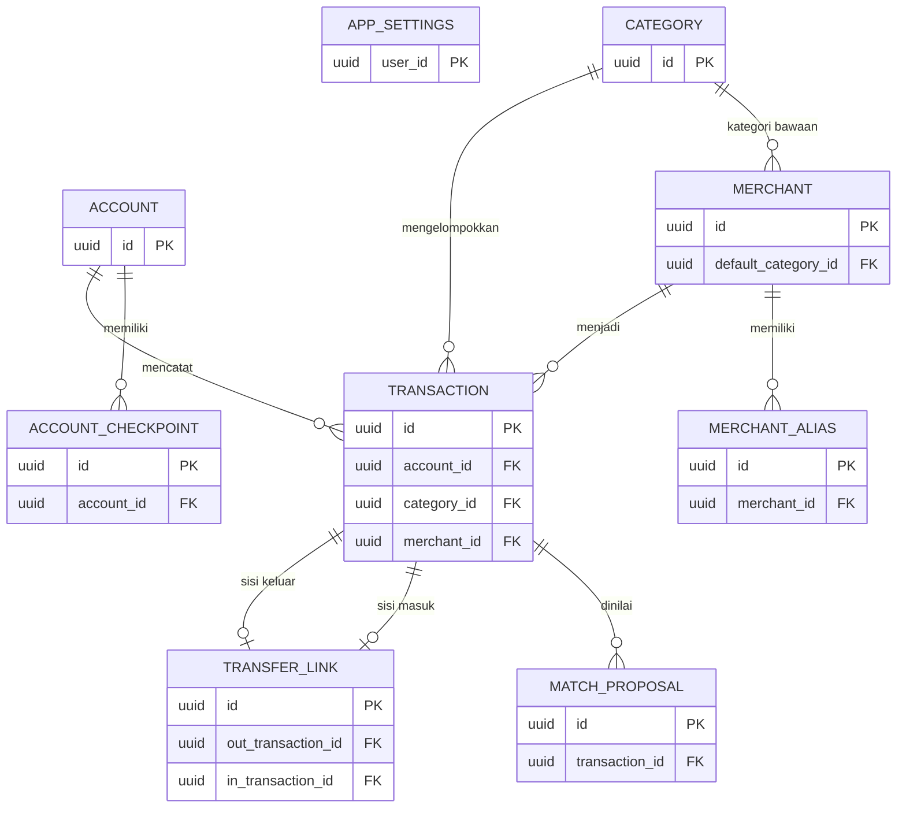

**ERD-B Bukti, email, dan LLM**
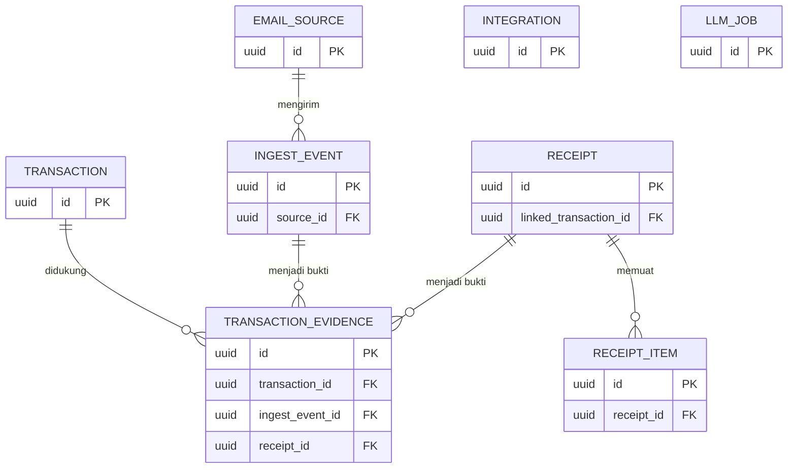

**ERD-C Aset, rencana, langganan, push**
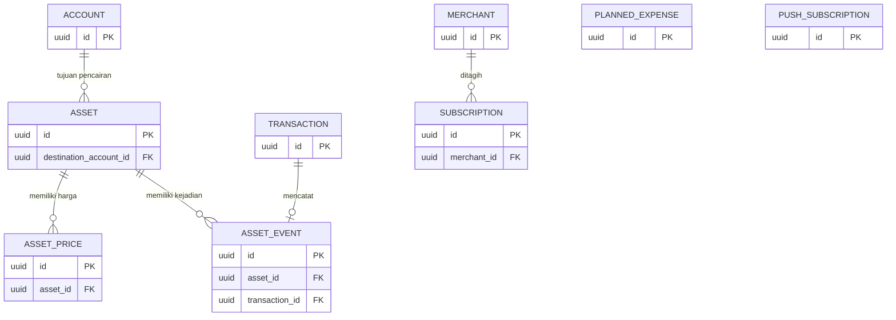

**ERD-D Bagi tagihan dan piutang**
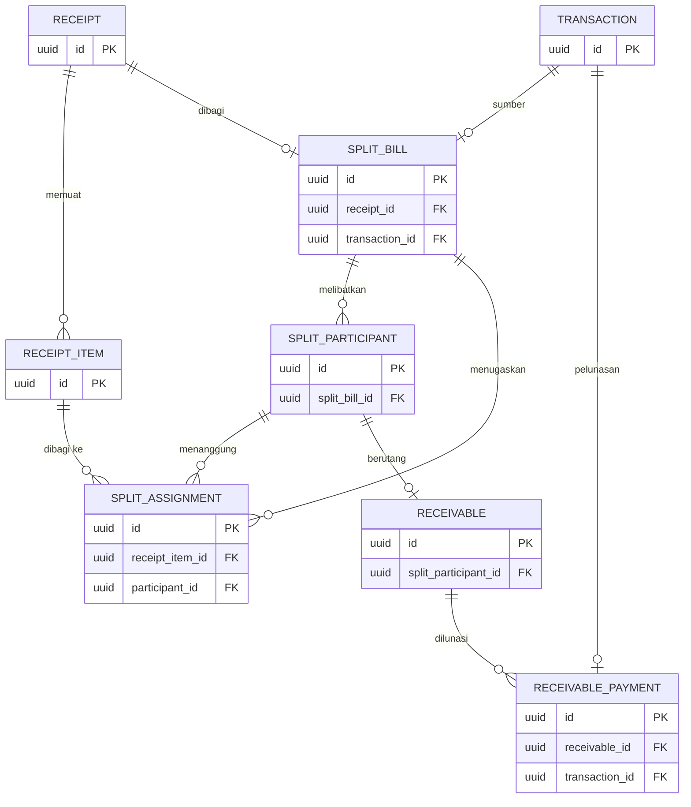

### 5.2 Kamus entitas

#### APP_SETTINGS
Dipakai oleh: F-01.2, F-01.3, F-05.4, F-06.1, F-12.3, F-13.2

Satu baris per pengguna; `user_id` adalah PK dan tidak ada kolom `id`.

| Field | Tipe | Wajib | Constraint / nilai awal | Keterangan |
|---|---|---|---|---|
| user_id | uuid | ya | PK, FK `auth.users` | Pemilik |
| graduation_date | date | tidak | harus > hari ini saat disimpan | Tanggal perkiraan lulus |
| emergency_reserve | bigint | ya | ≥ 0, default 0 | Cadangan darurat |
| burn_override | bigint | tidak | ≥ 0 | Estimasi pengeluaran rutin bulanan manual |
| large_amount_threshold | bigint | ya | 10.000 sampai 50.000.000, default 500.000 | Ambang nominal besar |
| idle_timeout_minutes | int | ya | salah satu dari 1, 5, 15, 30; default 5 | Batas idle kunci aplikasi |
| pin_hash, pin_salt | text | tidak | kosong bila kunci mati | Hasil PBKDF2 dan garam |
| pin_iterations | int | tidak | ≥ 210.000 | Jumlah iterasi |
| redaction_terms | text[] | ya | default kosong | Kata (nama, alamat) yang diredaksi sebelum ke LLM |
| payment_instructions | text | tidak | ≤ 500 karakter | Teks ditambahkan ke pesan penagihan |
| llm_enabled | boolean | ya | default true | Sakelar LLM |
| auto_link_transfers | boolean | ya | default false | Tautkan transfer otomatis |
| onboarding_step | int | ya | 1 sampai 5; 5 = selesai; default 1 | Kemajuan onboarding |
| gmail_prompt_dismissed_until | timestamptz | tidak | | Ajakan Gmail ditutup |
| dismissed_banners | jsonb | ya | default `{}` | Kunci banner ke waktu muncul lagi |
| last_export_at | timestamptz | tidak | | Ekspor terakhir |
| push_prefs | jsonb | ya | default semua true | Sakelar per jenis notifikasi |

#### ACCOUNT
Dipakai oleh: F-02.1, F-02.2, F-02.3, F-03.1, F-03.3, F-07.3, F-11.1

| Field | Tipe | Wajib | Constraint / nilai awal | Keterangan |
|---|---|---|---|---|
| name | text | ya | 1–40 karakter; unik tanpa beda huruf pada akun yang tidak diarsipkan | Nama tampil |
| kind | enum | ya | `bank`, `ewallet`, `cash` | Jenis |
| last4 | text | tidak | 4 digit | 4 digit terakhir rekening |
| number | text | tidak | 6–20 digit; bila diisi, last4 = 4 digit terakhirnya | Nomor rekening atau HP lengkap; tampil hanya saat privasi dibuka (ditambahkan 2026-11-04 atas keputusan pemilik) |
| match_hints | text[] | ya | default kosong | Kata untuk mencocokkan petunjuk akun dari email |
| opening_balance | bigint | ya | ≥ 0, ≤ 10.000.000.000 | Saldo awal |
| opening_date | date | ya | | Saldo dihitung dari tanggal ini |
| sort_order | int | ya | default 0 | Urutan kartu |
| is_system | boolean | ya | default false | True hanya untuk akun "Belum ditentukan" |
| archived_at | timestamptz | tidak | | Diarsipkan |

#### ACCOUNT_CHECKPOINT
Dipakai oleh: F-02.2, F-11.1

| Field | Tipe | Wajib | Constraint / nilai awal | Keterangan |
|---|---|---|---|---|
| account_id | uuid | ya | FK ke ACCOUNT | |
| as_of | date | ya | tidak di masa depan | Tanggal saldo |
| balance | bigint | ya | bilangan bulat | Saldo menurut statement atau aplikasi bank |
| source | enum | ya | `manual`, `statement` | Asal angka |

#### CATEGORY
Dipakai oleh: F-03.5, F-08.2

| Field | Tipe | Wajib | Constraint / nilai awal | Keterangan |
|---|---|---|---|---|
| name | text | ya | 1–30 karakter; unik per (kind, nama tanpa beda huruf) | |
| kind | enum | ya | `expense`, `income` | |
| icon_key | text | ya | salah satu kunci ikon lucide yang dipakai | Ikon petak |
| tone_key | text | ya | kunci pasangan warna di 4.2 | Warna petak |
| is_system | boolean | ya | default false | Kategori awal tidak dihapus |
| sort_order | int | ya | default 0 | |
| archived_at | timestamptz | tidak | | |

#### MERCHANT
Dipakai oleh: F-03.5, F-04.3, F-05.4, F-11.2

| Field | Tipe | Wajib | Constraint / nilai awal | Keterangan |
|---|---|---|---|---|
| display_name | text | ya | 1–80 karakter | Nama tampil |
| match_key | text | ya | unik per pengguna | Nama ternormalisasi menurut aturan di F-03.5 |
| default_category_id | uuid | tidak | FK ke CATEGORY | Kategori bawaan |
| default_one_off | boolean | ya | default false | Tandai sekali-jalan otomatis |
| skip_review | boolean | ya | default false | Lewati peninjauan (Tabel 5.4-A) |

#### MERCHANT_ALIAS
Dipakai oleh: F-03.5

| Field | Tipe | Wajib | Constraint / nilai awal | Keterangan |
|---|---|---|---|---|
| merchant_id | uuid | ya | FK ke MERCHANT, hapus berantai | Merchant tujuan |
| alias_key | text | ya | unik per pengguna | Nama ternormalisasi yang dipetakan |

#### TRANSACTION
Dipakai oleh: F-03.1, F-03.2, F-03.3, F-03.4, F-04.2, F-05.1, F-05.2, F-05.3, F-06.1, F-07.1, F-07.3, F-08.1, F-09.3, F-10.3

| Field | Tipe | Wajib | Constraint / nilai awal | Keterangan |
|---|---|---|---|---|
| account_id | uuid | ya | FK ke ACCOUNT | Akun terdampak |
| direction | enum | ya | `in`, `out` | Arah uang pada akun |
| amount | bigint | ya | > 0, ≤ 999.999.999 | Rupiah |
| occurred_at | timestamptz | ya | tidak lebih dari 1 hari di depan | Waktu kejadian |
| kind | enum | ya | `expense`, `income`, `transfer`, `fee`, `redemption`, `investment`, `repayment` | Pengaruh pada metrik: Tabel 5.4-J; `expense`, `fee`, `investment` selalu `out`; `income`, `redemption`, `repayment` selalu `in` |
| category_id | uuid | kondisional | FK; wajib bila kind `expense`, `income`, atau `fee` dan status `confirmed` atau `auto_confirmed` | Kategori |
| merchant_id | uuid | tidak | FK ke MERCHANT | |
| merchant_raw | text | tidak | ≤ 200 karakter | Nama mentah dari sumber |
| note | text | tidak | ≤ 500 karakter | Catatan |
| status | enum | ya | `needs_review`, `confirmed`, `auto_confirmed`, `ignored`; manual langsung `confirmed` | Siklus: 5.3 |
| review_reason | enum | tidak | `merchant_baru`, `kepercayaan_rendah`, `nominal_besar`, `llm_parsed`, `hanya_nota`, `transfer_tidak_jelas`, `akun_tidak_dikenal`, `duplikat_diduga`; wajib bila status `needs_review` | Alasan |
| confidence | numeric(3,2) | tidak | 0,00 sampai 1,00 | Kepercayaan; LLM ≤ 0,60 |
| source | enum | ya | `manual`, `email`, `receipt`, `webhook` | Asal |
| is_one_off | boolean | ya | default false | Sekali-jalan; dikecualikan dari rata-rata rutin |
| dedupe_key | text | tidak | unik per pengguna bila tidak kosong | Kunci dedupe dari parser |
| deleted_at | timestamptz | tidak | | Hapus lunak |

Indeks: `(user_id, occurred_at desc)`; `(user_id, status)` sebagian untuk `needs_review`; `(user_id, dedupe_key)` unik sebagian; `(account_id, occurred_at)`.

#### TRANSFER_LINK
Dipakai oleh: F-03.3, F-05.3

| Field | Tipe | Wajib | Constraint / nilai awal | Keterangan |
|---|---|---|---|---|
| out_transaction_id | uuid | ya | FK ke TRANSACTION; unik | Sisi keluar |
| in_transaction_id | uuid | ya | FK ke TRANSACTION; unik; berbeda dari sisi keluar | Sisi masuk |
| fee_transaction_id | uuid | tidak | FK ke TRANSACTION | Biaya admin |
| created_by | enum | ya | `manual`, `proposal`, `auto` | |

#### MATCH_PROPOSAL
Dipakai oleh: F-04.2, F-05.3, F-09.3, F-10.3

| Field | Tipe | Wajib | Constraint / nilai awal | Keterangan |
|---|---|---|---|---|
| type | enum | ya | `transfer`, `repayment`, `receipt_link`, `duplicate_suspect` | Jenis usulan |
| transaction_id | uuid | ya | FK ke TRANSACTION | Transaksi utama |
| other_transaction_id | uuid | tidak | FK ke TRANSACTION | Pasangan (transfer, duplikat) |
| receipt_id | uuid | tidak | FK ke RECEIPT | Untuk `receipt_link` |
| receivable_id | uuid | tidak | FK ke RECEIVABLE | Untuk `repayment` |
| score | numeric(3,2) | ya | 0,00 sampai 1,00 | Skor Tabel 5.4-F |
| fee_amount | bigint | ya | default 0 | Selisih jumlah (biaya admin) |
| status | enum | ya | `open`, `accepted`, `rejected`, `closed` | Siklus: 5.3 |
| resolved_at | timestamptz | tidak | | |

Unik: satu pasangan (type, transaction_id, pasangan) hanya sekali; proposal `rejected` tidak dibuat ulang.

#### TRANSACTION_EVIDENCE
Dipakai oleh: F-03.4, F-04.2, F-09.3

| Field | Tipe | Wajib | Constraint / nilai awal | Keterangan |
|---|---|---|---|---|
| transaction_id | uuid | ya | FK ke TRANSACTION, hapus berantai | |
| role | enum | ya | `email`, `receipt`, `webhook`, `manual` | Jenis bukti |
| ingest_event_id | uuid | tidak | FK ke INGEST_EVENT | Untuk email dan webhook |
| receipt_id | uuid | tidak | FK ke RECEIPT | Untuk nota |
| parsed_amount | bigint | tidak | | Jumlah menurut bukti |
| match_score | numeric(3,2) | tidak | | Skor kecocokan bila lintas sumber |

Unik: `(transaction_id, ingest_event_id)` dan `(transaction_id, receipt_id)`.

#### INGEST_EVENT
Dipakai oleh: F-04.2, F-04.3, F-04.4, F-04.5, F-04.6, F-12.1

| Field | Tipe | Wajib | Constraint / nilai awal | Keterangan |
|---|---|---|---|---|
| channel | enum | ya | `gmail`, `webhook` | |
| external_id | text | ya | unik bersama (user_id, channel) | Id pesan Gmail atau hash webhook |
| source_id | uuid | tidak | FK ke EMAIL_SOURCE | |
| sender | text | ya | | Pengirim |
| subject | text | tidak | ≤ 200 karakter | |
| received_at | timestamptz | ya | | Waktu pesan |
| parser_id | text | tidak | | Parser yang dipakai |
| parse_status | enum | ya | `pending`, `parsed`, `ignored`, `failed`, `needs_llm`, `unreadable`; default `pending` | |
| parse_error | text | tidak | | Alasan gagal |
| parsed | jsonb | tidak | | Keluaran terstruktur (Tabel 5.4-B) |
| raw_text_redacted | text | tidak | ≤ 20.000 karakter | Teks teredaksi; dikosongkan setelah 90 hari |

#### EMAIL_SOURCE
Dipakai oleh: F-04.2, F-04.3, F-04.5

| Field | Tipe | Wajib | Constraint / nilai awal | Keterangan |
|---|---|---|---|---|
| sender_address | text | ya | huruf kecil, berisi "@"; unik per pengguna | Alamat pengirim |
| label | text | ya | 1–40 karakter | Nama layanan |
| parser_id | text | tidak | salah satu id parser terdaftar | Kosong berarti LLM |
| enabled | boolean | ya | default true | |
| default_account_id | uuid | tidak | FK ke ACCOUNT | Akun bawaan |
| verified_with_real_email | boolean | ya | default false | Parser sudah diuji dengan email asli |
| last_seen_at | timestamptz | tidak | | Email terakhir |

#### INTEGRATION
Dipakai oleh: F-04.1, F-04.2, F-04.6

| Field | Tipe | Wajib | Constraint / nilai awal | Keterangan |
|---|---|---|---|---|
| provider | enum | ya | `gmail`; unik per pengguna | |
| vault_secret_id | uuid | tidak | id rahasia di Vault | Token tidak disimpan di tabel |
| account_email | text | tidak | | Alamat Gmail terhubung |
| status | enum | ya | `terhubung`, `perlu_hubungkan_ulang`, `terputus` | Siklus: 5.3 |
| cursor_internal_date_ms | bigint | tidak | | Waktu pesan terakhir diproses |
| backfill_state | jsonb | tidak | | Kemajuan impor 90 hari |
| last_polled_at | timestamptz | tidak | | |
| last_error | text | tidak | | |

#### LLM_JOB
Dipakai oleh: F-04.4, F-09.1, F-12.4

| Field | Tipe | Wajib | Constraint / nilai awal | Keterangan |
|---|---|---|---|---|
| kind | enum | ya | `parse_email`, `categorize`, `extract_receipt`, `quick_add` | |
| ref_id | uuid | tidak | | INGEST_EVENT atau RECEIPT terkait |
| payload | jsonb | ya | hanya data teredaksi | Masukan |
| status | enum | ya | `pending`, `running`, `done`, `failed`; default `pending` | Siklus: 5.3 |
| attempts | int | ya | 0 sampai 5 | |
| next_attempt_at | timestamptz | ya | default `now()` | |
| result | jsonb | tidak | | Keluaran tervalidasi |
| error | text | tidak | | |
| model_used | text | tidak | | |
| finished_at | timestamptz | tidak | | |

#### RECEIPT
Dipakai oleh: F-09.1, F-09.2, F-09.3, F-10.1

| Field | Tipe | Wajib | Constraint / nilai awal | Keterangan |
|---|---|---|---|---|
| image_path | text | tidak | path Storage privat; kosong untuk nota manual | |
| status | enum | ya | `uploaded`, `extracted`, `perlu_koreksi`, `confirmed`, `gagal` | Siklus: 5.3 |
| merchant_name | text | tidak | | |
| occurred_at | timestamptz | tidak | | |
| subtotal | bigint | tidak | ≥ 0 | |
| service_charge | bigint | ya | ≥ 0, default 0 | |
| tax_amount | bigint | ya | ≥ 0, default 0 | |
| tax_rate_pct | numeric(5,2) | tidak | | Dibaca dari nota |
| discount | bigint | ya | ≥ 0, default 0 | |
| rounding | bigint | ya | default 0; boleh negatif | |
| total | bigint | tidak | > 0 saat confirmed | |
| payment_method | text | tidak | | |
| validation_ok | boolean | ya | default false | Hasil Tabel 5.4-I |
| model_used | text | tidak | | |
| linked_transaction_id | uuid | tidak | FK ke TRANSACTION | |

#### RECEIPT_ITEM
Dipakai oleh: F-09.1, F-09.2, F-10.1

| Field | Tipe | Wajib | Constraint / nilai awal | Keterangan |
|---|---|---|---|---|
| receipt_id | uuid | ya | FK ke RECEIPT, hapus berantai | |
| position | int | ya | ≥ 1 | Urutan |
| name | text | ya | 1–120 karakter | |
| quantity | numeric(8,2) | ya | > 0, default 1 | |
| unit_price | bigint | ya | ≥ 0 | |
| line_total | bigint | ya | ≥ 0 | |

#### SPLIT_BILL
Dipakai oleh: F-10.1, F-10.2, F-10.3

| Field | Tipe | Wajib | Constraint / nilai awal | Keterangan |
|---|---|---|---|---|
| receipt_id | uuid | ya | FK ke RECEIPT; unik | Nota sumber (nota manual dibuat bila tidak ada foto) |
| transaction_id | uuid | tidak | FK ke TRANSACTION; unik | Transaksi pembayaran |
| title | text | ya | 1–60 karakter | |
| occurred_on | date | ya | | |
| total | bigint | ya | > 0 | Salinan total nota |
| tax_base | enum | ya | `items_plus_service`, `items`; default `items_plus_service` | Dasar pajak |
| status | enum | ya | `draft`, `shared`, `settled`, `cancelled`; default `draft` | Siklus: 5.3 |
| shared_at | timestamptz | tidak | | |

#### SPLIT_PARTICIPANT
Dipakai oleh: F-10.1, F-10.2, F-10.3

| Field | Tipe | Wajib | Constraint / nilai awal | Keterangan |
|---|---|---|---|---|
| split_bill_id | uuid | ya | FK ke SPLIT_BILL, hapus berantai | |
| name | text | ya | 1–40 karakter | |
| phone_digits | text | tidak | 8–15 digit tanpa "+" | Nomor WhatsApp |
| is_owner | boolean | ya | tepat satu per bagi tagihan | |
| share_amount | bigint | ya | ≥ 0 | Bagian terhitung (Tabel 5.4-D) |
| position | int | ya | ≥ 1 | |

#### SPLIT_ASSIGNMENT
Dipakai oleh: F-10.1

| Field | Tipe | Wajib | Constraint / nilai awal | Keterangan |
|---|---|---|---|---|
| split_bill_id | uuid | ya | FK ke SPLIT_BILL | |
| receipt_item_id | uuid | ya | FK ke RECEIPT_ITEM | |
| participant_id | uuid | ya | FK ke SPLIT_PARTICIPANT; unik bersama receipt_item_id | |
| weight | numeric(6,2) | ya | > 0, default 1 | Bobot pembagian item |

#### RECEIVABLE
Dipakai oleh: F-10.3

| Field | Tipe | Wajib | Constraint / nilai awal | Keterangan |
|---|---|---|---|---|
| split_participant_id | uuid | ya | FK ke SPLIT_PARTICIPANT; unik | |
| person_name | text | ya | 1–40 karakter | Salinan nama |
| amount | bigint | ya | > 0 | Jumlah awal |
| remaining | bigint | ya | 0 sampai amount | Sisa |
| status | enum | ya | `open`, `partially_paid`, `settled`, `written_off` | Siklus: 5.3 |
| settled_at | timestamptz | tidak | | |

#### RECEIVABLE_PAYMENT
Dipakai oleh: F-10.3

| Field | Tipe | Wajib | Constraint / nilai awal | Keterangan |
|---|---|---|---|---|
| receivable_id | uuid | ya | FK ke RECEIVABLE | |
| transaction_id | uuid | ya | FK ke TRANSACTION; unik | Transaksi kind `repayment` |
| amount | bigint | ya | > 0, ≤ sisa saat dicatat | |

#### ASSET
Dipakai oleh: F-06.1, F-07.1, F-07.2, F-07.3, F-07.4

| Field | Tipe | Wajib | Constraint / nilai awal | Keterangan |
|---|---|---|---|---|
| name | text | ya | 1–60 karakter | |
| type | enum | ya | `deposit`, `money_market_fund`, `equity_fund`, `gold`, `other` | Menentukan baris tangga likuiditas |
| quantity | numeric(18,4) | ya | ≥ 0 | Unit atau gram; deposito = 1 |
| cost_basis | bigint | tidak | ≥ 0 | Modal awal |
| maturity_date | date | tidak | wajib untuk `deposit` | Jatuh tempo |
| interest_rate_pa | numeric(5,2) | tidak | 0 sampai 100 | Bunga per tahun |
| destination_account_id | uuid | tidak | FK ke ACCOUNT | Tujuan pencairan |
| archived_at | timestamptz | tidak | | |

#### ASSET_PRICE
Dipakai oleh: F-07.1, F-07.4

| Field | Tipe | Wajib | Constraint / nilai awal | Keterangan |
|---|---|---|---|---|
| asset_id | uuid | ya | FK ke ASSET, hapus berantai | |
| as_of | date | ya | unik bersama asset_id; tidak di masa depan | |
| unit_price | numeric(18,4) | ya | > 0 | Rupiah per unit atau gram |

#### ASSET_EVENT
Dipakai oleh: F-07.1, F-07.3, F-07.4

| Field | Tipe | Wajib | Constraint / nilai awal | Keterangan |
|---|---|---|---|---|
| asset_id | uuid | ya | FK ke ASSET | |
| kind | enum | ya | `purchase`, `redemption`, `adjustment` | |
| occurred_on | date | ya | | |
| quantity_delta | numeric(18,4) | ya | positif untuk `purchase`, negatif untuk `redemption` | |
| amount | bigint | ya | ≥ 0 | Rupiah aliran |
| transaction_id | uuid | tidak | FK ke TRANSACTION; unik | Transaksi terkait |

#### PLANNED_EXPENSE
Dipakai oleh: F-06.1, F-06.2

| Field | Tipe | Wajib | Constraint / nilai awal | Keterangan |
|---|---|---|---|---|
| label | text | ya | 1–40 karakter | |
| amount | bigint | ya | > 0 | |
| due_on | date | ya | | Kemunculan pertama |
| repeat_months | int | tidak | 1 sampai 12 | Ulangi tiap N bulan |
| repeat_until | date | tidak | | Berhenti; kosong = tanggal lulus plus 24 bulan |
| category_id | uuid | tidak | FK ke CATEGORY | |
| paid_occurrences | date[] | ya | default kosong | Kemunculan yang sudah dibayar |

#### SUBSCRIPTION
Dipakai oleh: F-11.2

| Field | Tipe | Wajib | Constraint / nilai awal | Keterangan |
|---|---|---|---|---|
| merchant_id | uuid | ya | FK ke MERCHANT | |
| period | enum | ya | `monthly`, `yearly` | |
| avg_amount | bigint | ya | > 0 | |
| last_seen_on | date | ya | | |
| next_expected_on | date | ya | | |
| status | enum | ya | `suggested`, `active`, `stopped`, `dismissed`; default `suggested` | |

#### PUSH_SUBSCRIPTION
Dipakai oleh: F-12.3

| Field | Tipe | Wajib | Constraint / nilai awal | Keterangan |
|---|---|---|---|---|
| endpoint | text | ya | unik | Alamat langganan Web Push |
| p256dh | text | ya | | Kunci publik klien |
| auth | text | ya | | Rahasia autentikasi klien |
| last_success_at | timestamptz | tidak | | |

#### LABEL
Dipakai oleh: F-08.4

| Field | Tipe | Wajib | Constraint / nilai awal | Keterangan |
|---|---|---|---|---|
| name | text | ya | 1–40 karakter; unik (lower) per pengguna di antara yang aktif | Nama label |
| auto_one_off | boolean | ya | default false | Acara khusus: transaksi berlabel ditandai sekali-jalan |
| target_amount | bigint | tidak | 1–999.999.999.999 | Target biaya |
| archived_at | timestamptz | tidak | | Diarsipkan, tidak dihapus |

#### TRANSACTION_LABEL
Dipakai oleh: F-08.4

| Field | Tipe | Wajib | Constraint / nilai awal | Keterangan |
|---|---|---|---|---|
| transaction_id | uuid | ya | FK ke TRANSACTION; kunci gabungan dengan label_id | |
| label_id | uuid | ya | FK ke LABEL | RLS: transaksi dan label harus milik pemilik yang sama |

### 5.3 Siklus hidup status
Transisi yang tidak tercantum dilarang.

**TRANSACTION.status**
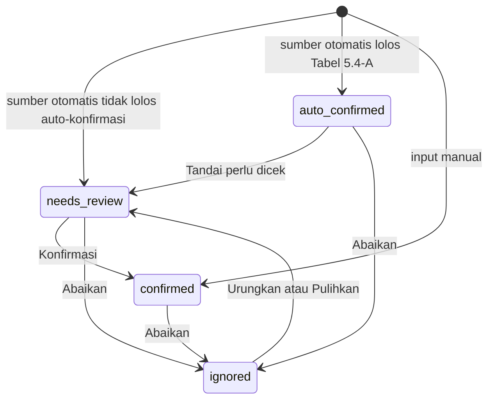

**RECEIPT.status**
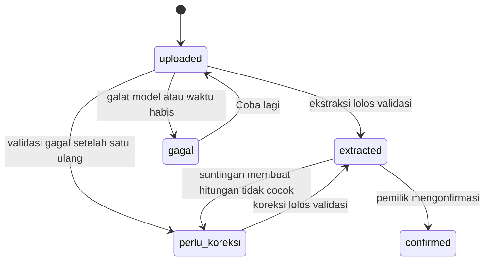

**SPLIT_BILL.status**
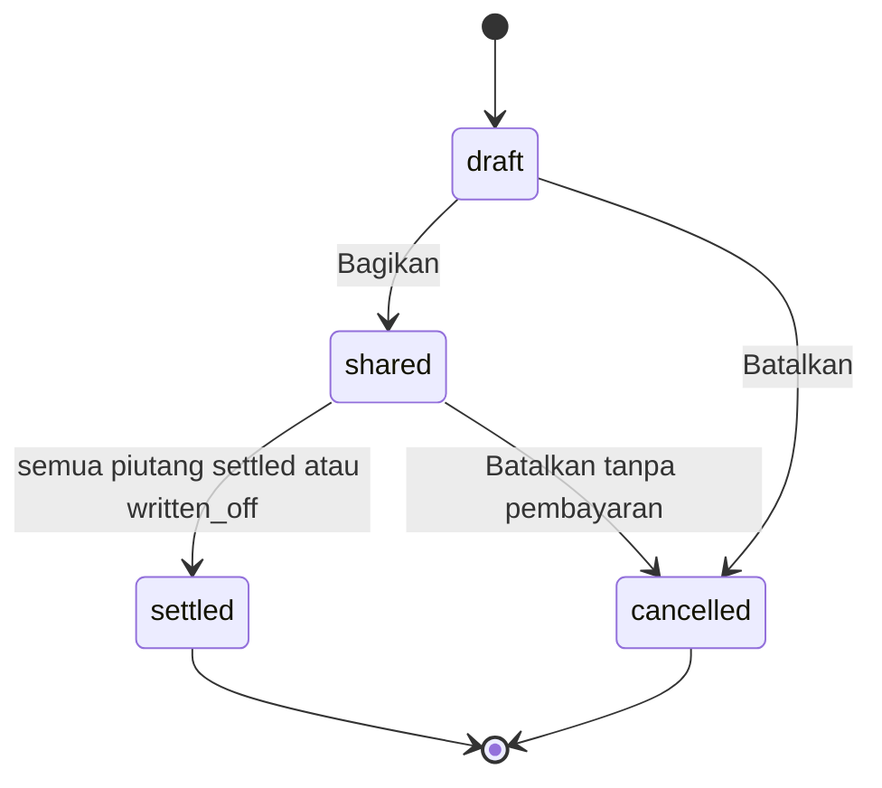

**RECEIVABLE.status**
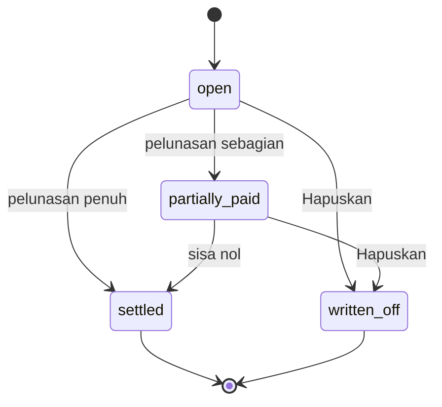

| Entitas | Dari | Ke | Pemicu | Siapa yang boleh | Syarat | Efek samping |
|---|---|---|---|---|---|---|
| TRANSACTION | needs_review | confirmed | Konfirmasi | Pemilik | akun bukan "Belum ditentukan"; kategori terisi bila kind expense, income, fee | Kategori ikut menjadi bawaan merchant bila "Ingat" menyala; bulk untuk merchant_baru |
| TRANSACTION | needs_review | ignored | Abaikan | Pemilik | - | Tidak dihitung di saldo |
| TRANSACTION | auto_confirmed | needs_review | Tandai perlu dicek | Pemilik | - | Muncul di Inbox |
| TRANSACTION | auto_confirmed atau confirmed | ignored | Abaikan | Pemilik | - | Saldo dihitung ulang |
| TRANSACTION | ignored | needs_review | Urungkan atau Pulihkan | Pemilik | - | |
| RECEIPT | uploaded | extracted | Ekstraksi lolos Tabel 5.4-I | Layanan | `validation_ok` benar | Item tersimpan |
| RECEIPT | uploaded | perlu_koreksi | Validasi gagal setelah satu ulang | Layanan | | Bidang bermasalah ditandai |
| RECEIPT | uploaded | gagal | Galat atau waktu habis 30 detik | Layanan | | Tombol Coba lagi dan Isi manual |
| RECEIPT | perlu_koreksi atau extracted | extracted atau perlu_koreksi | Suntingan pemilik | Pemilik | validasi dihitung ulang | |
| RECEIPT | extracted | confirmed | Konfirmasi nota | Pemilik | `validation_ok` benar | Pencocokan F-09.3 dijalankan |
| RECEIPT | gagal | uploaded | Coba lagi | Pemilik | gambar ada | Ekstraksi diulang |
| SPLIT_BILL | draft | shared | Bagikan | Pemilik | jumlah semua bagian = total | Piutang dibuat |
| SPLIT_BILL | shared | settled | Piutang terakhir selesai | Layanan | semua piutang settled atau written_off | |
| SPLIT_BILL | draft atau shared | cancelled | Batalkan | Pemilik | untuk shared: tanpa pembayaran | Piutang terbuka ditutup |
| RECEIVABLE | open | partially_paid | Pelunasan sebagian dikonfirmasi | Pemilik | 0 < jumlah < sisa | Sisa berkurang |
| RECEIVABLE | open atau partially_paid | settled | Pelunasan penuh | Pemilik | sisa menjadi 0 | `settled_at` diisi |
| RECEIVABLE | open atau partially_paid | written_off | Hapuskan | Pemilik | dialog konfirmasi | Sisa tidak dihitung |
| MATCH_PROPOSAL | open | accepted | Konfirmasi | Pemilik | transaksi terkait masih ada | Tautan atau pelunasan dibuat |
| MATCH_PROPOSAL | open | rejected | Tolak | Pemilik | | Pasangan tidak diusulkan lagi |
| MATCH_PROPOSAL | open | closed | Transaksi terkait dihapus atau diabaikan | Layanan | | |
| INTEGRATION | terhubung | perlu_hubungkan_ulang | Google menolak token | Layanan | galat invalid_grant | Banner tampil; polling berhenti |
| INTEGRATION | perlu_hubungkan_ulang atau terputus | terhubung | Hubungkan Gmail berhasil | Pemilik | | Polling dilanjutkan |
| INTEGRATION | terhubung atau perlu_hubungkan_ulang | terputus | Putuskan | Pemilik | | Rahasia Vault dihapus |
| LLM_JOB | pending | running | Pekerja mengambil | Layanan | `next_attempt_at` ≤ sekarang | `attempts` bertambah |
| LLM_JOB | running | done | Hasil lolos validasi | Layanan | | |
| LLM_JOB | running | pending | Router tidak terjangkau | Layanan | `attempts` < 5 | Jeda 10 menit |
| LLM_JOB | running | failed | Hasil tidak valid dua kali atau percobaan habis | Layanan | | Event menjadi `failed` |
| SUBSCRIPTION | suggested | active | Setujui | Pemilik | | |
| SUBSCRIPTION | suggested | dismissed | Tolak | Pemilik | | Tidak diusulkan lagi |
| SUBSCRIPTION | active | stopped | Hentikan | Pemilik | | Keluar dari total |

### 5.4 Aturan bisnis

**Tabel 5.4-A Penilaian kepercayaan transaksi otomatis** (baris pertama yang cocok menang; semua status awal dari sumber email, nota, dan webhook)
| # | Kondisi | Status | Alasan | Dapat dilewati dengan "lewati peninjauan"? |
|---|---|---|---|---|
| 1 | Hasil dibaca oleh LLM | needs_review | llm_parsed (kepercayaan ≤ 0,60) | Tidak |
| 2 | Akun tidak dapat ditentukan (akun sistem) | needs_review | akun_tidak_dikenal | Tidak |
| 3 | Jumlah ≥ ambang nominal besar | needs_review | nominal_besar | Tidak |
| 4 | Dugaan duplikat lintas akun | needs_review | duplikat_diduga | Tidak |
| 5 | Jenis tidak jelas (transfer dari atau ke orang tanpa merchant) | needs_review | transfer_tidak_jelas | Ya |
| 6 | Hanya ada nota, tidak ada transaksi bank atau email | needs_review | hanya_nota | Ya |
| 7 | Merchant belum punya kategori bawaan | needs_review | merchant_baru | Tidak (kategori bawaan diisi lewat Inbox, setelah itu baris 8 berlaku) |
| 8 | Parser deterministik berhasil, field wajib lengkap, merchant punya kategori bawaan, jumlah < ambang | auto_confirmed | - | - |

**Tabel 5.4-B Kontrak keluaran parser**
| Field | Tipe | Wajib | Aturan |
|---|---|---|---|
| status | teks | ya | `parsed`, `ignored`, atau `failed` |
| reason | teks | bila `failed` atau `ignored` | Alasan singkat tanpa isi email |
| transactions[].amount | bilangan bulat | ya | > 0 (Tabel 5.4-E) |
| transactions[].occurred_at | ISO 8601 UTC | ya | Tanpa zona waktu di sumber dianggap WIB |
| transactions[].direction | `in` atau `out` | ya | |
| transactions[].kind_hint | `expense`, `income`, `transfer_unknown` | ya | `transfer_unknown` memicu alasan transfer_tidak_jelas |
| transactions[].merchant_raw | teks | wajib untuk `expense` | ≤ 200 karakter |
| transactions[].account_hint | teks atau kosong | tidak | Nama bank, 4 digit, atau metode bayar |
| transactions[].payment_method | teks atau kosong | tidak | Dipetakan ke akun lewat `match_hints` |
| transactions[].dedupe_key | teks | ya | Format `{parser_id}:{referensi unik}` |

Referensi unik per parser:
| parser_id | Jenis email | Kunci dedupe | Catatan |
|---|---|---|---|
| mandiri | Bukti transaksi (transfer, QRIS, top-up) | nomor referensi | Metode bayar dan akun dari teks email |
| grab | E-receipt pesanan | Pesanan ID | Metode bayar (misalnya OVO) menentukan akun |
| shopee | Konfirmasi atau struk pesanan | nomor pesanan | Satu email dapat memuat beberapa pesanan |
| google_play | Struk pembelian | nomor pesanan | Format uang Rp 19800 tanpa pemisah |
| esb | Struk restoran | kode transaksi | Memuat item bila ada |
| gojek | Struk perjalanan atau pesanan | ID struk | Metode bayar seperti GoPay Tabungan |

**Tabel 5.4-C Rumus runway** (hari ini `T`, tanggal lulus `G`, cadangan `R`)
| Besaran | Definisi |
|---|---|
| D0 (dana tersisa) | Jumlah saldo akun aktif non-sistem ditambah nilai aset aktif; piutang tidak dihitung |
| B (pengeluaran rutin bulanan) | Rata-rata total pengeluaran efektif (kind `expense` dan `fee`, bukan sekali-jalan, tidak diabaikan atau terhapus) dari maksimum 3 bulan kalender penuh terakhir; bila tidak ada bulan penuh tetapi data ≥ 30 hari, rata-rata harian × 30; bila data < 30 hari, `burn_override`; bila kosong semua, B tidak ada |
| P (pengeluaran terjadwal) | Semua kemunculan PLANNED_EXPENSE yang belum dibayar dengan tanggal > T |
| V(k) | D0 − k × B − jumlah P dengan tanggal ≤ T ditambah k bulan |
| Tanggal habis | k terkecil dengan V(k) ≤ 0, diinterpolasi linear di dalam bulan itu; horizon 60 bulan; bila tidak ada, "Tidak habis dalam proyeksi" |
| Sisa saat lulus | V di tanggal G (bulan penuh ditambah pecahan hari) |
| Aman per hari | pembulatan ke bawah ke Rp 1.000 dari maks(0, D0 − jumlah P bertanggal ≤ G − R) ÷ jumlah hari dari T ke G |

Status:
| Kondisi | Status | Label |
|---|---|---|
| B tidak ada | data_belum_cukup | Isi estimasi pengeluaran |
| Sisa saat lulus < 0 | belum_cukup | Belum cukup sampai lulus |
| 0 ≤ sisa saat lulus < R | perlu_perhatian | Perlu diperhatikan |
| sisa saat lulus ≥ R | sesuai | Sesuai rencana |

**Tabel 5.4-D Alokasi bagi tagihan dan dampak analitik** (urutan langkah)
| Langkah | Aturan |
|---|---|
| 1 | Subtotal item tiap peserta `sub_p` = jumlah dari (total baris item × bobot peserta ÷ jumlah bobot item itu) |
| 2 | Diskon D dibagi proporsional terhadap `sub_p` |
| 3 | Biaya layanan S dibagi proporsional terhadap `sub_p` |
| 4 | Pajak T dibagi proporsional terhadap (`sub_p` + bagian layanan − bagian diskon) bila `tax_base` = `items_plus_service`, atau terhadap `sub_p` bila `items` |
| 5 | Bagian peserta = `sub_p` + layanan − diskon + pajak, ditambah pembulatan nota yang dibagi proporsional |
| 6 | Pembulatan ke rupiah dengan metode sisa terbesar sehingga jumlah semua bagian = total nota; selisih pecahan sama diberikan menurut urutan peserta |
| Dampak | Pengeluaran efektif transaksi asal = jumlah transaksi − jumlah bagian peserta selain pemilik; dipakai di analitik, rata-rata B, dan batang bulanan; saldo akun tetap berkurang penuh |

**Tabel 5.4-E Pengurai angka uang rupiah**
| Teks sumber | Hasil | Aturan |
|---|---|---|
| `Rp 17.201,00` | 17201 | Titik ribuan, koma desimal "00" |
| `Rp 19800` | 19800 | Tanpa pemisah |
| `Rp 819,376` | 819376 | Satu jenis pemisah diikuti tepat 3 digit = pemisah ribuan |
| `Rp517,500` | 517500 | Awalan tanpa spasi |
| `Rp 1,250,000.00` | 1250000 | Kedua pemisah: yang terakhir diikuti 2 digit "00" = desimal |
| `Rp 12.5` | gagal | Desimal selain "00" ditolak |

Langkah umum: hapus "Rp", spasi, dan spasi tak terputus; terapkan aturan di atas; hasil harus bilangan bulat > 0.

**Tabel 5.4-F Skor pencocokan**
| Jenis | Komponen skor | Ambang |
|---|---|---|
| Transfer internal | Selisih jumlah 0: 0,40; selisih termasuk daftar biaya admin: 0,40 (selisih di luar daftar: bukan kandidat). Selisih waktu ≤ 30 menit: +0,40; ≤ 24 jam: +0,25; ≤ 5 hari: +0,10. Petunjuk akun (nama atau 4 digit akun lawan muncul di teks sumber): +0,10 | Usul ≥ 0,60; tautan otomatis ≥ 0,90 bila sakelar menyala |
| Nota ke transaksi | Jumlah sama persis: 0,60 (wajib, jika tidak bukan kandidat). Selisih waktu ≤ 15 menit: +0,25; ≤ 2 jam: +0,15; ≤ 2 hari: +0,05. Kemiripan nama merchant (rasio token ≥ 0,6): +0,15 | Usul ≥ 0,75 |
| Pelunasan | Jumlah sama dengan sisa piutang: 0,60; jumlah antara 1 dan sisa − 1: 0,30. Nama pengirim memuat nama peserta: +0,30. Syarat: dalam 30 hari sejak shared | Usul ≥ 0,60 |
| Duplikat lintas sumber | Jumlah sama dan selisih waktu ≤ 10 menit pada akun yang sama: tautkan sebagai bukti; akun berbeda: usulan `duplicate_suspect` | - |

Daftar biaya admin yang dikenali (rupiah): 500, 999, 1.000, 1.500, 2.500, 6.500. Daftar dapat diubah di konfigurasi kode `ADMIN_FEES` tanpa mengubah migrasi.

**Tabel 5.4-G Perubahan dana bulan ini** (bulan kalender WIB)
| Baris | Rumus |
|---|---|
| Dipakai | jumlah pengeluaran efektif kind `expense` dan `fee` dalam bulan |
| Pemasukan | jumlah kind `income` dalam bulan; baris hanya tampil bila > 0 |
| Perubahan pasar | untuk tiap aset: nilai sekarang − nilai akhir bulan lalu − (jumlah `purchase` − jumlah `redemption` dalam bulan); dijumlahkan |
| Total berubah | −Dipakai + Pemasukan + Perubahan pasar |

**Tabel 5.4-H Label sumber saldo akun** (urutan; titik cek hanya dianggap bila `as_of` dalam 62 hari terakhir)
| # | Kondisi | Label |
|---|---|---|
| 1 | Titik cek terbaru berbeda dari saldo terhitung pada tanggalnya | Selisih Rp {selisih} |
| 2 | Titik cek terbaru sama persis | Cocok statement {bulan as_of} |
| 3 | Ada transaksi sumber email atau webhook dalam 30 hari | Dari email |
| 4 | Selain itu | Diisi manual |

**Tabel 5.4-I Validasi nota**
| Pemeriksaan | Toleransi |
|---|---|
| Jumlah total baris item = subtotal | ± Rp 100 |
| subtotal + biaya layanan + pajak − diskon + pembulatan = total | ± Rp 100 |
| Pajak dan layanan dibaca dari nota, tidak dihitung dari tarif tetap | wajib |
| Setiap item: jumlah × harga satuan = total baris | ± Rp 100 |
| Semua angka bilangan bulat ≥ 0 (pembulatan boleh negatif) | wajib |

**Tabel 5.4-J Pengaruh jenis transaksi**
| kind | Saldo akun | Total pengeluaran | Total pemasukan | Dana tersisa | Lain |
|---|---|---|---|---|---|
| expense | berkurang | dihitung (efektif) | tidak | berkurang | - |
| fee | berkurang | dihitung | tidak | berkurang | - |
| income | bertambah | tidak | dihitung | bertambah | - |
| transfer | berubah di kedua akun | tidak | tidak | tetap | - |
| investment | berkurang | tidak | tidak | tetap | Jumlah aset bertambah |
| redemption | bertambah | tidak | tidak | tetap | Jumlah aset berkurang |
| repayment | bertambah | tidak | tidak | bertambah (piutang tidak dihitung) | Sisa piutang berkurang |

### 5.5 Data awal dan data sensitif
**Data awal (seed) untuk pengembangan dan pengujian** — seluruhnya data contoh, bukan data pribadi. Jam sistem pada tes dapat disuntik; tes golden memakai "hari ini" = 14 November 2026.
| Kelompok | Isi |
|---|---|
| Pengaturan | tanggal lulus 14 Juli 2028; cadangan darurat Rp 30.000.000; ambang nominal besar Rp 500.000; kunci aplikasi mati |
| Akun | Mandiri (bank, ••4821, saldo hari ini Rp 2.350.000), BNI (bank, ••7733, Rp 1.420.000), OVO (ewallet, Rp 640.000), DANA (ewallet, Rp 520.000), Tunai (tunai, Rp 280.000); total Rp 5.210.000; saldo awal disetel agar saldo terhitung hari ini sama dengan nilai ini; ditambah akun sistem "Belum ditentukan" |
| Riwayat | Agustus, September, Oktober 2026: masing-masing total pengeluaran rutin Rp 8.400.000 dalam 6 sampai 10 transaksi; Agustus juga berisi satu transaksi sekali-jalan Rp 9.000.000 (biaya semester); November 2026 sampai tanggal 14: pengeluaran Rp 4.280.000 |
| Transaksi terbaru | Kedai Kopi Senja 28.000 (terverifikasi 2 bukti), Laundry Mawar 35.000, Ayam Geprek Pak Eko 22.000 (Tunai), pelunasan Budi +105.000 (BNI), Langganan musik 54.990 (OVO) |
| Inbox | Warung Mie Pak Dani 40.000 (QRIS 17:57; email dan nota cocok), Toko Obat Sehat 63.500 (merchant baru), Transfer masuk Rina 150.000 (belum terkait), Kedai Jus Taman 15.000, Ayam Bakar Bu Sri 48.000, Toko Bangunan Jaya 125.000, Es Teh Solo 12.000 (total 7 item) |
| Nota contoh | Warung Mie Pak Dani: Mie ayam spesial 12.727, Pangsit goreng 9.091, Es jeruk 8.182, Es teh 6.364; subtotal 36.364; pajak 10% 3.636; total 40.000 |
| Aset | Reksa dana pasar uang 50.000 unit × Rp 1.200 = Rp 60.000.000; Deposito A Rp 50.000.000 jatuh tempo 14 Feb 2027 ke Mandiri; Deposito B Rp 50.000.000 jatuh tempo 14 Jun 2027 ke Mandiri; Deposito C Rp 40.000.000 jatuh tempo 14 Nov 2027 ke BNI; Emas 16,5 gram × Rp 2.526.000 = Rp 41.679.000; Reksa dana saham dan campuran 25 unit × Rp 1.604.440 = Rp 40.111.000; total aset Rp 281.790.000 |
| Rencana | Biaya semester Rp 9.000.000 pada 14 Feb 2027, berulang tiap 6 bulan sampai 14 Feb 2028 |
| Piutang | Rina Rp 640.000 dan Budi Rp 1.000.000 (total Rp 1.640.000) |
| Pengirim email | mandiri, grab, shopee, google_play, esb, gojek dengan alamat contoh berakhiran `.example` dan `verified_with_real_email` = false |
| Hasil golden runway | Dana tersisa Rp 287.000.000; B Rp 8.400.000; sisa saat lulus Rp 92.000.000; tanggal habis Juni 2029; aman per hari Rp 378.000; status Sesuai rencana |

**Data sensitif dan retensi**
- Token Gmail hanya di Vault; `pin_hash` dan `pin_salt` di APP_SETTINGS; keduanya tidak boleh masuk ekspor, log, atau respons klien.
- `raw_text_redacted` dikosongkan setelah 90 hari oleh tugas pg_cron harian pukul 03:00 WIB; `parsed` dan relasi bukti dipertahankan.
- Gambar nota disimpan di bucket privat sampai pemilik menghapusnya; tautan unduh bertanda tangan berlaku 60 detik.
- Log aplikasi tidak boleh memuat isi email, jumlah uang, nama merchant, atau token; hanya id dan status.
- Data keuangan dan hasil ekstraksi nota tidak dikirim ke layanan lain selain LLM sesuai bagian 8.3.

## 6. Peran dan hak akses *(Mode App)*
| Aksi / data | Tamu | Pemilik | Layanan terjadwal |
|---|---|---|---|
| Masuk dan mendaftar TOTP (F-01.1) | C sesi, setelah kredensial dan TOTP benar; pendaftaran akun baru ditolak | - | - |
| Pengaturan dan kunci aplikasi (F-01.2, F-01.3) | tidak ada | R, U milik sendiri; PIN diverifikasi di server | tidak ada |
| Akun, transaksi, kategori, merchant (F-02, F-03, F-05) | tidak ada | C, R, U, hapus lunak milik sendiri | C, U transaksi, bukti, usulan, merchant atas nama pemilik |
| Aset, harga, pengeluaran terjadwal, langganan (F-06, F-07, F-11.2) | tidak ada | C, R, U, D milik sendiri | U langganan (deteksi) |
| Nota dan gambar nota (F-09) | tidak ada | C, R, U, D; gambar lewat tautan 60 detik | R gambar, U hasil ekstraksi |
| Bagi tagihan dan piutang (F-10) | tidak ada | C, R, U milik sendiri | tidak ada |
| Token Gmail (Vault) dan INTEGRATION (F-04.1) | tidak ada | tidak bisa membaca token; hanya melihat status; C lewat callback, D lewat Putuskan | R token, U status dan kursor |
| INGEST_EVENT dan EMAIL_SOURCE (F-04) | tidak ada | R; U sakelar dan daftar pengirim | C, U |
| LLM_JOB (F-04.4) | tidak ada | R status | C, U |
| Webhook ingest (F-12.1) | C hanya bila rahasia webhook benar | tidak ada | tidak ada |
| Ekspor data (F-13.1) | tidak ada | R setelah verifikasi ulang PIN atau TOTP | tidak ada |
| Hapus permanen data | tidak ada | tidak ada (hanya hapus lunak dan arsip) | D teks mentah teredaksi setelah 90 hari |

Aturan penegakan:
- Izin dipaksakan di server dan di basis data: setiap tabel memakai RLS dengan `user_id = auth.uid()` dan sesi aal2; komponen hanya mencerminkan izin dari server, menyembunyikan menu bukan kontrol akses.
- Kunci peran layanan (`SUPABASE_SERVICE_ROLE_KEY`) hanya ada di variabel lingkungan Edge Functions dan server Next.js, tidak pernah berawalan `NEXT_PUBLIC_`, dan tidak dikirim ke peramban.
- Akses langsung ke URL halaman tanpa sesi dialihkan (302) ke S-01; akses ke API tanpa sesi dijawab 401; akses sesi aal1 ke data dijawab 403 atau 0 baris.
- Webhook membandingkan rahasia dengan perbandingan waktu-konstan dan menjawab 401 bila salah.
- Pendaftaran akun baru dimatikan di konfigurasi Auth produksi setelah akun pemilik dibuat.
- Satu kriteria lintas pengguna diuji di lingkungan uji dengan dua akun: pengguna B yang meminta data pengguna A mendapat 0 baris atau galat izin, tanpa kebocoran data.

## 7. Kontrak API dan interaksi *(Mode App)*

Tiga jenis antarmuka dipakai: **Route Handler** Next.js (`/api/...`), **Server Action** Next.js (dipanggil dari komponen, tanpa URL publik), dan **Edge Function** Supabase (Deno). Pembacaan agregat memakai **RPC** Postgres (`rpc_*`, `security invoker` sehingga RLS berlaku). Kolom "Peran" memakai istilah bagian 6; "Pemilik" selalu berarti sesi aal2 yang tidak sedang terkunci PIN.

### 7.1 Daftar endpoint / aksi
| ID | Metode dan path | Peran | Input | Respons sukses | Galat | Fitur |
|---|---|---|---|---|---|---|
| API-01 | Supabase Auth SDK: `signInWithPassword`, lalu `mfa.enroll`, `mfa.challenge`, `mfa.verify` | Tamu | email, password; kode TOTP 6 digit | Sesi aal2; pengalihan ke S-04 atau S-03 bila onboarding belum selesai | 400 kredensial salah; 400 kode salah; 429 blokir 15 menit setelah 5 gagal; pendaftaran baru ditolak | F-01.1 |
| API-02 | `POST /api/pin/verify` | Pemilik (aal2) | `{ pin: string 6 digit }` | 200 `{ ok: true }` dan cookie buka-kunci HttpOnly selama batas idle | 401 `PIN_SALAH` dengan sisa percobaan; 401 `SESI_BERAKHIR` pada percobaan ke-5 (sesi diakhiri); 422 format; 503 verifikasi tidak terjangkau | F-01.2 |
| API-03 | Server Action `saveSettings` | Pemilik | subset field APP_SETTINGS (tanggal lulus, cadangan, estimasi pengeluaran, ambang, batas idle, kata redaksi, instruksi bayar, sakelar, PIN baru) | `{ ok: true, settings }` | 422 `VALIDASI` per field (tanggal ≤ hari ini, cadangan < 0); 403 sesi terkunci; 500 | F-01.2, F-01.3, F-05.4, F-06.1 |
| API-04 | Server Action `saveAccount`, `archiveAccount`, `reorderAccounts` | Pemilik | nama, kind, last4, match_hints, opening_balance, opening_date | `{ ok: true, account }` | 409 `NAMA_SAMA`; 422 `VALIDASI`; 409 `AKUN_SISTEM` bila akun sistem; 404 | F-02.1 |
| API-05 | RPC `rpc_account_balances(as_of date default today)` | Pemilik | tanggal acuan | array `{ account_id, balance, source_label, last_checkpoint }` menurut Tabel 5.4-H | 401 tanpa sesi; 0 baris bila aal1 | F-02.2, F-02.3 |
| API-06 | Server Action `saveCheckpoint` | Pemilik | account_id, as_of, balance | `{ ok: true, difference }` (selisih terhadap saldo terhitung) | 422 tanggal di masa depan; 404 akun; 409 titik cek sama sudah ada (diganti setelah konfirmasi) | F-02.2, F-11.1 |
| API-07 | Server Action `createTransaction` | Pemilik | amount, direction, kind (`expense` atau `income`), account_id, category_id, merchant_raw, occurred_at, note, is_one_off, `client_id` uuid | `{ ok: true, transaction }`; status langsung `confirmed` | 422 `VALIDASI` (amount ≤ 0 atau > 999.999.999, kategori kosong); 404 akun; idempotensi: `client_id` kembar mengembalikan 200 dengan transaksi yang sama | F-03.1, F-03.2 |
| API-08 | Server Action `createTransfer` | Pemilik | from_account_id, to_account_id, amount, fee (opsional), occurred_at, `client_id` | `{ ok: true, link }` (dua transaksi dan TRANSFER_LINK dibuat atomik) | 422 akun sama; 422 amount ≤ 0; 409 `SALDO_TIDAK_CUKUP` hanya peringatan, bukan penolakan | F-03.3 |
| API-09 | Server Action `updateTransaction`, `deleteTransaction` (hapus lunak), `restoreTransaction` | Pemilik | id, field yang diubah | `{ ok: true, transaction }`; hapus: `{ ok: true, undo_until }` (10 detik) | 404; 409 `SUDAH_DIUBAH` (versi `updated_at` tidak cocok); 422 | F-03.4 |
| API-10 | `GET /api/transactions` | Pemilik | query: `cursor`, `limit` (default 30, maks 100), `account`, `category`, `kind`, `q`, `from`, `to` | `{ items[], next_cursor }` urut `occurred_at desc, id desc` | 400 parameter salah; 401; 403 | F-03.4 |
| API-11 | Server Action `saveCategory`, `archiveCategory`, `saveMerchantRule`, `mergeMerchant` | Pemilik | nama, kind, ikon, warna; merchant_id, default_category_id, default_one_off, skip_review, alias | `{ ok: true, entity }`; `mergeMerchant` mengembalikan jumlah transaksi dipindah | 409 `NAMA_SAMA`; 409 `KATEGORI_SISTEM` bila dihapus; 422 | F-03.5, F-05.4 |
| API-12 | `GET /api/gmail/connect` | Pemilik | - | 302 ke persetujuan Google dengan satu scope `gmail.readonly`, `access_type=offline`, `prompt=consent`, `state` acak (cookie HttpOnly, 10 menit) | 401; 500 konfigurasi OAuth kosong | F-04.1 |
| API-13 | `GET /api/gmail/callback` | Pemilik | `code`, `state` (atau `error`) | 302 ke S-17; refresh token ke Vault; INTEGRATION `terhubung` | 400 `STATE_SALAH` tanpa menyimpan apa pun; 302 ke S-17 dengan pesan bila pemilik menolak; 502 Google gagal | F-04.1 |
| API-14 | `POST /api/gmail/disconnect` | Pemilik | - | 200 `{ ok: true }`; token dicabut di Google, rahasia dihapus dari Vault | 200 tetap bila pencabutan Google gagal (status `terputus`, peringatan dicatat); 401 | F-04.1 |
| API-15 | Edge Function `POST /functions/v1/ingest-gmail` (dipanggil pg_cron tiap 5 menit) | Layanan terjadwal | header `x-cron-secret`; body `{ mode: "poll" atau "backfill" }` | 200 `{ fetched, created, linked, needs_review, failed, remaining }` | 401 rahasia salah; 200 `{ skipped: "tidak ada pengirim" }`; 200 dengan `error` bila Gmail 429 atau 5xx (kursor tidak maju); invalid_grant mengubah INTEGRATION | F-04.2, F-04.3, F-05.1, F-05.3 |
| API-16 | Edge Function `POST /functions/v1/process-llm-jobs` (pg_cron tiap 5 menit) | Layanan terjadwal | header `x-cron-secret` | 200 `{ done, failed, pending }` | 401; 200 dengan `pending` tetap bila router tidak terjangkau; batas 200 panggilan per hari ditegakkan (sisa menunggu) | F-04.4 |
| API-17 | Server Action `saveEmailSource`, `toggleEmailSource`, `retryUnreadable`, `ignoreUnreadable`, `unreadableToManual` | Pemilik | alamat, label, akun bawaan; id INGEST_EVENT | `{ ok: true }`; `unreadableToManual` mengembalikan data awal formulir S-07 | 422 alamat tanpa "@"; 409 `PENGIRIM_SUDAH_ADA`; 404 | F-04.5 |
| API-18 | Server Action `startBackfill`, `cancelBackfill` | Pemilik | - | `{ ok: true, backfill_state }`; kemajuan dibaca dari INTEGRATION | 409 Gmail belum terhubung; 409 impor sedang berjalan | F-04.6 |
| API-19 | `GET /api/inbox` dan RPC `rpc_inbox_counts()` | Pemilik | query: `cursor`, `limit` (default 20), `reason` | `{ groups[], items[], next_cursor }` dengan kelompok per merchant baru; hitungan per alasan | 401; 403 | F-05.1 |
| API-20 | Server Action `confirmReview`, `bulkConfirmMerchant`, `ignoreReview`, `markNeedsReview`, `undoReview` | Pemilik | transaction_id (atau merchant_id), category_id, account_id, remember (boolean) | `{ ok: true, transaction, undo_until }` | 409 `AKUN_BELUM_DITENTUKAN`; 422 kategori kosong; 404; 409 status sudah berubah | F-05.2, F-05.4 |
| API-21 | Server Action `acceptProposal`, `rejectProposal` | Pemilik | proposal_id | `{ ok: true }`; transfer menghasilkan TRANSFER_LINK, pelunasan menghasilkan RECEIVABLE_PAYMENT | 404; 409 transaksi terkait sudah dihapus atau sudah ditautkan | F-05.3, F-09.3, F-10.3 |
| API-22 | RPC `rpc_runway(today date default today)` | Pemilik | tanggal acuan (untuk tes) | `{ status, dana_tersisa, burn_rutin, burn_source, planned_total, leftover_at_graduation, depletion_date, safe_per_day, series[] }` menurut Tabel 5.4-C | 200 `{ status: "data_belum_cukup" }` bila B tidak ada; 200 `{ status: "tanggal_lulus_kosong" }`; 401 | F-06.1, F-06.3 |
| API-23 | Server Action `savePlannedExpense`, `deletePlannedExpense`, `markPlannedPaid` | Pemilik | label, amount, due_on, repeat_months, repeat_until, category_id | `{ ok: true, planned }` | 422 amount ≤ 0; 422 `repeat_months` di luar 1 sampai 12; 404 | F-06.2 |
| API-24 | RPC `rpc_home_summary()` | Pemilik | - | `{ runway, accounts[], review_count, recent[], banners[], month_view }` untuk S-04 | 401; 200 dengan bagian kosong bila belum ada data | F-06.3, F-06.4 |
| API-25 | Server Action `saveAsset`, `archiveAsset`, `saveAssetPrice` | Pemilik | name, type, quantity, cost_basis, maturity_date, interest_rate_pa, destination_account_id; as_of, unit_price | `{ ok: true, asset }` | 422 deposito tanpa jatuh tempo; 422 unit_price ≤ 0; 409 harga untuk tanggal itu sudah ada (diganti setelah konfirmasi) | F-07.1 |
| API-26 | RPC `rpc_asset_ladder()` | Pemilik | - | `{ total_funds, rows[ { label, value, share_pct, items[] } ], maturities[] }` menurut urutan likuiditas | 401; 200 dengan baris kosong bila belum ada aset | F-07.2, F-07.3 |
| API-27 | Server Action `redeemAsset`, `rolloverDeposit` | Pemilik | asset_id, amount, quantity, destination_account_id, occurred_on | `{ ok: true, transaction, asset_event }` (transaksi `redemption` dan ASSET_EVENT atomik) | 422 jumlah melebihi nilai aset; 404; 409 aset diarsipkan | F-07.3 |
| API-28 | RPC `rpc_net_change(month date)` | Pemilik | awal bulan (WIB) | `{ used, income, market_change, total, by_asset[] }` menurut Tabel 5.4-G | 400 bulan tidak valid; 401 | F-07.4 |
| API-29 | RPC `rpc_monthly_spend(months int default 12)` dan `rpc_category_breakdown(month date)` | Pemilik | jumlah bulan (1 sampai 24); bulan | `{ months[ { month, total, one_off, routine } ] }`; `{ categories[ { category_id, amount, share_pct, delta_vs_prev } ] }` | 400 parameter salah; 401 | F-08.1, F-08.2 |
| API-30 | Edge Function `POST /functions/v1/extract-receipt` | Pemilik | `{ receipt_id }` (gambar sudah di Storage) | 200 `{ status: "extracted" atau "perlu_koreksi", receipt }` | 404 nota; 422 gambar > 5 MB atau bukan JPEG atau PNG; 504 melewati 30 detik (status `gagal`); 503 router tidak terjangkau | F-09.1, F-09.2 |
| API-31 | Server Action `createReceiptUpload`, `saveReceiptEdits`, `confirmReceipt`, `createManualReceipt`, `linkReceipt` | Pemilik | file ke Storage lewat URL unggah bertanda tangan; item dan angka hasil koreksi; transaction_id | `{ ok: true, receipt, validation }` | 422 hitungan tidak cocok (Tabel 5.4-I) tidak boleh dikonfirmasi; 409 nota sudah terhubung; 404 | F-09.1, F-09.2, F-09.3 |
| API-32 | `GET /api/receipts/[id]/image` | Pemilik | - | 302 ke URL bertanda tangan berlaku 60 detik | 404; 401; 403 | F-09.1 |
| API-33 | Server Action `saveSplit`, `shareSplit`, `cancelSplit` | Pemilik | receipt_id, peserta (nama, telepon), penugasan item dan bobot, tax_base | `{ ok: true, split, shares[], wa_links[] }` (tautan `wa.me`; tidak ada pengiriman otomatis) | 422 jumlah bagian ≠ total nota; 409 sudah dibagikan; 404 | F-10.1, F-10.2 |
| API-34 | Server Action `recordRepayment`, `writeOffReceivable` | Pemilik | receivable_id, amount, account_id, occurred_at | `{ ok: true, receivable }` (transaksi `repayment` dibuat) | 422 amount > sisa; 409 piutang sudah selesai; 404 | F-10.3 |
| API-35 | Server Action `approveSubscription`, `dismissSubscription`, `stopSubscription` | Pemilik | subscription_id | `{ ok: true, subscription }` | 404; 409 status tidak valid | F-11.2 |
| API-36 | `POST /api/ingest/webhook` | Tamu (rahasia webhook) | header `x-webhook-secret`; JSON `{ source_app, text, posted_at }` (≤ 8 KB) | 202 `{ accepted: true }` | 401 rahasia salah; 413 badan > 8 KB; 422 JSON salah; 429 lebih dari 60 per menit | F-12.1 |
| API-37 | `POST /share-target` (multipart) | Pemilik | berkas `image/*` | 303 ke `/nota/baru` dengan gambar tersimpan sementara 10 menit | 303 ke `/masuk` bila belum masuk; 415 bukan gambar | F-12.2 |
| API-38 | Server Action `subscribePush`, `unsubscribePush`, `savePushPrefs`; Edge Function `send-push` | Pemilik; Layanan terjadwal | endpoint, p256dh, auth; sakelar per jenis | `{ ok: true }`; `send-push` mengirim Web Push VAPID | 410 dari layanan push menghapus langganan; 422 langganan tidak valid | F-12.3 |
| API-39 | `POST /api/quick-add/parse` | Pemilik | `{ text }` (≤ 200 karakter) | 200 `{ amount, merchant, account_hint, via: "lokal" atau "llm" }` | 200 `{ amount: null }` bila tidak ada angka; 422 teks kosong; 503 LLM tidak terjangkau (hasil lokal tetap dikembalikan) | F-12.4 |
| API-40 | `POST /api/export` dan `GET /api/storage-usage` | Pemilik | ekspor: verifikasi ulang PIN atau TOTP | ekspor: arsip zip (JSON per tabel dan `transactions.csv`); penyimpanan: `{ db_mb, storage_mb, limits }` | 403 tanpa verifikasi ulang; 200 `{ available: false }` bila pemakaian tidak terbaca; 429 lebih dari 3 ekspor per jam | F-13.1, F-13.2 |
| API-41 | Edge Function `POST /functions/v1/maintenance` (pg_cron harian 03:00 WIB) | Layanan terjadwal | header `x-cron-secret` | 200 `{ purged, subscriptions_detected, push_sent }` | 401; kegagalan satu tugas tidak menghentikan tugas lain (dicatat per tugas) | F-11.2, F-12.3, F-07.3 |
| API-42 | `GET /api/cron/keepalive` (Vercel Cron sekali sehari) | Layanan terjadwal | header `Authorization: Bearer CRON_SECRET` | 200 `{ ok: true }` setelah satu kueri ringan ke basis data | 401 rahasia salah; 503 basis data tidak terjangkau | F-13.2 |

### 7.2 Konvensi bersama
- **Format galat standar** untuk semua Route Handler dan Server Action: `{ "error": { "code": "KODE_HURUF_BESAR", "message": "Teks bahasa Indonesia untuk pemilik", "fields": { "nama_field": "pesan" }, "request_id": "uuid" } }`. `fields` hanya ada pada galat validasi (422). Galat dari Edge Function memakai bentuk yang sama.
- **Kode status**: 400 parameter salah; 401 tidak ada sesi atau rahasia salah; 403 sesi aal1, terkunci PIN, atau verifikasi ulang kurang; 404 tidak ditemukan atau bukan milik pemilik (keduanya dijawab sama agar keberadaan data tidak bocor); 409 konflik status; 413 badan terlalu besar; 415 tipe berkas salah; 422 validasi; 429 batas laju; 500 galat tak terduga; 502 dan 503 layanan luar tidak terjangkau; 504 melewati batas waktu.
- **Paginasi**: kursor buram (base64 dari `occurred_at` dan `id`), `limit` default 30, maksimum 100; respons memuat `next_cursor` atau `null`.
- **Pengurutan**: daftar transaksi `occurred_at desc, id desc`; Inbox `created_at desc`; piutang `created_at asc`.
- **Idempotensi**: aksi pembuatan transaksi menerima `client_id` (uuid dari klien); pengiriman ulang dengan `client_id` yang sama mengembalikan hasil pertama. Ingest memakai `external_id` dan `dedupe_key` (bagian 5).
- **Batas laju**: login 5 gagal per 15 menit (Auth); PIN 5 salah lalu sesi berakhir; webhook 60 per menit; ekspor 3 per jam; LLM 200 panggilan per hari; unggah nota 20 per jam.
- **Waktu dan uang**: semua waktu ISO 8601 UTC di API, ditampilkan WIB di UI; semua uang bilangan bulat rupiah, tidak pernah desimal.
- **Waktu habis**: Route Handler 10 detik; Edge Function ingest 120 detik (asumsi, di bawah batas penyedia); panggilan LLM 30 detik.
- **Keamanan**: semua Route Handler selain API-01, API-36, dan API-42 memeriksa sesi aal2 dan status kunci di server sebelum menyentuh data; Server Action memeriksa hal yang sama; Edge Function terjadwal memeriksa `x-cron-secret` dengan perbandingan waktu-konstan.

### 7.3 Diagram urutan interaksi lintas layanan

**Hubungkan Gmail (API-12, API-13)**
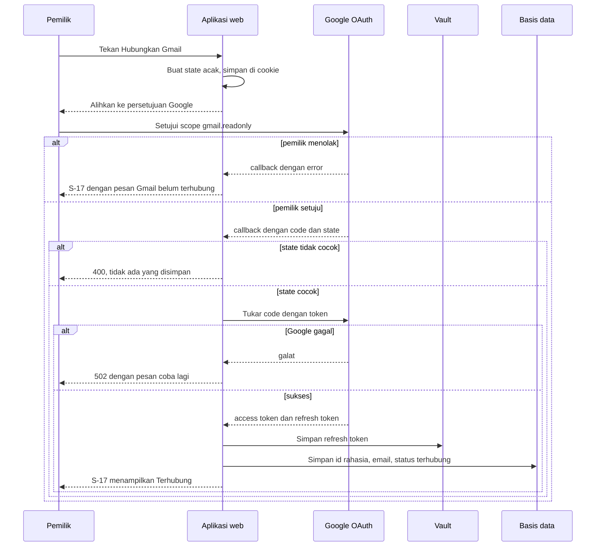

**Polling email dan pembuatan transaksi (API-15, API-16)**
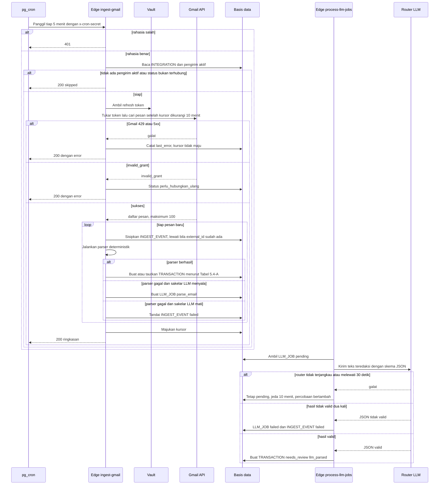

**Ekstraksi nota (API-31, API-30)**
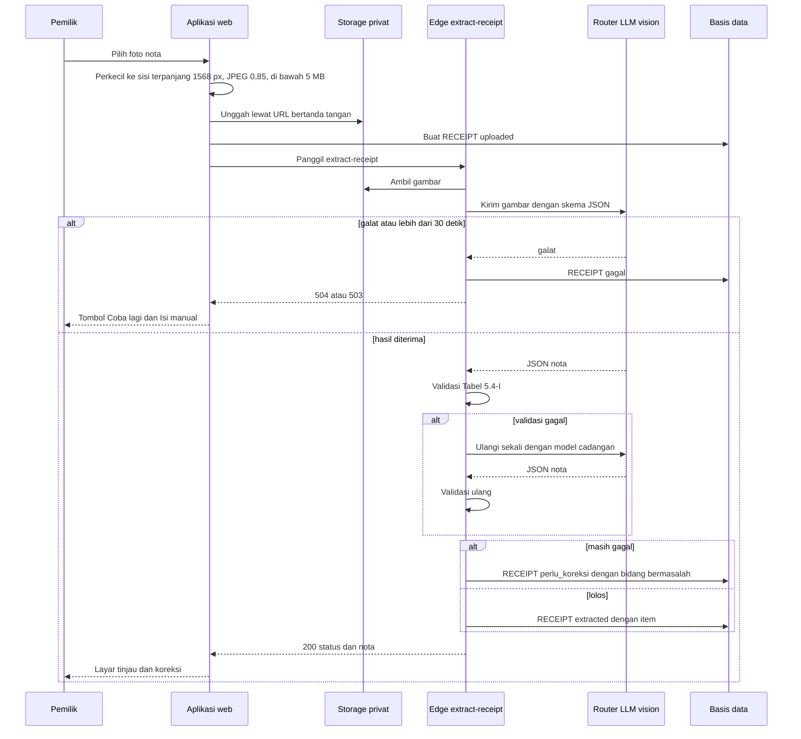

## 8. Integrasi dan konfigurasi *(Mode App)*

### 8.1 Layanan luar dan variabel lingkungan
**Layanan luar**
| Layanan | Tujuan | Fitur | Mode | Biaya / batas | OQ terkait |
|---|---|---|---|---|---|
| Gmail API dan Google OAuth | Membaca email transaksi dengan scope `gmail.readonly` | F-04.1, F-04.2, F-04.6 | OAuth 2.0 akses offline; polling tiap 5 menit | Gratis; aplikasi OAuth "In production" tanpa verifikasi untuk pemakaian pribadi (asumsi, R-2) | OQ-9 |
| Supabase | Postgres dengan RLS, Auth dengan TOTP, Storage, Vault, Edge Functions, pg_cron, pg_net | Semua | Proyek hosted (paket gratis) | 500 MB basis data, 1 GB Storage; proyek dijeda setelah 7 hari tanpa aktivitas; tanpa cadangan otomatis | OQ-10, OQ-11 |
| Vercel (paket Hobby) | Hosting Next.js dan satu cron harian | F-01.1, F-13.2 | Deploy dari repositori | Gratis, non-komersial; cron minimum sekali sehari | OQ-9 |
| 9router (router LLM milik pemilik) | Ekstraksi email dan nota, klasifikasi, kalimat biasa | F-04.4, F-09.1, F-12.4 | API kompatibel OpenAI di `LLM_BASE_URL` | Biaya mengikuti langganan pemilik; dibatasi 200 panggilan per hari | OQ-3 |
| Layanan Web Push peramban (FCM, Mozilla, Apple) | Mengirim notifikasi push VAPID | F-12.3 | Web Push standar | Gratis | OQ-4 |
| WhatsApp (`wa.me`) | Membuka obrolan dengan pesan terisi; tidak ada pengiriman otomatis | F-10.2 | Tautan, tanpa API | Gratis | - |

**Variabel lingkungan** (nama saja; jangan menulis nilai atau kunci asli ke repositori)
| Nama | Tujuan | Wajib | Contoh bentuk |
|---|---|---|---|
| `NEXT_PUBLIC_SUPABASE_URL` | Alamat proyek Supabase untuk klien | ya | `https://<ref>.supabase.co` |
| `NEXT_PUBLIC_SUPABASE_PUBLISHABLE_KEY` | Kunci publik klien (tunduk pada RLS) | ya | string dari dasbor Supabase |
| `SUPABASE_SERVICE_ROLE_KEY` | Kunci peran layanan; hanya server dan Edge Functions | ya | string panjang dari dasbor Supabase |
| `APP_NAME` | Nama tampil dan awalan berkas ekspor | ya | teks pendek; default "Glideslope" |
| `APP_BASE_URL` | Alamat dasar untuk tautan callback | ya | `http://localhost:3000` atau domain produksi |
| `GOOGLE_CLIENT_ID` | ID klien OAuth Google | ya untuk F-04 | string dari Google Cloud Console |
| `GOOGLE_CLIENT_SECRET` | Rahasia klien OAuth Google | ya untuk F-04 | string dari Google Cloud Console |
| `GOOGLE_REDIRECT_URI` | Alamat callback terdaftar | ya untuk F-04 | `${APP_BASE_URL}/api/gmail/callback` |
| `LLM_BASE_URL` | Alamat router LLM | ya untuk F-04.4, F-09, F-12.4 | `http://localhost:20128/v1` (lokal); dari Edge Function lokal `http://host.docker.internal:20128/v1` |
| `LLM_API_KEY` | Kunci router LLM | ya bila router meminta | string dari konfigurasi 9router |
| `LLM_MODEL_TEXT` | Model teks untuk email dan kalimat biasa | ya untuk F-04.4 | nama model di 9router |
| `OCR_URL` | Alamat layanan OCR nota (`ocr/`) | ya untuk F-09 | mis. `http://ocr:8000` |
| `OCR_TOKEN` | Token bersama untuk layanan OCR | tidak | nilai acak |
| `LLM_DAILY_LIMIT` | Batas panggilan LLM per hari | tidak | bilangan bulat; default 200 |
| `CRON_SECRET` | Rahasia bersama untuk pemanggil terjadwal (pg_cron dan Vercel Cron) | ya | string acak ≥ 32 karakter; di Supabase disimpan di Vault |
| `WEBHOOK_SECRET` | Rahasia webhook notifikasi HP | ya untuk F-12.1 | string acak ≥ 32 karakter |
| `NEXT_PUBLIC_VAPID_PUBLIC_KEY` | Kunci publik Web Push | ya untuk F-12.3 | string dari pembangkit VAPID |
| `VAPID_PRIVATE_KEY` | Kunci privat Web Push | ya untuk F-12.3 | string dari pembangkit VAPID |
| `VAPID_SUBJECT` | Kontak VAPID | ya untuk F-12.3 | `mailto:` diikuti alamat email pemilik |

Berkas `.env.example` harus memuat semua nama di atas dengan nilai kosong; `.env*` selain `.env.example` harus masuk `.gitignore`.

### 8.2 Notifikasi dan analitik
**Peta notifikasi** (kanal Web Push; hanya bila F-12.3 aktif)
| Kejadian | Penerima | Kanal | Isi singkat | Dapat dimatikan? |
|---|---|---|---|---|
| Item Inbox baru (digabung maksimum 1 per 15 menit) | Pemilik | Web Push | "3 transaksi perlu dicek." | Ya (sakelar `inbox`) |
| Gmail perlu hubungkan ulang | Pemilik | Web Push dan banner S-04, S-17 | "Gmail perlu dihubungkan ulang." | Ya (sakelar `gmail`) |
| Deposito jatuh tempo dalam 7 hari | Pemilik | Web Push dan baris di S-11 | "Ada deposito jatuh tempo minggu ini." | Ya (sakelar `deposito`) |
| Cadangan lebih dari 7 hari | Pemilik | Banner S-04 dan S-20 saja | "Data belum dicadangkan lebih dari 7 hari." | Ditutup 7 hari |

Isi notifikasi tidak boleh memuat nominal atau nama merchant.

**Peristiwa analitik**: tidak ada pelacak pihak ketiga dan tidak ada skrip analitik di klien. Metrik G-1 sampai G-5 (bagian 1.4) dihitung dari kueri ke basis data milik pemilik (INGEST_EVENT, TRANSACTION, LLM_JOB, ACCOUNT_CHECKPOINT) dan dari Lighthouse pada tahap tes.

### 8.3 Komponen AI/LLM
**Prinsip**: LLM hanya membaca dan mengusulkan; manusia mengonfirmasi. Tidak ada keluaran LLM yang mengubah saldo atau runway tanpa melewati status `needs_review` atau layar tinjau (F-04.4, F-09.2, F-12.4).

**Tugas**
| Tugas | Model (env) | Masukan | Keluaran (JSON, divalidasi skema) | Validasi tambahan | Bila gagal |
|---|---|---|---|---|---|
| `parse_email` | `LLM_MODEL_TEXT` | pengirim, subjek, tanggal, teks teredaksi ≤ 6.000 karakter | `{ transactions[ { amount, direction, occurred_at, merchant_raw, account_hint, kind_hint } ], ignored, reason }` | angka jumlah harus muncul sebagai substring teks sumber; jumlah > 0; tanggal tidak lebih dari 1 hari di depan | satu pengulangan; lalu INGEST_EVENT `failed` dan masuk "Tidak terbaca" |
| `categorize` | `LLM_MODEL_TEXT` | nama merchant teredaksi, daftar nama kategori pengeluaran | `{ category_name, is_transfer, confidence }` | nama harus salah satu kategori yang ada (tanpa beda huruf besar/kecil), selain itu tanpa saran; `is_transfer` untuk isi saldo e-wallet, transfer ke akun sendiri, atau nama orang | transaksi tetap `needs_review` dengan alasan `merchant_baru` |
| `structure_receipt` (hanya bila pembaca OCR gagal validasi) | `LLM_MODEL_TEXT` | teks OCR teredaksi ≤ 6.000 karakter + hasil pembaca otomatis | skema nota yang sama | setiap angka harus muncul di teks OCR; Tabel 5.4-I | hasil OCR dipakai, status `perlu_koreksi` |
| `quick_add` | `LLM_MODEL_TEXT` | kalimat ≤ 200 karakter, nama akun | `{ amount, merchant, account_name }` | jumlah harus ada di kalimat | hanya hasil pengurai lokal dipakai |

**Saran kategori (`categorize`)** — keputusan pemilik 2026-11-04: saran + konfirmasi oleh pemilik, bukan auto-konfirmasi.
- Pekerja LLM membuat satu LLM_JOB `categorize` per merchant yang masih punya pengeluaran `needs_review` tanpa kategori dan belum punya kategori bawaan (sekali per merchant, `ref_id` = merchant); hasilnya disimpan di `llm_jobs.result`, tanpa kolom baru. Job membaca email (`parse_email`) diproses lebih dulu.
- Inbox (S-05) mengisi kategori dari saran dengan keterangan "Kategori diisi dari saran AI · yakin/ragu" (yakin bila `confidence` ≥ 0,75); saran `is_transfer` tidak mengisi kategori dan menampilkan peringatan kemungkinan isi saldo atau transfer.
- Tombol "Tinjau saran AI (N)" membuka daftar merchant baru bersaran: yang yakin tercentang, yang ragu tidak; kategori bisa diganti per baris; "Konfirmasi N" menjalankan Konfirmasi biasa (dengan "Ingat kategori") per merchant. Tidak ada transaksi yang berubah status tanpa tindakan pemilik.

**Redaksi sebelum pengiriman** (dijalankan di server, sebelum LLM_JOB dibuat):
- Angka berderet ≥ 8 digit diganti `••••` diikuti 4 digit terakhir; alamat email diganti `[email]`; nomor telepon diganti `[telepon]`; setiap kata di `redaction_terms` diganti `[nama]`.
- Hanya field yang dibutuhkan tugas yang dikirim; tidak ada riwayat transaksi, saldo, atau identitas pemilik.
- Gambar nota tidak pernah dikirim ke LLM; hanya layanan OCR milik pemilik yang membacanya. LLM hanya menerima teks OCR yang sudah diredaksi.

**Perilaku saat gagal**: router tidak terjangkau, 5xx, atau melewati 30 detik → LLM_JOB tetap `pending` (maksimum 5 percobaan, jeda 10 menit); S-17 menampilkan "Menunggu dibaca". Keluaran bukan JSON atau gagal skema dua kali → `failed`. Batas harian tercapai → pekerjaan baru menunggu sampai hari berikutnya (UTC+7). Sakelar LLM mati → tidak ada panggilan sama sekali.

**Batas biaya**: 200 panggilan per hari (`LLM_DAILY_LIMIT`), keluaran maksimum 1.500 token per panggilan (asumsi), satu pengulangan per tugas. Pemakaian dihitung dari LLM_JOB dan ditampilkan di S-20.

**Evaluasi** (ambang untuk dinyatakan layak dipakai, dijalankan terhadap fixture sintetis di `tests/llm-eval/`; angka adalah asumsi sampai ada email dan nota asli, OQ-2):
- `parse_email`: ≥ 30 fixture; jumlah benar pada ≥ 95%; arah benar pada ≥ 95%; tidak ada hasil dengan jumlah yang tidak ada di teks sumber.
- `extract_receipt`: ≥ 10 fixture; total benar pada ≥ 90%; lolos Tabel 5.4-I pada percobaan pertama pada ≥ 80%.
- Hasil evaluasi ditulis ke `tests/llm-eval/REPORT.md`. Bila ambang tidak tercapai, fitur tetap berjalan karena semua hasil melewati peninjauan manusia, dan laporan akhir agent harus menyebutkannya.

**Data yang dikirim ke LLM**: teks email teredaksi, gambar nota, kalimat catatan cepat. Tidak dikirim: token, PIN, saldo, ringkasan runway, daftar akun.

## 9. Persyaratan non-fungsional
| ID | Kategori | Persyaratan |
|---|---|---|
| NFR-1 | Performa | LCP ≤ 2,5 detik, INP ≤ 200 ms, CLS ≤ 0,1 pada S-04 dengan profil Lighthouse mobile dan 4G terlambat; JavaScript awal ≤ 180 KB terkompresi (asumsi); `rpc_runway` ≤ 300 ms pada persentil ke-95 untuk 10.000 transaksi; `GET /api/transactions` 30 baris ≤ 400 ms; satu jalan `ingest-gmail` untuk 100 pesan selesai ≤ 120 detik |
| NFR-2 | Keamanan dan privasi | Semua lalu lintas HTTPS; RLS aktif di semua tabel dengan sesi aal2; token Gmail hanya di Vault; kunci peran layanan tidak pernah ada di bundel klien; cookie `HttpOnly`, `Secure`, `SameSite=Lax`; header `Content-Security-Policy`, `Strict-Transport-Security`, `X-Content-Type-Options: nosniff`, dan `frame-ancestors 'none'`; log tidak memuat isi email, nominal, nama merchant, atau token; `npm audit` tanpa kerentanan tingkat High atau Critical pada saat rilis; tidak ada pelacak pihak ketiga |
| NFR-3 | Kompatibilitas | Chrome dan Edge pada Android dan desktop (2 versi stabil terakhir); Safari iOS 16.4 atau lebih baru untuk PWA terpasang dan push; Firefox desktop (versi stabil terakhir) tanpa share target; lebar layar 360 sampai 1920 px; PWA dapat dipasang dan membuka shell aplikasi tanpa jaringan dengan pesan "Tidak ada koneksi" (data keuangan tidak disimpan di cache offline) |
| NFR-4 | Aksesibilitas dan lokalisasi | WCAG 2.2 AA sebagaimana bagian 4.10; bahasa antarmuka Indonesia saja; zona waktu tampil Asia/Jakarta (WIB, UTC+7); mata uang IDR dengan format `Rp 1.234.567` (titik ribuan, tanpa desimal); tanggal `14 Nov 2026`; angka memakai `tabular-nums` |
| NFR-5 | Keandalan | Ingest idempoten: dua kali jalan atas kotak masuk yang sama tidak menambah data; kegagalan satu pesan tidak menghentikan pesan lain dalam satu jalan; kursor hanya maju setelah seluruh pesan dalam jalan itu tersimpan; transaksi yang dibuat atomik dengan relasinya (transfer, pelunasan, pencairan) dalam satu transaksi basis data |
| NFR-6 | Biaya | Biaya infrastruktur Rp 0 per bulan pada paket gratis Supabase dan Vercel Hobby; panggilan LLM ≤ 200 per hari; peringatan di S-20 pada 80% batas basis data 500 MB dan Storage 1 GB |
| NFR-7 | Retensi dan cadangan | `raw_text_redacted` dikosongkan setelah 90 hari; hapus lunak transaksi dapat dipulihkan selama 30 hari lalu dibersihkan oleh `maintenance`; ekspor manual F-13.1 adalah satu-satunya cadangan karena paket gratis tanpa cadangan otomatis; banner pengingat bila ekspor terakhir lebih dari 7 hari |
| NFR-8 | Kualitas dan pengujian | Cakupan tes unit ≥ 80% pada modul domain (runway, pengurai uang, parser, alokasi bagi tagihan, skor pencocokan); setiap parser punya ≥ 5 fixture (berhasil, format uang berbeda, diabaikan, gagal); tes golden runway sesuai bagian 5.5 lulus; tes RLS dua akun lulus; minimal 5 tes end-to-end Playwright (masuk dengan MFA, catat pengeluaran, tinjau Inbox, ubah harga aset, bagi tagihan) dan 0 pelanggaran axe tingkat serious atau critical pada S-04, S-05, S-07, S-11 |
| NFR-9 | Observabilitas | Setiap Edge Function mencatat ringkasan satu baris per jalan (jumlah diambil, dibuat, gagal, durasi) tanpa isi data; S-17 menampilkan waktu polling terakhir dan galat terakhir; galat tak terduga membawa `request_id` yang tampil di UI |

## 10. Rencana fase build
Fase adalah urutan kerja dan gerbang verifikasi di dalam satu eksekusi, bukan prompt terpisah. Di akhir setiap fase agent menjalankan tes, mencentang kriteria penerimaan di dokumen ini, memastikan aplikasi tetap dapat dijalankan, lalu melanjutkan ke fase berikutnya. Bila waktu atau batas sesi tidak cukup, fase PH-5 sampai PH-8 boleh dipotong dari belakang dan hasilnya dilaporkan; PH-1 sampai PH-4 tidak boleh dipotong.

### PH-1 Fondasi, masuk, dan akun
- **Tujuan:** Kerangka proyek, skema data, autentikasi MFA, kunci aplikasi, onboarding, dan pengelolaan akun berjalan sebagai irisan tipis.
- **Cakupan:** F-01.1, F-01.2, F-01.3, F-02.1
- **Bergantung pada:** tidak ada
- **DO NOT CHANGE:** belum ada (fase pertama)
- **Kondisi akhir:** aplikasi dapat dijalankan; pemilik dapat membuat akun, mendaftar TOTP, masuk, mengatur PIN, menyelesaikan onboarding, dan melihat kartu akun kosong di S-04.
- **Kriteria penerimaan fase**
  - [x] Repositori memuat Next.js 16 (App Router, TypeScript strict), Tailwind dengan token bagian 4.2, migrasi Supabase untuk seluruh entitas bagian 5 beserta RLS aal2, `.env.example`, `README.md`, dan `AGENTS.md`.
  - [x] Folder `design/` berisi tangkapan layar referensi dan dipakai sebagai acuan tata letak.
  - [x] Tes RLS dua akun lulus: pengguna B tidak membaca baris pengguna A.
  - [x] Semua kriteria penerimaan F-01.1, F-01.2, F-01.3, dan F-02.1 tercentang.
  - [x] `npm run build`, `npm run lint`, `npm run typecheck`, dan tes unit lulus.

### PH-2 Uang manual
- **Tujuan:** Saldo terhitung, kartu akun, dan seluruh pencatatan manual (pengeluaran, pemasukan, transfer, daftar, kategori) berfungsi.
- **Cakupan:** F-02.2, F-02.3, F-03.1, F-03.2, F-03.3, F-03.4, F-03.5
- **Bergantung pada:** PH-1
- **DO NOT CHANGE:** skema autentikasi, RLS, dan alur masuk dari PH-1; token desain bagian 4.2.
- **Kondisi akhir:** aplikasi dapat dijalankan; pemilik dapat mencatat pengeluaran lewat numpad, pemasukan lewat Tambah, dan transfer, lalu melihat saldo kartu akun berubah sesuai Tabel 5.4-J.
- **Kriteria penerimaan fase**
  - [x] Semua kriteria penerimaan F-02.2, F-02.3, F-03.1, F-03.2, F-03.3, F-03.4, dan F-03.5 tercentang.
  - [x] Tes unit pengurai uang mencakup seluruh baris Tabel 5.4-E.
  - [x] Transfer antar akun tidak mengubah total pengeluaran maupun pemasukan.
  - [ ] S-06, S-07, S-08, dan S-09 sesuai tata letak bagian 4 pada lebar 360 px dan 1280 px.

### PH-3 Aset dan runway
- **Tujuan:** Mesin runway, pengeluaran terjadwal, Beranda, dan seluruh manajemen aset berjalan dengan data seed.
- **Cakupan:** F-06.1, F-06.2, F-06.3, F-06.4, F-07.1, F-07.2, F-07.3, F-07.4
- **Bergantung pada:** PH-2
- **DO NOT CHANGE:** perhitungan saldo dan jenis transaksi dari PH-2; skema entitas ACCOUNT dan TRANSACTION.
- **Kondisi akhir:** aplikasi dapat dijalankan; dengan data seed bagian 5.5, S-04 menampilkan status "Sesuai rencana", aman per hari Rp 378.000, dan S-11 menampilkan tangga likuiditas dengan total Rp 287.000.000.
- **Kriteria penerimaan fase**
  - [ ] Semua kriteria penerimaan F-06.1, F-06.2, F-06.3, F-06.4, F-07.1, F-07.2, F-07.3, dan F-07.4 tercentang.
  - [x] Tes golden runway lulus dengan hari ini 14 November 2026: sisa saat lulus Rp 92.000.000, habis Juni 2029, aman per hari Rp 378.000.
  - [x] Tes status: keempat status Tabel 5.4-C punya satu kasus uji masing-masing.
  - [x] Pencairan deposito membuat transaksi `redemption` dan tidak mengubah dana tersisa.
  - [ ] S-04 dan S-11 sesuai tangkapan layar di `design/` pada 360 px dan 1280 px.

### PH-4 Email dan Inbox
- **Tujuan:** Transaksi dari Gmail masuk otomatis, dinilai kepercayaannya, dan ditinjau lewat Inbox.
- **Cakupan:** F-04.1, F-04.2, F-04.3, F-04.4, F-04.5, F-04.6, F-05.1, F-05.2, F-05.3, F-05.4
- **Bergantung pada:** PH-3
- **DO NOT CHANGE:** rumus runway (Tabel 5.4-C), perhitungan saldo, dan kontrak API-05 sampai API-11.
- **Kondisi akhir:** aplikasi dapat dijalankan; dengan fixture email sintetis, pemanggilan `ingest-gmail` membuat transaksi `auto_confirmed` dan `needs_review`, dan Inbox dapat mengonfirmasi, mengubah, mengabaikan, serta menautkan transfer.
- **Kriteria penerimaan fase**
  - [x] Semua kriteria penerimaan F-04.1 sampai F-04.6 dan F-05.1 sampai F-05.4 tercentang; bagian yang butuh akun Google asli diuji dengan Gmail API ditiru (mock) dan ditandai di laporan akhir.
  - [x] Tes parser: enam parser (mandiri, grab, shopee, google_play, esb, gojek) masing-masing ≥ 5 fixture, termasuk semua format uang Tabel 5.4-E.
  - [x] Dua kali pemanggilan `ingest-gmail` pada kotak masuk yang sama tidak menambah baris.
  - [x] Tidak ada hasil LLM yang berstatus `auto_confirmed`.
  - [x] Redaksi mengganti nomor berderet ≥ 8 digit sebelum payload LLM dibuat.
  - [x] pg_cron memanggil `ingest-gmail` dan `process-llm-jobs` tiap 5 menit pada lingkungan lokal Supabase.

### PH-5 Analitik, rekonsiliasi, langganan, dan data
- **Tujuan:** Analitik bulanan, titik cek saldo, deteksi langganan, ekspor, dan pengingat cadangan berjalan.
- **Cakupan:** F-08.1, F-08.2, F-11.1, F-11.2, F-13.1, F-13.2
- **Bergantung pada:** PH-4
- **DO NOT CHANGE:** logika penilaian kepercayaan (Tabel 5.4-A), parser, dan kontrak API-15 sampai API-21.
- **Kondisi akhir:** aplikasi dapat dijalankan; S-10 menampilkan batang 12 bulan dan rincian kategori, ekspor menghasilkan arsip yang tidak memuat rahasia.
- **Kriteria penerimaan fase**
  - [ ] Semua kriteria penerimaan F-08.1, F-08.2, F-11.1, F-11.2, F-13.1, dan F-13.2 tercentang.
  - [x] Pengeluaran efektif pada S-10 memakai definisi Tabel 5.4-D.
  - [x] Pencarian "refresh_token" dan "pin_hash" pada arsip ekspor menghasilkan 0 temuan.
  - [x] `maintenance` mengosongkan `raw_text_redacted` yang lebih tua dari 90 hari pada tes dengan jam disuntik.

### PH-6 Nota
- **Tujuan:** Foto nota diekstraksi, divalidasi, dikoreksi, dan dicocokkan dengan transaksi.
- **Cakupan:** F-09.1, F-09.2, F-09.3
- **Bergantung pada:** PH-4
- **DO NOT CHANGE:** alur Inbox dan penilaian kepercayaan dari PH-4; skema TRANSACTION.
- **Kondisi akhir:** aplikasi dapat dijalankan; pemilik dapat mengunggah foto, melihat item hasil ekstraksi, memperbaiki angka, dan menautkan nota ke transaksi.
- **Kriteria penerimaan fase**
  - [x] Semua kriteria penerimaan F-09.1, F-09.2, dan F-09.3 tercentang; panggilan LLM diuji dengan router ditiru (mock) bila router asli tidak tersedia.
  - [x] Nota seed Warung Mie Pak Dani lolos Tabel 5.4-I dengan total Rp 40.000 dan cocok dengan transaksi QRIS Rp 40.000.
  - [x] Nota dengan hitungan tidak cocok tidak dapat dikonfirmasi.
  - [x] Bucket nota privat; tautan gambar kedaluwarsa dalam 60 detik.

### PH-7 Bagi tagihan dan piutang
- **Tujuan:** Nota dapat dibagi ke peserta, pesan penagihan dibuat, dan piutang dilunasi.
- **Cakupan:** F-10.1, F-10.2, F-10.3
- **Bergantung pada:** PH-6
- **DO NOT CHANGE:** validasi dan koreksi nota dari PH-6; rumus runway; definisi pengeluaran efektif kecuali yang dinyatakan di Tabel 5.4-D.
- **Kondisi akhir:** aplikasi dapat dijalankan; pemilik dapat membagi nota seed ke tiga peserta, membuka tautan `wa.me` berisi pesan, dan mencatat pelunasan.
- **Kriteria penerimaan fase**
  - [x] Semua kriteria penerimaan F-10.1, F-10.2, dan F-10.3 tercentang.
  - [x] Tes alokasi: jumlah semua bagian sama dengan total nota untuk ≥ 20 kasus acak, termasuk tarif pajak 10% dan 11%.
  - [x] Pengeluaran efektif transaksi asal berkurang sebesar piutang peserta lain; saldo akun berkurang penuh.
  - [x] Piutang tidak dihitung pada dana tersisa; pelunasan membuat transaksi `repayment`.

### PH-8 Jalur tambahan dan penyempurnaan
- **Tujuan:** Webhook, share target, push, kalimat biasa, lalu dokumentasi dan penyempurnaan akhir.
- **Cakupan:** F-12.1, F-12.2, F-12.3, F-12.4
- **Bergantung pada:** PH-4
- **DO NOT CHANGE:** kontrak API yang sudah ada dan skema entitas; tidak ada fitur baru di luar daftar.
- **Kondisi akhir:** aplikasi dapat dijalankan; seluruh tes lulus dan `README.md` menjelaskan penyiapan dari nol.
- **Kriteria penerimaan fase**
  - [ ] Semua kriteria penerimaan F-12.1, F-12.2, F-12.3, dan F-12.4 tercentang.
  - [x] `README.md` memuat: penyiapan proyek Supabase, penerapan migrasi, pengisian variabel lingkungan bagian 8.1, pembuatan kredensial OAuth Google dan klik layar "belum diverifikasi", pendaftaran TOTP dan pemulihan bila perangkat hilang, menjalankan router LLM lokal dan pekerja lokal, deploy ke Vercel, dan cara ekspor.
  - [x] `AGENTS.md` memuat perintah build, lint, tes, dan aturan bagian 11.
  - [x] Tes end-to-end bagian NFR-8 dan pemeriksaan axe lulus; Lighthouse mobile pada S-04 memenuhi NFR-1 atau penyimpangannya dicatat di laporan akhir.
  - [x] Setiap kriteria yang tidak dapat diverifikasi (misalnya butuh akun Google atau email asli) tercantum di laporan akhir dengan sebabnya.

## 11. Batasan untuk agent
**Selalu** (lakukan tanpa bertanya)
- Jalankan lint, typecheck, dan tes sebelum menyatakan fase selesai; centang hanya kriteria yang benar-benar terverifikasi.
- Tulis uang sebagai bilangan bulat rupiah dan waktu sebagai UTC; jangan memakai tipe desimal untuk uang.
- Letakkan logika domain (runway, pengurai uang, alokasi, skor pencocokan, parser) sebagai fungsi murni dengan tes unit; jam sistem harus dapat disuntik.
- Tegakkan izin di server dan RLS; setiap tabel baru langsung diberi RLS aal2.
- Ikuti token, komponen, dan tata letak bagian 4 serta tangkapan layar di `design/`; bila berbeda, bagian 4 yang berlaku.
- Perbarui PRD ini lebih dulu bila sebuah keputusan berubah.

**Tanya dulu** (tidak ada yang menjawab selama sesi, jadi: pakai default di Pertanyaan Terbuka, catat keputusannya di laporan akhir bagian "Asumsi yang dipakai", lalu lanjut)
- Menambah dependensi di luar tumpukan bagian 1.8.
- Mengubah skema yang sudah dibuat pada fase sebelumnya (buat migrasi baru, jangan menyunting migrasi lama).
- Mengubah kontrak API yang sudah ada.
- Menyimpan data apa pun yang tidak ada di bagian 5.

**Jangan**
- Jangan menulis token, kunci, PIN, atau isi `.env` ke kode, log, atau commit; jangan menaruh `SUPABASE_SERVICE_ROLE_KEY` di variabel berawalan `NEXT_PUBLIC_`.
- Jangan mengirim email, pesan WhatsApp, atau push otomatis selain notifikasi push bagian 8.2; tautan `wa.me` hanya dibuka oleh pemilik.
- Jangan memberi `auto_confirmed` pada hasil LLM, dan jangan menautkan transfer otomatis sebelum pemilik menyalakan sakelarnya.
- Jangan membaca atau menulis ke Gmail di luar scope `gmail.readonly`; jangan menghapus atau mengubah email.
- Jangan mengerjakan hal di bagian Non-goals (1.5) dan jangan menambah fitur di luar F-01 sampai F-13.
- Jangan menyalin merek, logo, atau aset desain pihak lain; pakai wordmark teks dari `APP_NAME`.
- Jangan membuat akun, memanggil layanan berbayar, atau memakai akun nyata pemilik selama pengembangan; pakai fixture sintetis dan tiruan.
- Jangan menghapus data pemilik secara permanen; hanya hapus lunak dan arsip.

## 12. Risiko dan pertanyaan terbuka

### Risiko
| ID | Risiko | Dampak | Mitigasi |
|---|---|---|---|
| R-1 | Perangkat TOTP hilang atau rusak | Pemilik terkunci dari semua data | README mendokumentasikan penghapusan faktor MFA lewat dasbor atau CLI Supabase; ekspor berkala (F-13) menjaga salinan data |
| R-2 | Kebijakan Google untuk scope `gmail.readonly` dan aplikasi OAuth tidak terverifikasi berubah, atau refresh token ditolak (invalid_grant) | Tangkapan email berhenti; fitur kritis tidak berjalan | Status integrasi dan banner (F-04.1) mendeteksi dalam ≤ 5 menit; fallback: webhook HP (F-12.1), input manual (F-03), dan hubungkan ulang; asumsi "In production tanpa verifikasi" wajib diuji pemilik dalam 2 minggu pertama (OQ-9) |
| R-3 | Format email pengirim berubah atau parser salah membaca nominal | Saldo dan runway keliru | Nominal besar selalu ditinjau; email tak terbaca masuk daftar S-17; fixture per parser; penanda "belum diverifikasi dengan email asli" (OQ-2); titik cek saldo (F-11.1) membongkar selisih |
| R-4 | Supabase paket gratis menjeda proyek setelah 7 hari tanpa aktivitas dan tidak punya cadangan otomatis | Aplikasi tidak bisa diakses atau data hilang | Cron keepalive harian (API-42) dan polling tiap 5 menit menjaga aktivitas (asumsi, perlu diverifikasi); ekspor manual dan banner 7 hari (F-13); OQ-10 |
| R-5 | LLM mengarang angka atau salah membaca nota | Transaksi keliru masuk | Validasi substring angka; hasil LLM selalu `needs_review` dan tidak pernah `auto_confirmed`; nota wajib ditinjau manusia; evaluasi fixture (bagian 8.3) |
| R-6 | Router LLM berjalan di komputer pemilik dan tidak terjangkau dari cloud | Pembacaan LLM tertunda | Antrean LLM_JOB dengan percobaan ulang; pekerja lokal (F-04.4); email deterministik tetap berjalan tanpa LLM (OQ-3) |
| R-7 | Isi email atau nota yang sensitif terkirim ke penyedia model | Kebocoran privasi | Redaksi sebelum kirim, sakelar LLM, field minimal, `raw_text_redacted` dikosongkan setelah 90 hari, gambar nota hanya dikirim bila sakelar menyala |
| R-8 | Salah klasifikasi (transfer dianggap pengeluaran, auto-konfirmasi keliru) merusak angka runway | Keputusan pengeluaran bersandar pada angka salah | Transfer hanya usulan secara bawaan; metrik pengawas G-2 dan G-3; Inbox untuk merchant baru dan nominal besar; tes golden runway |
| R-9 | Batas Vercel Hobby (non-komersial, cron sekali sehari, batas durasi fungsi) | Polling tidak bisa dijalankan di Vercel | Seluruh polling dan pekerjaan terjadwal berjalan di Supabase (pg_cron dan Edge Functions); Vercel hanya melayani UI dan satu cron harian |
| R-10 | Cakupan 13 fitur dan 42 API terlalu besar untuk satu sesi agent | Fase akhir tidak selesai atau kualitas turun | Urutan fase memprioritaskan Must (PH-1 sampai PH-4); PH-5 sampai PH-8 boleh dipotong dari belakang dan dilaporkan; kriteria per fase memaksa verifikasi diri |

### Pertanyaan terbuka
- OQ-1: Apakah aplikasi akan diberi logo gambar? (Nama sudah diputuskan: Glideslope.) — Pemilik: pemilik produk — Dibutuhkan: berkas logo atau keputusan membuatnya — Sebelum: PH-8 — Default jika tidak dijawab: konstanta `APP_NAME` bernilai "Glideslope" dengan wordmark teks tanpa logo gambar.
- OQ-2: Apa alamat pengirim asli dan contoh email asli (Mandiri, Grab, Shopee, Google Play, ESB, Gojek)? — Pemilik: pemilik produk — Dibutuhkan: minimal 3 contoh email per pengirim dengan data pribadi dihapus — Sebelum: PH-4 — Default jika tidak dijawab: parser dibangun dari fixture sintetis berdasarkan format uang di Tabel 5.4-E, alamat contoh berakhiran `.example`, dan `verified_with_real_email` bernilai false.
- OQ-3: Di mana router LLM berjalan pada penggunaan sehari-hari: komputer pemilik atau server yang selalu hidup? — Pemilik: pemilik produk — Dibutuhkan: alamat `LLM_BASE_URL` yang dapat dijangkau dari Supabase — Sebelum: PH-4 — Default jika tidak dijawab: router di komputer pemilik, LLM_JOB mengantre, dan pekerja lokal memproses antrean saat komputer menyala.
- OQ-4: Apakah ponsel pemilik Android atau iPhone? — Pemilik: pemilik produk — Dibutuhkan: satu jawaban — Sebelum: PH-8 — Default jika tidak dijawab: Android dengan Chrome; share target (F-12.2) dibangun, dan push iOS (butuh pemasangan ke layar utama) tetap didukung sesuai F-12.3.
- OQ-5: Berapa tanggal perkiraan lulus dan angka awal (saldo akun, nilai aset, estimasi pengeluaran bulanan)? — Pemilik: pemilik produk — Dibutuhkan: tanggal dan angka saat onboarding — Sebelum: pemakaian pertama (bukan pembangunan) — Default jika tidak dijawab: produksi dimulai kosong dan meminta angka di onboarding; data seed bagian 5.5 hanya untuk pengembangan dan tes.
- OQ-6: Berapa ambang nominal besar yang selalu ditinjau? — Pemilik: pemilik produk — Dibutuhkan: satu angka rupiah — Sebelum: PH-4 — Default jika tidak dijawab: Rp 500.000, dapat diubah di S-20.
- OQ-7: Berapa cadangan darurat yang tidak boleh dipakai dalam perhitungan aman per hari? — Pemilik: pemilik produk — Dibutuhkan: satu angka rupiah — Sebelum: pemakaian pertama — Default jika tidak dijawab: Rp 0 pada produksi dan Rp 30.000.000 pada data seed.
- OQ-8: Perlukah impor PDF statement bank? — Pemilik: pemilik produk — Dibutuhkan: ya atau tidak, dengan contoh PDF bila ya — Sebelum: tidak menghalangi pembangunan — Default jika tidak dijawab: tidak ada impor PDF; titik cek saldo diisi manual (F-11.1).
- OQ-9: Apa domain produksi, dan apakah aplikasi OAuth "In production" tanpa verifikasi tetap bisa membaca Gmail pemilik tanpa token kedaluwarsa? — Pemilik: pemilik produk — Dibutuhkan: domain atau subdomain Vercel, dan hasil uji 2 minggu — Sebelum: pemakaian produksi — Default jika tidak dijawab: pakai subdomain `*.vercel.app`, daftarkan satu `GOOGLE_REDIRECT_URI` per lingkungan, dan anggap asumsi benar sampai banner "perlu hubungkan ulang" muncul.
- OQ-10: Perlukah cadangan otomatis di luar ekspor manual (misalnya berbayar atau skrip ke Drive)? — Pemilik: pemilik produk — Dibutuhkan: keputusan dan anggaran — Sebelum: tidak menghalangi pembangunan — Default jika tidak dijawab: hanya ekspor manual F-13.1 dengan pengingat 7 hari.
- OQ-11: Apakah proyek Supabase hosted sudah dibuat, dan siapa yang menyediakan kuncinya? — Pemilik: pemilik produk — Dibutuhkan: URL proyek, kunci publik, dan kunci layanan di lingkungan — Sebelum: PH-1 — Default jika tidak dijawab: agent memakai Supabase lokal (CLI) untuk seluruh pengembangan dan tes, lalu menyiapkan README langkah menghubungkan proyek hosted; tidak ada rahasia dibuat atau ditebak.
- OQ-12: Berapa tarif pajak restoran yang dipakai sebagai nilai awal pada nota manual? — Pemilik: pemilik produk — Dibutuhkan: satu angka persen — Sebelum: PH-7 — Default jika tidak dijawab: 10% sebagai nilai awal yang dapat disunting; tarif pada nota hasil ekstraksi selalu dibaca dari nota, tidak dari nilai awal ini.

## 13. Glosarium dan riwayat perubahan

### Glosarium
| Istilah | Arti dalam dokumen ini |
|---|---|
| Runway | Perkiraan seberapa lama dana tersisa cukup untuk membiayai hidup, dibandingkan dengan tanggal lulus |
| Dana tersisa | Jumlah saldo akun aktif non-sistem ditambah nilai aset aktif; piutang tidak dihitung |
| Pengeluaran rutin (B) | Rata-rata pengeluaran efektif bulanan dari maksimum 3 bulan kalender penuh terakhir, tidak termasuk transaksi sekali-jalan |
| Aman per hari | Jumlah yang dapat dibelanjakan per hari sampai lulus tanpa mengurangi cadangan darurat dan pengeluaran terjadwal (Tabel 5.4-C) |
| Pengeluaran efektif | Jumlah transaksi dikurangi bagian peserta lain pada bagi tagihan; dipakai di analitik dan rata-rata rutin |
| Sekali-jalan | Pengeluaran besar yang tidak berulang (misalnya biaya semester) dan dikecualikan dari rata-rata rutin |
| Inbox | Antrean transaksi yang butuh tinjauan pemilik (status `needs_review`) |
| Auto-konfirmasi | Transaksi dari sumber otomatis yang lolos Tabel 5.4-A dan langsung berstatus `auto_confirmed` |
| Bukti | Email, nota, atau webhook yang mendukung satu transaksi (TRANSACTION_EVIDENCE) |
| Titik cek | Saldo akun menurut statement atau aplikasi bank pada tanggal tertentu, dipakai membandingkan dengan saldo terhitung |
| Tangga likuiditas | Pengelompokan dana menurut kecepatan dapat dicairkan: rekening dan wallet, reksa dana pasar uang, deposito, emas, reksa dana saham atau campuran |
| Piutang | Uang yang harus dibayar peserta bagi tagihan kepada pemilik |
| Parser | Fungsi deterministik per pengirim yang membaca email menjadi transaksi (Tabel 5.4-B) |
| Redaksi | Penggantian data pribadi dalam teks sebelum dikirim ke LLM (bagian 8.3) |
| aal2 | Level jaminan autentikasi Supabase setelah kata sandi dan TOTP; syarat membaca data |
| RLS | Row-Level Security Postgres; pembatas baris per pengguna di basis data |
| 9router | Router LLM milik pemilik yang menyediakan API kompatibel OpenAI di `LLM_BASE_URL` |
| WIB | Waktu Indonesia Barat, UTC+7, zona tampil seluruh antarmuka |

### Riwayat perubahan
| Tanggal | Perubahan | Oleh |
|---|---|---|
| 2026-11-02 | Draf awal: 13 fitur, model data, kontrak API, spesifikasi frontend, rencana 8 fase | Claude, atas permintaan pemilik produk |
| 2026-11-02 | Nama aplikasi diputuskan: Glideslope; `APP_NAME` default dan OQ-1 diperbarui | Claude, atas keputusan pemilik produk |
| 2026-11-02 | Build PH-1: tes DB/RLS memakai PGlite (Postgres in-process) karena Docker lokal tidak bisa menarik image Supabase (disk host penuh); tabel tambahan `private.rate_limits` untuk batas laju (login, webhook, ekspor) dan kolom `transactions.client_id` untuk idempotensi API-07/08; `rpc_runway` diwujudkan sebagai fungsi server TypeScript di atas `src/lib/core/runway.ts` agar rumus hanya ditulis sekali; dialog memakai elemen `<dialog>` bawaan, bukan shadcn/Radix | Agent build |
| 2026-11-03 | Build PH-6–PH-8: unggah nota lewat Server Action (bukan URL unggah bertanda tangan) dan ekstraksi nota dijalankan di server Next.js, tidak sebagai Edge Function `extract-receipt`; Web Push diimplementasikan langsung dengan WebCrypto (tanpa pustaka `web-push`), percobaan ulang push langsung (bukan jeda 1 menit); webhook memakai koneksi Postgres `SUPABASE_DB_URL` agar memakai pipeline ingest yang sama; dependensi tambahan: `postgres` dan `@electric-sql/pglite` (dev) | Agent build |
| 2026-11-03 | Verifikasi full-stack (Supabase lokal, Playwright + axe, Lighthouse): perbaikan bug yang ditemukan — `Segmented` memakai `aria-current` (bukan `aria-pressed` pada tautan), `<main>` desktop meluap, embed `split_bills` dari PostgREST berupa objek, validasi tanggal memakai jam yang bisa disuntik, formulir tidak lagi di-reset React 19 setelah galat (`keepValues`), toast bertahan setelah muat ulang, balapan simpan di editor nota, kategori Inbox mobile memakai pilihan satu baris agar Konfirmasi di atas lipatan, grafik runway mobile memakai viewBox sempit; Edge Function memakai postgres.js v3 build Deno (v4 tidak didukung edge runtime) | Agent build |
| 2026-11-04 | Perbaikan visual: `select` dan `input[type=date]` memakai chevron/ikon kalender sendiri dengan jarak dari tepi (aturan global di `globals.css`); bilah filter Transaksi dengan rentang tanggal satu kontrol dan tombol Hapus filter; merchant tanpa kategori memakai monogram berwarna stabil (bukan ikon generik); nama ALL CAPS dari email bank ditampilkan Title Case kecuali singkatan (PT, BNI, …); F-08.3 didesain ulang (bilah proporsi, kelompok per bulan, sakelar Sekali-jalan); bilah rincian kategori memakai warna kategorinya; chip kategori Inbox berikon | Claude, atas permintaan pemilik |
| 2026-11-04 | Tugas LLM `categorize` dibangun sebagai saran per merchant dengan tinjauan massal di Inbox; keluaran ditambah `is_transfer`; auto-konfirmasi saran LLM dipertimbangkan dan ditolak pemilik (risiko salah kategori diam-diam ke rata-rata dan runway) | Claude, atas keputusan pemilik |
| 2026-11-04 | F-08.4 Label: tabel baru `labels` dan `transaction_labels` (migrasi 20261104000001), label lintas kategori dengan target opsional dan opsi acara khusus (otomatis sekali-jalan), catatan di Inbox; disetujui pemilik sebelum dibangun | Claude, atas keputusan pemilik |
| 2026-11-04 | Jenis aset diperluas (bond dengan kupon bulanan, fixed_income_fund, stock, crypto; migrasi 20261104000002); isi saldo e-wallet dapat dijadikan transfer (`rpc_convert_to_transfer`, migrasi 20261104000003) dengan pencocokan nomor dompet; parser Livin menyimpan nomor tujuan isi saldo; akun e-wallet pemilik ditambahkan | Claude, atas permintaan pemilik |
| 2026-11-04 | Tombol privasi saldo dan nomor (cookie `privasi`); kolom `accounts.number` (migrasi 20261104000004) dengan last4 diturunkan otomatis; nomor HP pemilik dipasang di akun e-wallet | Claude, atas keputusan pemilik |
| 2026-11-04 | F-09 memakai OCR sungguhan (RapidOCR/PP-OCR di kontainer `ocr/`) dan pembaca deterministik; LLM vision dihapus, LLM teks hanya merapikan teks OCR dengan penjaga angka; perbaikan bug lama: hasil ekstraksi gagal tersimpan karena field `currency_ok` tanpa kolom | Claude, atas keputusan pemilik |
| 2026-11-04 | Deploy ke VPS pemilik dengan Docker (Supabase self-hosted, app, worker, OCR, Caddy), CI/CD GitHub Actions; env Supabase dibaca saat runtime (`SUPABASE_URL`, `SUPABASE_PUBLISHABLE_KEY`) karena Next menanam `NEXT_PUBLIC_*` saat build; data dipindah dengan `deploy/migrate-data.sh` (termasuk faktor TOTP dan token Gmail lewat Vault) | Claude, atas keputusan pemilik |
